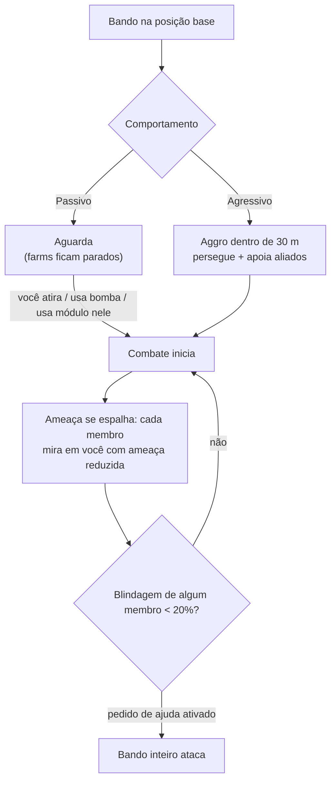

# NPCs e caça PVE

Os NPCs são a principal fonte do jogo para obter [plasma de reator](/content/ores/),
[kernels](/pt/features/research/) e módulos, além de serem uma maneira confiável de ganhar pontos
de extensão (EP) em qualquer nível. Eles existem em **bandos (flocks)**: grupos que compartilham uma
posição base, um raio de alcance, um tempo de respawn e um comportamento.

## Quem está por aí

Os NPCs pertencem a quatro raças — **Nuimqol, Pelistal, Thelodica e Industrial** —
cada uma com várias classes de robôs (runners, crawlers, mechs, heavy mechs) e
ranks de 1 a 5, que aumentam progressivamente em atributos e espólios (loot). Além dos ranks regulares:

- **Goblins** — guardas de guerra eletrônica (EWar) nas ilhas protegidas. Frágeis, mas seus
  modificadores de mira (locking) são extremos (eles travam a mira em você ~5× mais rápido que o normal,
  a uma distância ~2× maior): um acampamento de goblins torna doloroso lutar ou minerar por perto.
- **Elites** — variantes raras dos NPCs com rank, com atributos base aproximadamente
  dobrados e espólios melhores.
- **Observers** — NPCs agressivos e itinerantes (Arbalest, Baphomet, Waspish,
  Tyrannos, Artemis, Kain, Gropho, Sequer, Seth, Mesmer…). Eles patrulham grandes
  áreas da ilha e são significativamente mais difíceis que os NPCs normais da
  mesma classe — os *grand* observers nas ilhas protegidas e suas variantes de
  ilhas abertas são os caçadores comuns mais fortes que existem.
- **Chefes (Bosses)** — NPCs raros, configurados individualmente. Eles nunca fogem, podem
  anunciar sua presença para todo o servidor, e alguns estão ligados a postos avançados (derrotá-los
  altera a [estabilidade do posto avançado](/pt/features/outposts/)) ou geram relic rifts ao
  serem eliminados. Chefes mais fracos podem ser derrotados solo em ilhas protegidas; os mais fortes
  exigem um grupo dedicado.
- **Spawns do Sindicato (Syndicate)** — uma facção especial (o Sindicato, com seus próprios
  NPCs nomeados) que mantém seus próprios pontos de farm estáticos, geralmente em ilhas protegidas e
  ilhas abertas rasas.

## Passivo vs agressivo

- **Bandos passivos** nunca atacam por conta própria — você precisa atirar, lançar bombas ou
  usar um módulo ativo neles primeiro. A maioria dos farms estáticos clássicos é passiva.
- **Bandos agressivos** entram em combate por conta própria quando você se aproxima a menos de **30 m**,
  perseguem você e prestam suporte a aliados que estiverem lutando. Todos os Observers, a maioria dos
  spawns itinerantes e guardiões/invasores de postos avançados são agressivos.

Quando um combate começa, **a ameaça se espalha pelo bando**: todos os membros voltam a atenção
para você com nível de ameaça reduzido e, se a blindagem de qualquer membro cair abaixo de **20%**, o
grupo inteiro parte para cima com força total (para bandos com pedido de ajuda ativado). Considere que
você está enfrentando todo o spawn no instante em que o primeiro robô disparar.

## Spawns e respawning

- **Spawns estáticos** permanecem em uma posição base fixa com um raio de alcance determinado; os membros
  renascem **individualmente** em seu próprio cronômetro. Um bando que foi muito farmado
  renasce mais rápido; um que não foi tocado renasce mais devagar.
- **Spawns itinerantes** movem-se pela ilha — são os Observers e bandos em estilo de comboio,
  e costumam ser agressivos.
- **Reforços de áreas de mineração** — NPCs industriais operando um depósito de recursos
  possuem ondas de reforço pré-configuradas: à medida que a luta se prolonga, novas
  ondas chegam ao local. Chefes também chamam reforços ao sofrerem dano.
  Assim, um farm de "um robô só" pode se transformar em uma luta de grupo; inspecione a área antes de
  iniciar o confronto.

## O que eles dropam

Os espólios são configurados por tipo de NPC: **plasma de reator da raça da ilha**,
**kernels** (comuns, hitech, industriais e específicos de raça), componentes de módulos
e, com menor frequência, módulos empacotados. Ranks mais altos e tipos especiais dropam mais itens.

Cada eliminação também concede **pontos de extensão (EP)**, configurados por tipo de NPC — e
dobrados em ilhas abertas (tier beta).

## Vantagens dos tiers de zona

As ilhas são divididas em três tiers — protegida (alpha), PvE aberto (beta) e PvP
aberto (gamma). A caça torna-se mais perigosa, mas também mais recompensadora, à medida que você
avança para zonas mais profundas:

- **Explosões ao morrer** — em ilhas protegidas, um robô destruído *não* explode.
  Em ilhas abertas (beta e gamma), cada robô destruído — seja jogador
  ou NPC — detona e causa dano em área. Explosões em cadeia tornam o farm
  mais rápido e os pontos de emboscada (gank) mais letais.
- **EP em dobro** — a recompensa básica de EP de todas as atividades é dobrada em ilhas
  do tier beta.
- **Missões melhores** — missões de níveis mais altos estão localizadas nas ilhas abertas,
  e o EP concedido por elas também é dobrado.
- **Moedas de missão de facção** — missões nas ilhas abertas pagam com a moeda de missão daquela raça
  (moeda Nuimqol / Pelistal / Thelodica) em vez da moeda universal. As moedas de facção também podem
  ser negociadas diretamente em terminais de ilhas abertas, e a moeda universal pode ser comprada onde
  as moedas de facção não estão disponíveis.

## Dicas práticas

- **Analise o bando antes de engajar** — conte os membros, observe os ranks e
  verifique se o spawn é agressivo; um farm passivo onde você entrou inadvertidamente ainda
  pode conter até cinco robôs.
- **Ataque fora do alcance deles** — spawns estáticos não saem do seu raio de ação; posicionar-se para
  disparos limpos de longo alcance costuma ser a forma mais econômica de vencer.
- **Locais de recursos são armadilhas** — os reforços em áreas de mineração significam que quanto mais tempo
  você levar na luta, mais adversários surgirão.
- **Observers em movimento** — se você estiver explorando, buscando artefatos ou fazendo transporte de
  longa distância, um Observer agressivo no seu caminho exigirá uma luta ou um desvio de rota.

<!--
Written from scratch against the server backend, 2026-09-27:
Zones/NpcSystem/Flocks/ (Flock.cs, NormalFlock.cs — group respawns, adaptive
respawn multiplier), AI/Behaviors/ (Passive vs Aggressive; threat spread at
50%, call-for-help at 20% armor in SmartCreature.cs), AI/BodyPullThreatHelper.cs
(30 m aggro range, aggressive-only body-pull), Reinforcements/ + npcreinforcements
(mining-site and boss waves at HP thresholds), NpcSpecialType + npcbossinfo
(boss respawn noise, outpost stability links, server-wide announce),
entitydefaults (rank1-5 + dps/interceptor/scout/miniboss/elite variants, 30
elite definitions with ~2x modifiers; 13 def_npc_roaming_* observers; goblin
lancer/shark with 5x lock-time / 2x lock-range modifiers),
npcloot (26k rows: race plasma, common/hitech/industrial/race kernels,
modules), NpcEp.cs + GetNpcKillEp (EP per NPC, x2 on beta),
Unit.DoExplosion (death AoE suppressed on protected zones, active on
beta/gamma; radius from signature, damage from remaining core),
MissionLocation.cs (race-specific mission coins; universal coin on protected
zones), ZoneConfiguration (IsAlpha/IsBeta/IsGamma).
An earlier version of this page was adapted from the Open Perpetuum
community wiki (perpetuum.miraheze.org) and has been fully rewritten from
backend sources; no text was reused.
The ingested "TAP" section was dropped: no teleport-attractor concept exists
in this backend (no definition, code or table).
-->