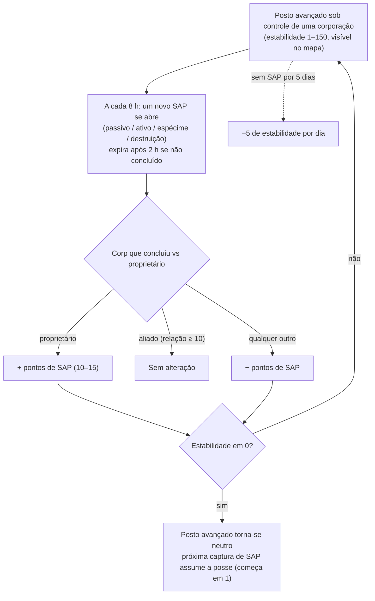

# Postos avançados & SAP

Nas ilhas de PvP aberto, **postos avançados podem pertencer a corporações de jogadores**.
O controle é medido por uma barra de **estabilidade** (0–150) exibida acima do posto avançado
na visualização do mapa. O sistema **SAP** (Service Access Point / Ponto de Acesso a Serviços) é o mecanismo pelo qual essa barra
se move — e como os postos avançados mudam de dono.

## As regras

- Quando a corporação **proprietária** conclui um SAP, a estabilidade **aumenta** pelo
  valor em pontos do SAP.
- Quando uma **corporação aliada do proprietário** (relação mútua de +10 ou superior)
  conclui um SAP, a estabilidade **não se altera**.
- Quando **qualquer outro** conclui, a estabilidade **diminui** pela mesma
  quantidade.
- Em **zero**, o posto avançado perde o proprietário e torna-se neutro. A conclusão de
  qualquer SAP em um posto neutro **captura-o** (a corporação concluinte
  torna-se a nova proprietária, começando com estabilidade 1).
- **Degradação (Decay)**: se nenhum SAP for concluído durante **5 dias**, o posto avançado começa a perder
  **5 pontos de estabilidade por dia** até que um seja concluído (ou até que o posto seja perdido).

## Os quatro tipos de SAP

A cada 8 horas, um posto avançado disponibiliza um novo SAP — de um dos quatro tipos. Cada tipo tem
seu próprio valor de pontos e seu próprio método de conclusão:

| Tipo | Como é feito | Pontos | Estilo de recompensa |
|---|---|---|---|
| **Passivo** | Fique dentro do feixe do SAP por **8 minutos**. O progresso é individual (tempo contínuo próprio de cada jogador no feixe); o jogador com maior progresso individual conquista o objetivo. | +10 | Plasma de facção (escala com a estabilidade), kits de pesquisa, aceleradores de EP. |
| **Ativo** | Mire no SAP e mantenha um **módulo de hacking de SAP** em execução — cerca de 120 ciclos de módulo (5 s cada), ou seja, ~10 minutos. O progresso persiste se você parar ou sair; é individual. | +15 | Plasma, núcleos de memória (kernels), kits de pesquisa e **núcleos de reator** (produção de robôs). |
| **Espécime** | Leve **itens de espécimes** até o SAP (dentro de 7 m) e entregue os 5–6 solicitados. Cada entrega tem uma recarga de 90 segundos; o progresso é individual. | +15 | Plasma, núcleos de memória (kernels), kits de pesquisa. |
| **Destruição** | Destrua-o com armas: **30.000 de armadura** e **150 de resistência a todos os quatro tipos de dano** (redução de 60%), **assinatura de 6 m** — armas pequenas causam melhor impacto. O progresso de dano é **corporativo, não individual**, permitindo que frotas inteiras ataquem em conjunto; a corporação com maior dano quando ele é destruído aplica o resultado. | ±15 | **Munição PvP** de facção, plasma, núcleos de memória. |

Todos os quatro SAPs **transmitem os maiores pontuadores atuais** (top 10) para todos
ao redor, e **expiram após 2 horas** se não forem concluídos.

### Negando o objetivo ao inimigo

Como o progresso da destruição é corporativo e o sinal da mudança de estabilidade
depende de quem vence, uma tática frequente é **causar dano suficiente para liderar a
pontuação, mas não o suficiente para finalizar o SAP**: se a equipe do próprio proprietário
finalizar o objetivo, *sua* corporação continuará sendo a vencedora, e a perda de estabilidade
será aplicada contra o proprietário.

## Observação e previsão

- A **carga de escâner de intrusão** em um geo-escâner, ativada perto do
  posto avançado, informa o **tempo restante até o próximo SAP** para postos no alcance
  (em ilhas de PvP aberto, a mesma carga informa o status de reforços de NPCs).
- Os SAPs emitem um aviso aos jogadores próximos pouco antes de abrirem.
- A transmissão do placar de pontuação máxima do SAP permite que você **acompanhe um SAP disputado em
  tempo real** e decida se deve intervir.

## Outras formas de variação da estabilidade

- **Relíquias de SAP** — objetos de relíquia que surgem entre 90 e 350 m do posto avançado (ressurgimento a cada
  4 horas, duram até 12 horas). Coletar uma aplica **±1 de estabilidade instantaneamente**
  (para a sua corporação), sinaliza você com PvP flag e concede EP mais um contêiner de plasma.
- **Guardiões e invasores** — chefes NPCs do posto avançado:
  - NPCs **Guardas** permanecem próximos ao posto avançado (~35 m). Abater um **sempre
    reduz** a estabilidade em 3, independentemente de quem o matou; ressurgem em ~6 horas.
  - NPCs **Invasores** patrulham até ~300 m. Abater um **aumenta** a estabilidade em
    2 para a corporação executora; ressurgem em ~6 horas.

## Por que os postos avançados são importantes

Controlar um posto avançado concede bônus à corporação (produção, instalações de
defesa, efeitos) e constitui a espinha dorsal do combate territorial em PvP aberto — veja
[PBS](/pt/features/pbs/) para conhecer as estruturas que transformam um posto avançado em uma base
operacional completa.

<!--
Written from scratch against the server backend, 2026-09-27:
Zones/Intrusion/Outpost.cs (stability 0-150, capture at 1, ally threshold
+10, EP to participants), OutpostDecay.cs (5-day grace, -5/day), SAP.cs +
PassiveHackingSAP.cs / ActiveHackingSAP.cs / SpecimenProcessingSAP.cs /
DestructionSAP.cs (8-min passive, 120x5s active, 5-6 specimen items with 90s
cooldown, corporate destruction score, 2h expiry, top-10 broadcast),
entitydefaults options (#increase=n10/n15), siegeitems (def_specimen_sap_item
2-3 x 5-6), def_sap_destruction stats (30k armor, 150 res all types, 6m
signature), def_siege_hack_module (5s cycle), intrusionsitestabilitythreshold
+ intrusionsaps, intrusionloot (plasma/kernels/research kits/cores/PvP ammo
by stability tier), npcbossinfo + npcflock (guard -3 @ ~35m, invader +2 @
~300m, 6h respawn), OutpostRelicManager.cs + SAPRelic.cs (90-350m spawn,
4h respawn, 12h lifespan, +1 stability, PvP flag), Scanner.Intrusion.cs
(next-SAP-time scan), EntitiesModule.cs (8h SAP interval).
An earlier version of this page was adapted from the Open Perpetuum
community wiki (perpetuum.miraheze.org) and has been fully rewritten from
backend sources; no text was reused.
Note: the ingested text had several numbers this server contradicts (3-day
decay vs 5-day, 10-min passive vs 8-min, "no resistances" vs 150 all types,
3 km invader range vs 300 m).
-->
