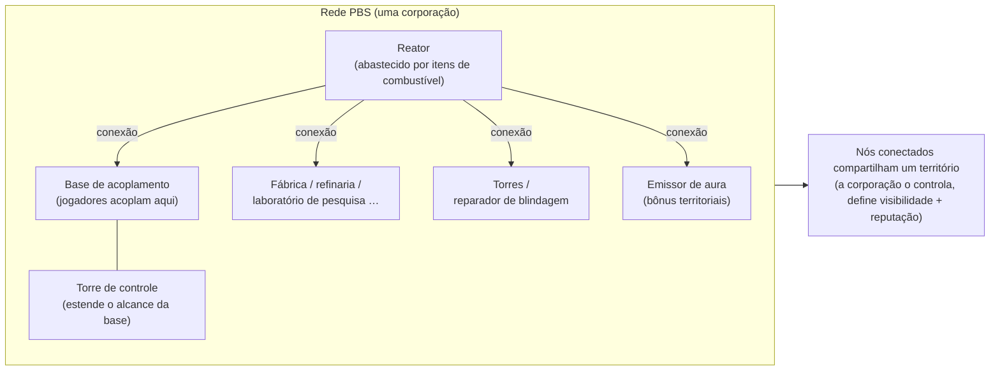
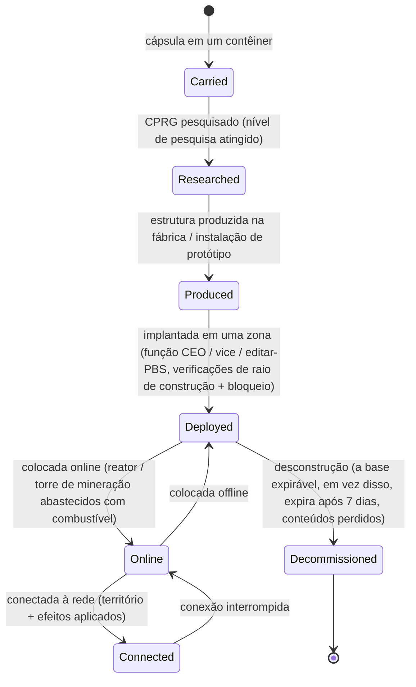

# Estações base de energia (PBS)

Uma **PBS** (Power Base Station - Estação Base de Energia) é uma estrutura posicionável em uma zona. Objetos PBS podem ser
**conectados** em uma **rede**, o que define **territórios** e ativa **efeitos**.
Esta é uma atividade corporativa/estrutural — a maioria das ações requer a função corporativa
correta.

> As localizações na interface seguem a [visão geral da UI do cliente](/pt/features/ui/). O nome dentro do cliente para "PBS" deve
> ser confirmado. A mecânica abaixo foi confirmada em relação ao servidor.

## O que uma PBS faz

- É um **nó** em uma **rede** PBS.
- Nós conectados formam um **território** compartilhado controlado pela corporação proprietária.
- Uma rede pode projetar **efeitos** (bônus/controles) sobre o seu território.
- Algumas estruturas PBS podem ser **abastecidas** com itens (combustível) para operar.

## Famílias de estruturas

Cada estrutura PBS está disponível em níveis **pequeno / médio / grande** (small / medium / large). Você carrega a
**cápsula**, pesquisa o item (CPRG) e faz a **implantação** do objeto — a implantação é
restrita por privilégios (veja abaixo). As famílias:

| Família | Estruturas | Função |
|---|---|---|
| Energia | reator, poço de energia, bateria central, transmissor central | gerar, armazenar e distribuir a **energia central (core energy)** que alimenta tudo |
| Acoplamento | base de acoplamento, base de acoplamento expirável, torre de controle | onde os jogadores acoplam; a torre de controle estende o alcance da base |
| Produção | fábrica, refinaria, reprocessador, reparo, prototipador, laboratório de pesquisa, forja de calibração (CPRG), forja de kits de pesquisa, aprimoramento de produção | as instalações de [produção](/pt/features/production/), na zona em vez de em uma base inicial |
| Defesa | torres (laser / canhão eletromagnético / mísseis / guerra eletrônica), reparador de blindagem | defesa automatizada do território |
| Efeitos | emissor de aura, fornecedor de efeito, torre de camuflagem, torre de mineração | projetam os bônus de efeito do território; a torre de mineração extrai minério automaticamente |
| Transporte | nó de autoestrada | conecta-se à **autoestrada (highway)** da zona (linhas de viagem rápida) |
| Construção | módulo de construção | o construtor que posiciona as outras estruturas |

### Efeitos do emissor de aura

O emissor de aura é o principal bônus territorial. Cada nível projeta um de três
**bônus base escalonados por nível**:

- **pequeno (small)** — sensores nv1 / engenharia nv1 / indústria nv1
- **médio (medium)** — os mesmos três no nv2
- **grande (large)** — os mesmos três no nv3

Sensores aumentam o alcance de escaneamento/reconhecimento, engenharia acelera a construção e indústria acelera
a produção.

### A base de acoplamento expirável

Uma base PBS especial com um **tempo de vida fixo de 7 dias** (168 h no conteúdo). Ela **não pode
ser desconstruída** — ela **expira ou é destruída**. O tempo de vida restante é
anunciado por um comunicador no jogo (tópico do canal da base, correio e MOTD); quando ele se
esgota, a base é destruída e seus conteúdos são perdidos. Este é o modelo de "aluguel" para acoplamento
PBS: você não paga aluguel, você recebe um limite de tempo.

## Implantação

- **Verificar implantação (Check deployment)** — antes de posicionar, verifique se uma PBS pode ser implantada em uma posição
  (verificações de inclinação, bloqueio e privilégios). Isso requer uma função corporativa
  (**CEO / vice / editar-PBS**).
- A implantação utiliza o **raio de construção** e o **raio de bloqueio** da estrutura.

## Rede e conexões

- **Obter rede (Get network)** — visualize a rede PBS da qual você faz parte.
- **Informações do nó (Node info)** — detalhes de um nó PBS.
- **Renomear um nó (Rename a node)**.
- **Fazer uma conexão (Make a connection)** — conecte dois nós PBS. (Conectar a uma rede que já possui
  uma base de acoplamento aciona um caso específico de transferência de propriedade.)
- **Desfazer uma conexão (Break a connection)** — desconecte dois nós.
- **Definir peso da conexão (Set connection weight)** — ajuste a força/prioridade de uma conexão.

## Controle e estado

- **Definir online (Set online)** — coloque um nó online/offline.
- **Definir um efeito (Set an effect)** — configure o efeito que um nó projeta.
- **Definir desconstrução da base (Set base deconstruction)** — marque uma base para desconstrução.

## Território

- **Obter territórios (Get territories)** — liste os territórios que sua rede controla.
- **Definir visibilidade do território (Set territory visibility)** — controle se o território é visível para outros.
- **Definir limite de reputação (Set standing limit)** — restrinja o acesso por reputação (standing).
- **Definir deslocamento de reforço (Set reinforce offset)** — ajuste o comportamento de reforço.

## Abastecimento

- **Informações de abastecimento (Feedable info)** — o que uma PBS precisa e seu estado de abastecimento atual.
- **Abastecer itens (Feed items)** — envie itens para energizar/operar a PBS.

As estruturas que podem ser abastecidas são o **reator** e a **torre de mineração**. O abastecimento converte
itens com um valor de energia (as `corecalories` por unidade) no buffer de energia central do nó,
até o seu valor máximo — qualquer jogador dentro do alcance pode abastecer um nó. O que você pode queimar:

| Combustível | Energia central (Core) por unidade |
|---|---|
| Acelerador de reator classe C | 8.000.000 |
| Acelerador de reator classe B | 4.000.000 |
| Acelerador de reator classe A | 2.000.000 |
| Espécime SAP (intrusão) | 600.000 (variante de fluxo: 28.000) |
| Bloco de energia gama | 2.000 |
| Munição de acelerador central | 1.000 |
| Minério bruto (espitium) | 400 |
| Minério bruto (vitricyl / prilumium / chollonin) | 300 |
| Minério bruto (axicol) | 40 |

Aceleradores são o combustível eficiente; minério bruto é a alternativa de baixo custo.

## Reembolso

- **Obter / definir informações de reembolso (Get / set reimburse info)** — configure o reembolso para custos relacionados à PBS.

## Registros (Logs)

- **Registros de PBS (PBS logs)** — revise as atividades da PBS (conexões, implantações, etc.).

## Notas práticas

- **Esta é uma atividade de oficiais** — a implantação e a maioria dos controles necessitam de uma função corporativa.
- **Conexões definem o território** — a rede que você constrói é o que você controla.
- **Verifique a implantação primeiro** — isso informa por que um posicionamento falharia (inclinação, bloqueio,
  privilégios) antes de você confirmar a ação.
- **O abastecimento mantém tudo funcionando** — reatores e torres de mineração queimam itens de combustível (aceleradores
  ou minério bruto) para sustentar seu buffer de energia central.
- **A base expirável é o seu limite de tempo** — 7 dias, sem desconstrução; planeje-se para a destruição.
- **Visibilidade de território e reputação** permitem abrir ou fechar sua zona para outros jogadores.

## Torres de defesa

Não são controláveis por jogadores — são implantadas como estruturas de defesa da PBS. As torres são montadas a partir
de peças como qualquer outro robô, mas ficam fixadas a uma plataforma PBS e não podem ser pilotadas.

| Torre | Função |
|---|---|
| Torre PBS | Defesa genérica de PBS |
| Torre de GE PBS | Guerra eletrônica (interrupção de escudo/blindagem) |
| Torre Laser PBS | Defesa com armas de feixe |
| Torre de Mísseis PBS | Defesa com mísseis |
| Torre Rail PBS | Defesa com projéteis (eletromagnéticos) |
| Torre de guarda policial | Defesa policial NPC da zona |

Consulte a [referência de robôs](/content/robots/) para obter detalhes em nível de peças.

<!-- TODO: only the in-client name for PBS and the UI remain (structure list, network
     editor, feeding screen).
     Confirmed: 416 def_pbs_* definitions, S/M/L tiers with capsule/cprg/pr/object
     variants; aura emitter #effect=N93..101 = pbs sensors/engineering/industry lvl1-3
     (EffectType enum); feedable = reactor + mining tower (IPBSFeedable), fuel =
     definitionconfig.corecalories (boosters A/B/C 2/4/8M, SAP 600k/28k, gamma block
     2k, ore espitium 400 / vitricyl+prilumium+chollonin 300 / axicol 40);
     ExpiringPBSDockingBase: lifetime 168 h from definitionconfig.lifetime, no
     deconstruction, announcer channel topic + mail, kill on expiry. -->
     Developer notes: Zone/PBS/PBSCheckDeployment.cs (construction/blocking radius,
     CEO/deputy/editPBS role), PBSMakeConnection.cs / PBSBreakConnection.cs,
     PBSSetConnectionWeight.cs, PBSSetOnline.cs, PBSSetEffect.cs, PBSSetBaseDeconstruct.cs,
     PBSGetNetwork.cs, PBSNodeInfo.cs, PBSRenameNode.cs, PBSGetTerritories.cs,
     PBSSetTerritoryVisibility.cs, PBSSetStandingLimit.cs, PBSSetReinforceOffset.cs,
     PBSFeedableInfo.cs / PBSFeedItemsHander.cs, PBSGetReimburseInfo.cs /
     PBSSetReimburseInfo.cs, PbsGetLog.cs; Zones/PBS/* (IPBSObject, ConnectionHandler). -->