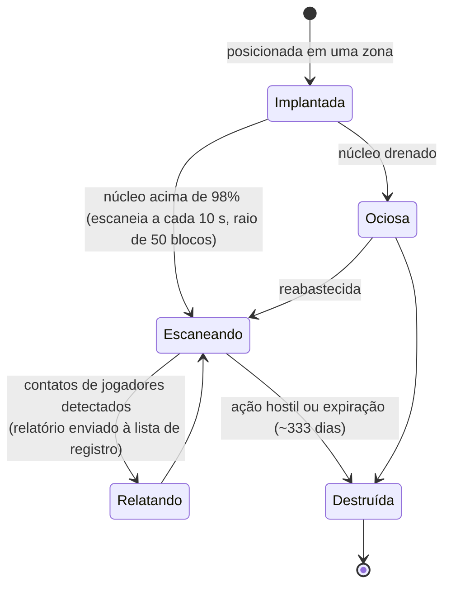

# Sondas de proximidade

As sondas dividem-se em duas famílias:

- **Sondas de visibilidade (proximidade)** — pequenos dispositivos implantados em uma zona para **vigiar uma
  área**. Enquanto abastecidas por energia de núcleo, elas escaneiam em busca de unidades de jogadores ao redor e enviam
  relatórios aos personagens registrados. É uma ferramenta de vigilância e reconhecimento.
- **Sondas de mineração** — um **módulo** instalado no seu robô (com níveis que vão de *básico/noob* até
  *padrão*, *industrial*, *especial/named*, *elite* e *artefato*) além de **munição de sonda por minério**
  (variantes de bloco, direção e área para cada minério). Dispará-la produz um resultado de escaneamento para aquele
  minério na área, armazenado por personagem (veja
  [coleta → escaneamento](/pt/features/gathering/)).

> Os locais da interface seguem a [visão geral da interface do cliente](/pt/features/ui/). As mecânicas abaixo são confirmadas pelo servidor.

## Gerenciando suas sondas

- **Listar** suas sondas — veja as sondas que você possui.
- **Informações de registro** — o estado e os dados de registro de uma sonda.
- **Definir registro** — vincule personagens à lista de relatórios da sonda.
- **Definir um nome** — atribua um rótulo identificador a uma sonda.
- **Remover** o registro de uma sonda (em uma zona) — encerra o monitoramento / limpa o registro.

### Como funciona uma sonda de visibilidade

- Ela é **alimentada pelo núcleo**: só escaneia enquanto seu núcleo estiver praticamente cheio (acima de 98% do
  `core_max`); uma sonda descarregada permanece inativa.
- Enquanto estiver ativa, ela escaneia **a cada 10 segundos** em busca de robôs de jogadores dentro de seu **raio
  de detecção (50 blocos)** e envia um relatório (ID de personagem de cada contato e sua posição) para
  todos na lista de registro.
- O **registro** é uma atividade corporativa: você só pode registrar **membros da sua
  própria corporação**, e o **CEO e o Vice-CEO estão sempre na lista** automaticamente.
  A lista possui um tamanho máximo.
- **Tempo de vida útil**: uma sonda implantada expira após seu tempo de desaparecimento definido no conteúdo
  (`despawn_time`, configurado em ~333 dias para a sonda de visibilidade) ou até ser destruída.

## Eventos de ciclo de vida

O servidor notifica eventos de ciclo de vida das sondas conforme eles ocorrem:
- **criada**, **atualizada**, **destruída** — uma sonda é implantada, envia relatórios ou é eliminada.

Essas informações chegam como notificações automáticas (push); você reage a elas sem precisar consultá-las manualmente.

## Notas práticas

- **Registre antes de ler** — uma sonda só envia relatórios para os personagens nela registrados.
- **Sondas podem ser destruídas** — ações inimigas ou expiração podem eliminar uma sonda; fique atento aos eventos de ciclo de vida.
- **Nomeie suas sondas** — com várias sondas em campo, rótulos claros facilitam a organização.
- **Reconhecimento, não combate** — sondas coletam informações de inteligência; elas não lutam.

<!-- TODO: only the UI remains (probe list, registration picker).
     Confirmed: visibility probe (def_visibility_probe): core_max 50, active only at
     core>98%, 10 s scan interval (ProximityDevice.cs _probingInterval), detection via
     blob_emission 10 / blob_emission_radius 50, report = characterID + x/y per contact
     pushed to registered characters (ProximityProbe.OnUnitsFound); registration =
     own-corp members only, CEO+Deputy always included, max count
     (ProximityProbeRegisterSet.cs); despawn_time 28,800,000 s (~333 d) on the capsule;
     stealth_strength 275 / detection_strength 45. Mining probes: tiered modules
     (noob/standard/industrial1-2/named1-3/elite t2-t4/artifact) + per-ore tile/
     direction/area ammo (79 def_*probe* definitions).
     Developer notes: ProximityProbeList.cs / ProximityProbeGetRegistrationInfo.cs /
     ProximityProbeRegisterSet.cs / ProximityProbeSetName.cs; Zone/ProximityProbeRemove.cs;
     Zones/ProximityProbes/ProximityProbe.cs + ProximityProbeDeployer.cs +
     ProximityDevice.cs; Zones/Blobs/* (blob emission/stealth); lifecycle events via
     ProximityProbeCreated/Update/Dead/Info commands. -->
