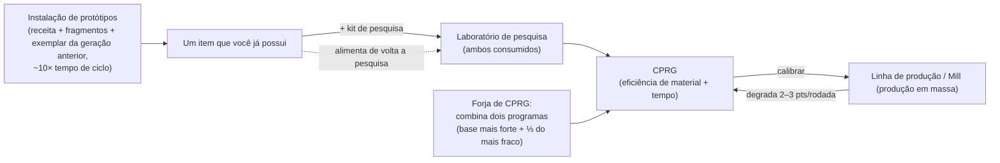

# Produção

A produção é a forma pela qual você transforma recursos brutos e componentes em itens utilizáveis.
Ela ocorre em uma **instalação de produção** (uma fábrica ou "mill") na base onde você está atracado.
Tudo aqui ocorre **apenas atracado**.

> As localizações na interface seguem a [visão geral da interface do cliente](/pt/features/ui/) (as categorias
> **Refinaria / Reciclagem / Reparo / Seguro** na barra superior). As mecânicas abaixo foram confirmadas
> com o servidor.

## Linhas de produção

Uma **linha de produção** é uma receita salva: ela define o que você produz e a partir de quê. A lista
completa de componentes para cada item fabricável (com níveis de pesquisa) é gerada em
[Receitas](/content/recipes/). Você executa uma linha por um determinado número de **rodadas (rounds)**.

- **Listar linhas** — veja as linhas disponíveis.
- **Iniciar uma linha** — execute-a em uma instalação pelo número escolhido de rodadas (mínimo 1).
  - Você pode pagar a partir da sua **carteira pessoal** ou da **carteira da corporação**.
  - Os componentes de origem podem ser buscados no seu **inventário** ou nos seus **robôs**.
- **Calibrar uma linha** — ajuste as configurações de eficiência de uma linha.
- **Definir rodadas** — escolha quantas rodadas produzir.
- **Consultar próxima rodada** — pré-visualize o que a próxima rodada consumirá e produzirá.
- **Cancelar** — interrompa uma produção em andamento.
- **Excluir uma linha** — remova uma linha salva.

Executar uma linha consome componentes (e créditos) e produz o item final ao longo das rodadas.

## Operações avulsas

Estas são ações individuais em vez de linhas com múltiplas rodadas. Cada uma possui uma variante de
**Consulta (Query)** que pré-visualiza custo e rendimento antes de confirmar.

- **Refinar** — matérias-primas → mercadoria refinada, usando a receita do item (consulte [Receitas](/content/recipes/)).
  Você escolhe quantas unidades do item final produzir; os insumos nominais da receita são multiplicados
  por um fator de material de `1 + 50/(bônus + 100)`, onde *bônus* é sua perícia de refino
  (extensões + pontos da instalação + pontos de reputação). Sem bônus, você consome **150%** da receita
  nominal; com bônus máximo, esse valor se aproxima de **100%**.
- **Reciclar / reprocessar** — quebra um item de volta nos componentes de sua receita (a receita reversa).
  O rendimento é `nominal × (1 − 75/(bônus + 100)) × razão de integridade do item` — sem bônus de perícia,
  a base é de **25%**, aproximando-se de 100% com perícia máxima; **um item danificado rende proporcionalmente
  menos** (repare-o antes caso seja valioso). Apenas lotes inteiros (quantidades padrão completas) são reciclados;
  a sobra permanece. Itens de missão são excluídos, não reciclados.
- **Reparar** — restaura a integridade total de um item/robô danificado. O custo é
  `(porcentagem de integridade faltante) × valor material do item × 75/(bônus + 100)`. O "valor material"
  é calculado recursivamente: a receita do item é decomposta até matérias-primas e cotada pelas **médias de mercado
  globais**, logo o custo de reparo oscila com o mercado. O multiplicador de perícia começa em **75%** sem bônus
  e tende a 0 com bônus máximo.
- **Componentes de pesquisa** — produz componentes de pesquisa (consultar + executar).

## O ciclo de vida do item (o processo circular)

A criação de itens é um ciclo formado por três instalações interligadas:

1. **Pesquisa (engenharia reversa)** — insira no laboratório de pesquisa um exemplar do item que deseja
   produzir, acompanhado de um **kit de pesquisa** cujo nível atenda ao nível de pesquisa do item
   (os kits vão dos níveis 0 a 10). Ambos os insumos são **consumidos**, e a operação gera um **CPRG**
   para esse item. As eficiências do programa resultante partem da base de cada item (a maioria dos itens 50,
   munições mais alta, torres até 90) e são aumentadas por *nível do kit acima do nível exigido × 5*
   mais o seu bônus de perícia de pesquisa (até +50 adicionais). Portanto, um kit alguns níveis acima do
   item — somado a extensões de produção razoáveis — é o que transforma um programa básico 50/50 em um programa
   competitivo. É assim que novos itens entram no seu repertório de produção.
2. **A fábrica / mill (produção em massa)** — produza em massa a partir do programa. Cada rodada
   **degrada** as eficiências da linha (2 a 3 pontos por rodada, por categoria de item; veja
   [CPRG](#cprg-programas-de-calibracao)) — quando o desperdício fica elevado, calibre um novo programa
   na linha. Itens protótipos também consomem um **exemplar da geração anterior** como componente
   (um módulo padrão para fabricar um protótipo T2, um T2 para fabricar um T3), que é consumido no processo.
3. **A instalação de protótipos** — produza um **protótipo** de um item diretamente: os materiais da
   receita mais fragmentos de robô (shards) *e* o exemplar da geração anterior, levando cerca de
   **10× o tempo de ciclo da fábrica** (além do multiplicador de tempo usual). Você só pode criar protótipos
   de itens desbloqueados na sua árvore tecnológica. Protótipos custam muito mais caro que seus equivalentes
   padrão; sua finalidade principal é serem **pesquisados para gerar programas de alta qualidade** (pesquisar um
   item protótipo é o que desbloqueia a patente seguinte) — ou serem usados no robô quando o item for raro demais
   para ser obtido por pilhagem e caro demais no mercado.

## Progressão de patentes

A maioria dos módulos e robôs divide-se em **patentes T1 → T4** (o emblema de patente no cliente; as linhas de
definição `standard → named1 → named2 → named3`, seguidas pelas linhas especiais `elitet4`/`artifact`).
As regras:

- **Cada patente é um item separado com seu próprio nó na árvore tecnológica.** Desbloquear um
  nó custa pontos de pesquisa (pesquisados a partir de kernels) e exige o **nó pai** — portanto as
  patentes devem ser desbloqueadas em ordem. Você só pode criar **protótipos** (ou produzir em massa) de um
  item cujo nó já esteja desbloqueado: não há como fabricar uma patente superior sem a pesquisa.
- **Cada patente superior consome um exemplar da patente anterior** como componente (além de materiais
  e fragmentos de robô). Um item T1, portanto, nunca pode ser "trocado diretamente" por um T3 — o protótipo
  T3 exige um item **T2**, e esse exemplar é **consumido**, não convertido: o resultado é um item totalmente novo.
- A página de cada item exibe sua **linha de patentes** — toda a cadeia `T1 → T2 → T3 → T4` como links —,
  e as [páginas de nós da árvore tecnológica](/content/techtree/) mostram o nó pai/seguinte de cada patente e
  os preços em pontos.

Exemplo, a linha do módulo minerador pequeno: [pequeno módulo minerador padrão (T1)](/content/items/standard-small-driller/) →
[pequeno módulo minerador Biroter 5050 (T2)](/content/items/named1-small-driller/) →
[pequeno módulo minerador Sublimator Low-D (T3)](/content/items/named2-small-driller/) →
[pequeno módulo minerador Scraper-990 (T4)](/content/items/named3-small-driller/) —
e o mesmo padrão aplica-se a todas as famílias de módulos e robôs.

## Protótipos & kits de pesquisa

- **Protótipo** — fabrica um item protótipo (iniciar + consultar). Um protótipo por vaga;
  mais vagas paralelas de prototipagem são obtidas por meio de extensões de produção.
- **Fundir kits de pesquisa** — combina múltiplos kits de pesquisa em um kit de nível superior
  (executar + consultar). Um kit superior tanto reduz o tempo de pesquisa quanto aumenta as eficiências
  do programa gerado.

## CPRG (programas de calibração)

Um **CPRG** (programa de calibração) é o que alimenta uma linha de produção — um programa específico por item
com pontos de **eficiência de material** e **eficiência de tempo** (0 a 100 cada). Você obtém um ao
**pesquisar o item** em um laboratório de pesquisa (o nível de pesquisa limita quais itens você consegue produzir),
ou ativando uma **cápsula de calibração**.

- Um CPRG recém-pesquisado começa com **50/50** pontos.
- **Forjar CPRGs** na forja de programas de calibração: combina dois CPRGs do mesmo item; o resultado
  mantém os pontos do programa mais forte como base e adiciona um terço dos pontos do mais fraco. Forjar leva
  tempo e custa créditos (tempo × preço por segundo da instalação).
- **Calibrar uma linha** com um CPRG para definir suas eficiências. Cada rodada de produção **degrada**
  a eficiência da linha (um valor de descalibração por item), logo as linhas perdem rendimento com o tempo —
  recalibre antes de execuções longas.

As eficiências alimentam as fórmulas da fábrica (por ciclo de produção):

- **Materiais consumidos** = receita × `1 + 50/(pontos de material + perícia + 100 + bônusDaFábrica)`
  — um novo CPRG de 50 pontos sem perícia e sem bônus de produção em massa da árvore tecnológica consome
  ≈ **133%** da receita nominal.
- **Tempo de produção** = tempo base da instalação (3.600 s por ciclo na fábrica) ×
  `1 + 100/(pontos de tempo + perícia + 100)` × modificador de duração do item — um novo CPRG sem
  perícia leva ≈ **1 hora e 40 minutos** por item.
- **Preço** = tempo de produção × preço por segundo da instalação (7 créditos/s para a fábrica PBS,
  3 para laboratórios de pesquisa PBS grandes/médios) × modificador de preço do item (1–10).
- CPRGs relacionados a missões são gratuitos e fixados em 10 segundos.

## Seguro

A instalação de seguros cobre **seus robôs**, não o que é produzido na fábrica:

- **Contratar** uma apólice para um robô (ele deve estar sem danos, desempacotado e não ser um robô inicial),
  **listar** suas apólices, **consultar** uma apólice, **cancelar** uma apólice.
- A cobertura dura **15 dias** (+ bônus de dias por extensão); você pode manter apólices para
  1 + (bônus por extensão) robôs.
- Cada robô tem uma **taxa** e um **pagamento (indenização)** definidos no conteúdo (tabela `insuranceprices`,
  67 definições de robôs); a taxa é reduzida pelo bônus da extensão de desconto e pode ser paga a partir
  da carteira da corporação.
- Se o robô segurado for destruído, a **indenização é paga em créditos** (o robô ainda é perdido) — consulte
  [combate](/pt/features/combat/).

## Instalações & status

- **Informações / descrição da instalação** — o que uma instalação de produção oferece.
- **Em andamento (meu / corporação)** — o que está sendo produzido no momento.
- **Histórico de produção** — suas produções passadas.
- **Lista de componentes** — componentes de produção disponíveis.
- **Status do servidor** — estado do servidor de produção.

## Notas práticas

- **Você deve estar atracado em uma base com instalação de produção.**
- **Consulte antes de executar** — as variantes de consulta exibem custo e rendimento para você não queimar
  componentes por engano.
- **Carteira da corporação** — você pode gastar fundos corporativos para produção se tiver permissão.
- **Componentes também podem vir de robôs** — uma linha pode puxar componentes de robôs equipados, não apenas
  do seu inventário.
- **Recicle com integridade total** — itens danificados rendem menos; repare itens valiosos antes de reprocessá-los.
- **Multiplicadores de perícia são as verdadeiras alavancas econômicas** — os bônus de refino/reciclagem/reparo/fábrica
  escalam da mesma forma; investir em extensões de produção traz retorno direto na economia de materiais em cada rodada.
- **O seguro é uma rede de segurança para robôs** — contrate-o para montagens caras antes de ir para o PvP em espaço profundo.
- **Kits de pesquisa são a porta de entrada** — o nível de pesquisa de um item (1 a 9) decide quais kits conseguem
  decodificá-lo, e usar um kit vários níveis acima do item é a forma mais barata de elevar as eficiências do programa gerado.

<!--
Developer notes: rewritten 2026 from backend sources; no community-wiki text reused.
Verified against:
- refine = 1 output per unit, input = nominal x (1+50/(bonus+100)) (Refinery.cs);
- recycle = reverse recipe x (1-75/(bonus+100)) x healthRatio, whole batches only,
  mission items deleted (ReprocessSessionMember.cs);
- repair price = (1-healthRatio) x PriceCalculator world-market value x
  75/(bonus+100) (Repair.cs + PriceCalculator.cs);
- ResearchLab.cs (StartResearch/EndResearch: source item + research kit both
  consumed; kit level must be >= itemresearchlevels.researchlevel (1-9);
  efficiency = per-item base + levelDifference*5 + (1-100/(100+skill))*50);
- itemresearchlevels (1101 rows, levels 1-9), research kits def_research_kit_0..10
  (#level option), RandomResearchKit (mission kits, fake 100/100);
- calibrationdefaults (per-CPRG base efficiencies 50-90; default fallback 50/50;
  CalibrationProgram.OnInsertToDb sets 50/50);
- PBSFacilities.cs CalculateResultingPoints (forge = better base + weak/3 +
  (1-100/(100+skill))*25);
- productiondecalibration (2-3 points decrease per round per category,
  distorsion 0.5-1%);
- Prototyper.cs (StartPrototype: components include previous-gen specimen via the
  components table — e.g. T2 NEXUS consumes 1x standard module, T3 consumes 1x T2;
  time = 10x cycle x multiplier; tech-tree unlock check in
  ProductionPrototypeStart.cs);
- prototypes table (339 rows, standard->prototype mapping);
- Mill.cs (CalculateFinalMaterialMultiplier 1+50/(pts+skill+100+millBonus) with
  tech-tree mass-production bonus; CalculateFinalTimeMultiplier;
  productionduration table);
- Insurance: InsuraceFacility.cs (15d + time-extension bonus, 1+slot-extension
  policies, noob bot excluded, must be single+unpacked), InsuranceDescription.cs
  (payout in credits via central bank), insuranceprices (67 robot definitions,
  payout = 80x fee except noob/arkhe2 at 4x).
- Facility options (entitydefaults): def_pbs_facility_mill #perSecondPrice=7
  #productionTime=3600; refinery #materialEfficiency=0.95;
  calibration_program_forge #perSecondPrice=7; def_production_public_factory
  #materialEfficiency=0.6 #manufactureTime=3600 #perSecondPrice=3.
Developer files: Production/ProductionLineStart.cs (PrepareProductionForPublicContainer,
LineStartInMill, corp wallet, search-in-robots, rounds); Production/ProductionLine*.cs;
Production/ProductionRefine*.cs, ProductionReprocess*.cs, ProductionRepair*.cs,
ProductionResearch*.cs (query+run pairs); Production/ProductionPrototype*.cs,
ProductionMergeResearchKitsMulti*.cs; Production/ProductionCPRG*.cs,
ProductionGetCPRGFromLine*.cs; Production/ProductionInsurance*.cs;
Production/ProductionFacility*.cs, ProductionInProgress*.cs, ProductionHistory.cs;
Services/ProductionEngine/Facilities/*.cs; Services/ProductionEngine/PBSFacilities.cs;
Services/ProductionEngine/ResearchKits/*.cs; Services/ProductionEngine/CalibrationPrograms/*;
Services/Insurance/InsuranceHelper.cs; Items/PriceCalculator.cs.
Corrections vs ingested page: no "decoder" item exists (research kits are the
level-gated inputs); the "researched to 100%" claim is wrong (tech-tree unlock is
the gate; research levels run 1-9); prototype time is 10x the mill cycle; specimen
consumption verified from the components table; insurance payout is 80x the fee.
-->
