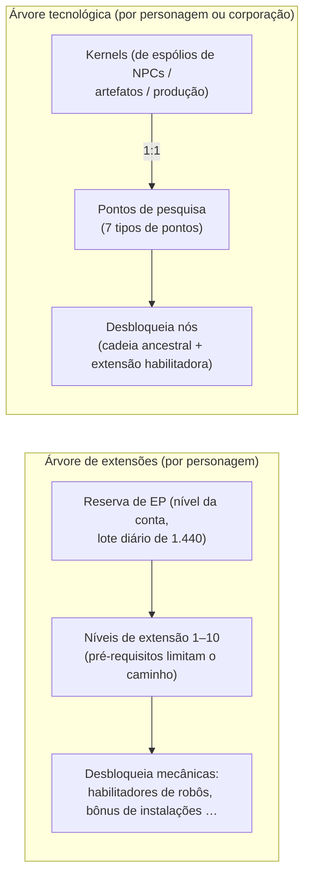

# Pesquisa

Existem **dois sistemas de progressão separados**. Ambos funcionam apenas enquanto você está atracado.

> As localizações na interface seguem a [visão geral da interface do cliente](/pt/features/ui/) (Janela de personagem
> → extensões; a árvore tecnológica possui sua própria janela). As mecânicas abaixo foram confirmadas com o servidor.

## A árvore de extensões (habilidades do personagem)

Extensões são níveis de habilidade individuais do personagem que desbloqueiam mecânicas de jogo —
principalmente as **extensões habilitadoras** que permitem pilotar uma classe de robô (obrigatórias para
desatracar e selecionar um robô; consulte [movimento](/pt/features/movement/) e [robôs](/pt/features/robots/)).

### Como funciona o aprendizado

- Você deve estar **atracado** para aprender.
- Cada extensão pode ser elevada até os **níveis 1 a 10** (o nível 10 é o limite máximo).
- O **nível 1 custa créditos** (o `price` da extensão), gastos da sua carteira.
- **Todos os níveis custam Pontos de Extensão (EP)** de acordo com uma tabela fixa de patente × nível —
  para os níveis 1–5 o custo é `60 × patente × nível`; os níveis 6–10 sobem para
  `patente × (1440, 2520, 3840, 5400, 12000)`. Os dez níveis de uma extensão de patente 1 custam
  60 → 6.000 EP, totalizando 13.500 EP; uma de patente 10 custa dez vezes mais em cada nível.
- **Pré-requisitos** já devem estar aprendidos antes que você possa adquirir uma extensão
  (a lista de "prerequire").
- O EP é uma **reserva no nível da conta**: é compartilhado entre todos os seus personagens e acumulado
  ao longo do tempo (consulte "Fontes de EP" abaixo).

### Gerenciando extensões

- **Lista de categorias / obter tudo / lista de aprendidas / lista de pré-requisitos** — navegue pela árvore e pelo
  que você já possui.
- **Pontos disponíveis** — veja sua reserva atual de EP.
- **Remover um nível** — reduz um único nível de uma extensão.
- **Redefinir extensões do personagem** — redefine toda a árvore de um personagem.
- **Liberar EP bloqueado** — libera o EP que ficou retido (por exemplo, após remover níveis).
- **Comprar acelerador de EP (EP boost)** — um acelerador pago que eleva o ganho de EP.
- **Registro diário de EP por atividade** — visualize quanto EP você ganhou por jogar.

### Fontes de EP

O EP não é uma moeda negociável comprada diretamente — ele é acumulado em um **lote diário**:

- Cada conta recebe **1.440 EP por dia** (concedido uma vez ao dia, entre 08:00 e
  11:00 no horário do servidor, pelo procedimento `extensionPointsAdd`). O código também define um lote
  dobrado de **2.880 EP** para contas com assinatura paga, mas o procedimento atual paga o lote base para todas as contas.
- **Aceleradores pagos** (compras de bônus de EP) somam-se a esse valor.
- Seu **EP disponível** = todos os lotes diários recebidos − penalidades − EP gasto no jogo.
  (O registro de EP por atividade detalha os ganhos diários.)

**Catálogo completo** — todas as extensões (patente, preço de nível 1, bônus, pré-requisitos) estão em
[Extensões](/content/extensions/), e cada nó da árvore tecnológica (item desbloqueado, extensão habilitadora,
preços em pontos) está em [Árvore tecnológica](/content/techtree/).

## A árvore tecnológica (desbloqueios)

A árvore tecnológica é um grafo de **nós** que você desbloqueia gastando **pontos de pesquisa**. Diferente
do EP (reserva da conta), os pontos da árvore tecnológica são **obtidos consumindo "kernels"** — itens que você
pesquisa e depois envia.

### Como funciona

- **Pesquisar kernels** — envie itens de kernel a partir de um contêiner. Cada kernel é convertido
  **1:1** em pontos de pesquisa de um determinado **tipo de ponto**; os kernels são consumidos.
  Existem sete tipos de kernels, um para cada tipo de ponto: Theodica, Pelistal, Nüimqol,
  Industrial, Common, HiTech e NewTech.
- **Desbloquear um nó** — gaste os pontos de pesquisa necessários. Um nó só pode ser desbloqueado se:
  - todos os seus **nós pais** já estiverem desbloqueados, e
  - você possuir a **extensão habilitadora** do nó aprendida no seu personagem.
- **Desbloqueios de corporação** — com o cargo corporativo adequado, um nó pode ser desbloqueado
  **para a corporação** (compartilhado). Desbloqueios corporativos custam mais (aplica-se um multiplicador
  de preço corporativo) e são pagos com os pontos da corporação.
- **Doar** — doe pontos de pesquisa (por exemplo, para a sua corporação).
- **Informações / registros** — veja detalhes do nó e seu histórico de desbloqueios e pesquisas.

### Por que isso importa

Nós desbloqueados na árvore tecnológica controlam o acesso a conteúdos e mecânicas de patentes superiores.
Verifique os pré-requisitos de um nó (cadeia ancestral + extensão habilitadora) antes de gastar pontos.

## Notas práticas

- **Extensões habilitadoras liberam robôs** — você não pode pilotar uma classe de robô que não tenha
  pesquisado (essa é a mesma verificação que impede desatracar/selecionar).
- **O nível 1 é o único custo em créditos** na árvore de extensões; acima dele, tudo custa EP.
- **A árvore tecnológica é irreversível** — pontos gastos em um desbloqueio não voltam; planeje seu caminho.
- **Tecnologia corporativa é esforço em equipe** — utiliza pontos compartilhados e possui multiplicador de preço.

<!-- TODO: only the research UI remains (window layout, point display).
     Confirmed: EP earn = 1440/day flat via dbo.extensionPointsAdd (08:00-11:00 window,
     once per day; 2880 bonus constant exists in GiveExtensionPointsService for paid
     subscriptions but the current SP pays base to all); available = batches -
     penalties - spent (extensionPointsAvailable fn); EP cost table in
     Services/ExtensionService/ExtensionPoints.cs (60*rank*level for levels 1-5, then
     rank*(1440,2520,3840,5400,12000)); kernels convert 1:1 (TechTreeResearch.cs), 7
     kernel definitions -> point types n1..n7 (Theodica/Pelistal/Nuimqol/Industrial/
     Common/HiTech/NewTech).
     Developer notes: Extensions/ExtensionBuyForPoints.cs (docked, prereq, level cap 10,
     level-1 credit price, EP by rank/level, account pool, training-char free);
     Extensions/ExtensionGetAvailablePoints.cs; Extensions/ExtensionBuyEpBoost.cs,
     ExtensionFreeLockedEp.cs, ExtensionRemoveLevel.cs, ExtensionResetCharacter.cs;
     EpForActivityDailyLog.cs; TechTree/TechTreeResearch.cs (kernels → points);
     TechTree/TechTreeUnlock.cs (parent chain + enabler extension, corp multiplier);
     TechTree/TechTreeDonate.cs; Services/ExtensionService/GiveExtensionPointsService.cs;
     Services/ExtensionService/ExtensionPoints.cs. -->
