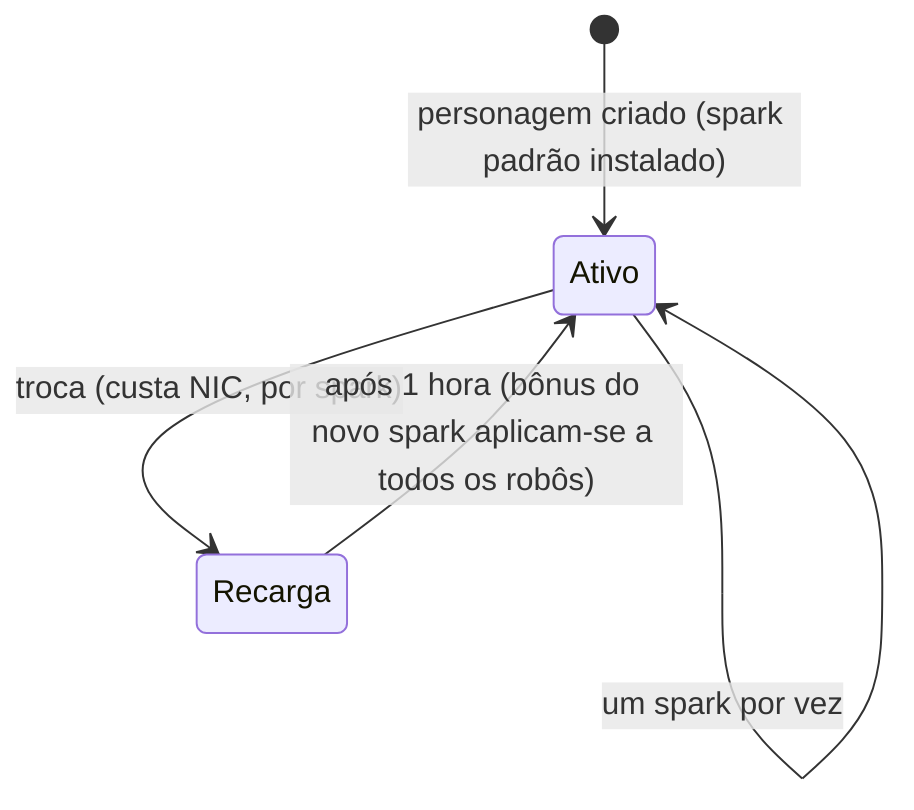

# Sparks (Faíscas)

Um **spark** é uma especialização de nanorrobôs instalada no seu personagem. Enquanto estiver
ativo, seus bônus se aplicam a cada robô que você pilota — o spark da linha de combate de uma
facção, por exemplo, aumenta o dano de armas e a chance de crítico nível a
nível, enquanto uma linha industrial aumenta a capacidade do núcleo e o rendimento de mineração.

Cada personagem possui um **spark padrão** concedido na criação. Além dele, os sparks
são organizados em famílias — as linhas básicas padrão, as linhas de combate/industrial/social por facção
(três níveis cada), linhas pagas do Sindicato e linhas especiais limitadas
— e os bônus exatos de um spark são simplesmente um pacote de níveis de habilidades fixos que você pode
consultar na [página de extensões](/content/extensions/). A [visão geral das famílias abaixo](#famílias-de-sparks)
permite ir direto aos sparks de cada família.

## Desbloqueando (autorizando) um spark

Instalar um spark que você ainda não possui requer **desbloqueá-lo** primeiro (exclusivamente
atracado). Dependendo do spark, o servidor verifica:

- um **preço** em NIC (as linhas pagas — ex.: os sparks utilitários do Sindicato e os
  sparks especiais limitados),
- **relação (standing)** com a megacorporação desenvolvedora (as linhas de facção exigem uma
  relação mínima com a megacorp daquela facção, obtida ao concluir suas
  [missões](/pt/features/missions/)),
- ou um **item** retirado do seu inventário (alguns sparks especiais são desbloqueados
  com um item-chave).

O desbloqueio é feito uma única vez: depois de desbloqueado, o spark permanece na sua coleção.

## Trocando de sparks

- Você só pode ter **um spark ativo** por vez; instalar outro substitui o anterior.
- Cada troca **custa NIC** — o valor varia por spark (as linhas comuns custam
  10k, enquanto as linhas especiais pagas chegam a até um milhão).
- Há um **tempo de recarga de uma hora** entre trocas: o servidor registra quando seu
  spark atual foi ativado e recusa um novo até que o período se encerre.

Como a troca sempre custa NIC e leva uma hora, escolha o spark que
melhor atenda à atividade na qual você passa a maior parte do tempo, e encare a
re-especialização como uma decisão ocasional e não por sessão de jogo.
<!-- sparkfamilies:generated -->

## Famílias de sparks

Visão geral dos 47 sparks divididos em 6 famílias: uma caixa por família (contagem de sparks, modo de desbloqueio), na ordem em que as linhas foram introduzidas (da esquerda para a direita, de cima para baixo). **Clique em uma caixa para pular para os sparks daquela família abaixo.** **Role sobre o diagrama para aplicar zoom**, arraste para mover e use o botão ⟲ para reiniciar.

<button type="button" class="zoommap-reset" title="Reiniciar zoom">⟲</button>
<svg class="zoommap" xmlns="http://www.w3.org/2000/svg" viewBox="0 0 1008 278" width="960" height="264" role="img" aria-label="Famílias de sparks: 6 famílias, 47 sparks; clique em uma família para ir aos seus sparks abaixo">
  <rect x="0" y="0" width="1008" height="278" fill="#10151f" stroke="#39445a" stroke-width="1"/>
  <g><title>Evento &amp; especial: 9 sparks, desbloqueio gratuito</title><a href="#family-special"><rect x="24" y="40" width="300" height="84" rx="10" fill="#10151f" stroke="#c8d2e0" stroke-width="1.5"/><text x="174" y="68" text-anchor="middle" fill="#e8eefc" font-size="15" font-weight="700">Evento &amp; especial</text><text x="174" y="92" text-anchor="middle" fill="#c8d2e0" font-size="12">9 sparks · gratuito</text></a></g>
  <g><title>TM (Truhold-Markson): 9 sparks, desbloqueio com relação TM</title><a href="#family-tm"><rect x="354" y="40" width="300" height="84" rx="10" fill="#10151f" stroke="#41d3ff" stroke-width="1.5"/><text x="504" y="68" text-anchor="middle" fill="#e8eefc" font-size="15" font-weight="700">TM (Truhold-Markson)</text><text x="504" y="92" text-anchor="middle" fill="#41d3ff" font-size="12">9 sparks · relação TM</text></a></g>
  <g><title>ICS: 9 sparks, desbloqueio com relação ICS</title><a href="#family-ics"><rect x="684" y="40" width="300" height="84" rx="10" fill="#10151f" stroke="#6ee7a0" stroke-width="1.5"/><text x="834" y="68" text-anchor="middle" fill="#e8eefc" font-size="15" font-weight="700">ICS</text><text x="834" y="92" text-anchor="middle" fill="#6ee7a0" font-size="12">9 sparks · relação ICS</text></a></g>
  <g><title>ASI: 9 sparks, desbloqueio com relação ASI</title><a href="#family-asi"><rect x="24" y="154" width="300" height="84" rx="10" fill="#10151f" stroke="#f5a05a" stroke-width="1.5"/><text x="174" y="182" text-anchor="middle" fill="#e8eefc" font-size="15" font-weight="700">ASI</text><text x="174" y="206" text-anchor="middle" fill="#f5a05a" font-size="12">9 sparks · relação ASI</text></a></g>
  <g><title>Sindicato (NIC): 5 sparks, desbloqueio com preço em NIC</title><a href="#family-syndicate"><rect x="354" y="154" width="300" height="84" rx="10" fill="#10151f" stroke="#a78bfa" stroke-width="1.5"/><text x="504" y="182" text-anchor="middle" fill="#e8eefc" font-size="15" font-weight="700">Sindicato (NIC)</text><text x="504" y="206" text-anchor="middle" fill="#a78bfa" font-size="12">5 sparks · preço em NIC</text></a></g>
  <g><title>Limitado: 6 sparks, desbloqueio com preço em NIC</title><a href="#family-limited"><rect x="684" y="154" width="300" height="84" rx="10" fill="#10151f" stroke="#f472b6" stroke-width="1.5"/><text x="834" y="182" text-anchor="middle" fill="#e8eefc" font-size="15" font-weight="700">Limitado</text><text x="834" y="206" text-anchor="middle" fill="#f472b6" font-size="12">6 sparks · preço em NIC</text></a></g>
</svg>

### Evento &amp; especial (9)

Desbloqueio: nenhum custo — estas são as linhas padrão básicas. Cada troca custa NIC (o valor é por spark, veja os cards) e exige uma hora de recarga — veja [Trocando de sparks](#switching-sparks) acima.

ww

desbloqueio sem custo · troca 10k NIC

Spark padrão — instalado na criação do personagem

wi

desbloqueio sem custo · troca 10k NIC

Spark padrão — instalado na criação do personagem

ws

desbloqueio sem custo · troca 10k NIC

Spark padrão — instalado na criação do personagem

iw

desbloqueio sem custo · troca 10k NIC

Spark padrão — instalado na criação do personagem

ii

desbloqueio sem custo · troca 10k NIC

Spark padrão — instalado na criação do personagem

is

desbloqueio sem custo · troca 10k NIC

Spark padrão — instalado na criação do personagem

sw

desbloqueio sem custo · troca 10k NIC

Spark padrão — instalado na criação do personagem

si

desbloqueio sem custo · troca 10k NIC

Spark padrão — instalado na criação do personagem

ss

desbloqueio sem custo · troca 10k NIC

Spark padrão — instalado na criação do personagem

### TM (Truhold-Markson) (9)

Desbloqueio: relação (standing) com a megacorporação TM (2 → 4 → 6 por nível). Cada troca custa NIC (o valor é por spark, veja os cards) e exige uma hora de recarga — veja [Trocando de sparks](#switching-sparks) acima.

Combate Nvl 1

desbloqueio relação 2 com TM · troca 10k NIC

Inclui 2 níveis de extensão

Combate Nvl 2

desbloqueio relação 4 com TM · troca 100k NIC

Inclui 3 níveis de extensão

Combate Nvl 3

desbloqueio relação 6 com TM · troca 1M NIC

Inclui 3 níveis de extensão

Indy Nvl 1

desbloqueio relação 2 com TM · troca 10k NIC

Inclui 2 níveis de extensão

Indy Nvl 2

desbloqueio relação 4 com TM · troca 100k NIC

Inclui 3 níveis de extensão

Indy Nvl 3

desbloqueio relação 6 com TM · troca 1M NIC

Inclui 3 níveis de extensão

Social Nvl 1

desbloqueio relação 2 com TM · troca 10k NIC

Inclui 2 níveis de extensão

Social Nvl 2

desbloqueio relação 4 com TM · troca 100k NIC

Inclui 3 níveis de extensão

Social Nvl 3

desbloqueio relação 6 com TM · troca 1M NIC

Inclui 3 níveis de extensão

### ICS (9)

Desbloqueio: relação (standing) com a megacorporação ICS (2 → 4 → 6 por nível). Cada troca custa NIC (o valor é por spark, veja os cards) e exige uma hora de recarga — veja [Trocando de sparks](#switching-sparks) acima.

Combate Nvl 1

desbloqueio relação 2 com ICS · troca 10k NIC

Inclui 2 níveis de extensão

Combate Nvl 2

desbloqueio relação 4 com ICS · troca 100k NIC

Inclui 3 níveis de extensão

Combate Nvl 3

desbloqueio relação 6 com ICS · troca 1M NIC

Inclui 3 níveis de extensão

Indy Nvl 1

desbloqueio relação 2 com ICS · troca 10k NIC

Inclui 2 níveis de extensão

Indy Nvl 2

desbloqueio relação 4 com ICS · troca 100k NIC

Inclui 3 níveis de extensão

Indy Nvl 3

desbloqueio relação 6 com ICS · troca 1M NIC

Inclui 3 níveis de extensão

Social Nvl 1

desbloqueio relação 2 com ICS · troca 10k NIC

Inclui 2 níveis de extensão

Social Nvl 2

desbloqueio relação 4 com ICS · troca 100k NIC

Inclui 3 níveis de extensão

Social Nvl 3

desbloqueio relação 6 com ICS · troca 1M NIC

Inclui 3 níveis de extensão

### ASI (9)

Desbloqueio: relação (standing) com a megacorporação ASI (2 → 4 → 6 por nível). Cada troca custa NIC (o valor é por spark, veja os cards) e exige uma hora de recarga — veja [Trocando de sparks](#switching-sparks) acima.

Combate Nvl 1

desbloqueio relação 2 com ASI · troca 10k NIC

Inclui 2 níveis de extensão

Combate Nvl 2

desbloqueio relação 4 com ASI · troca 100k NIC

Inclui 3 níveis de extensão

Combate Nvl 3

desbloqueio relação 6 com ASI · troca 1M NIC

Inclui 3 níveis de extensão

Indy Nvl 1

desbloqueio relação 2 com ASI · troca 10k NIC

Inclui 2 níveis de extensão

Indy Nvl 2

desbloqueio relação 4 com ASI · troca 100k NIC

Inclui 3 níveis de extensão

Indy Nvl 3

desbloqueio relação 6 com ASI · troca 1M NIC

Inclui 3 níveis de extensão

Social Nvl 1

desbloqueio relação 2 com ASI · troca 10k NIC

Inclui 5 níveis de extensão

Social Nvl 2

desbloqueio relação 4 com ASI · troca 100k NIC

Inclui 6 níveis de extensão

Social Nvl 3

desbloqueio relação 6 com ASI · troca 1M NIC

Inclui 6 níveis de extensão

### Sindicato (NIC) (5)

Desbloqueio: um preço em NIC (1M por spark). Cada troca custa NIC (o valor é por spark, veja os cards) e exige uma hora de recarga — veja [Trocando de sparks](#switching-sparks) acima.

Syndicate Nic Combat

desbloqueio 1M NIC · troca 100k NIC

Inclui 2 níveis de extensão

Syndicate Nic Scout

desbloqueio 1M NIC · troca 100k NIC

Inclui 2 níveis de extensão

Syndicate Nic Coreboost

desbloqueio 1M NIC · troca 100k NIC

Inclui 2 níveis de extensão

Syndicate Nic Allresist

desbloqueio 1M NIC · troca 100k NIC

Inclui 4 níveis de extensão

Syndicate Nic Fitboost

desbloqueio 1M NIC · troca 100k NIC

Inclui 2 níveis de extensão

### Limitado (6)

Desbloqueio: um preço em NIC (25–50M por spark). Cada troca custa NIC (o valor é por spark, veja os cards) e exige uma hora de recarga — veja [Trocando de sparks](#switching-sparks) acima.

Anniversary Combat

desbloqueio 25M NIC · troca 1M NIC

Inclui 6 níveis de extensão

Anniversary Logistic

desbloqueio 25M NIC · troca 1M NIC

Inclui 6 níveis de extensão

Amazon c1 Combat

desbloqueio 25M NIC · troca 1M NIC

Inclui 2 níveis de extensão

Amazon c1 Indy

desbloqueio 25M NIC · troca 1M NIC

Inclui 2 níveis de extensão

Steam a

desbloqueio 50M NIC · troca 1M NIC

Inclui 2 níveis de extensão

Steam b

desbloqueio 50M NIC · troca 1M NIC

Inclui 2 níveis de extensão

<!--
Written from scratch against the server backend, 2026-09-27:
RequestHandlers/Sparks/SparkUnlock.cs (unlock rules: price, standing, item),
RequestHandlers/Sparks/SparkChange.cs + Services/Sparks/SparkHelper.cs
(60-minute switch cooldown, per-spark change price),
Services/Sparks/Spark.cs, sparks + sparkextensions tables (47 sparks, per-line
bonus bundles).
An earlier version of this page was adapted from the Open Perpetuum
community wiki (perpetuum.miraheze.org) and has been fully rewritten from
backend sources; no text was reused.
-->
