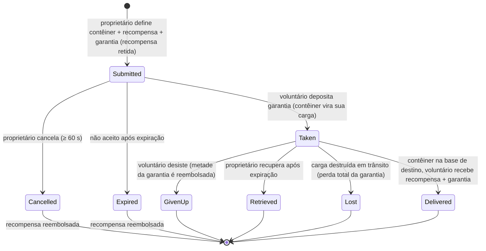

# Transporte (envio de itens)

Uma **missão de transporte** move um contêiner de itens de uma base para outra, com um
**transportador voluntário** que é pago pelo serviço. Trata-se de um mercado bilateral: o **proprietário** publica uma
remessa, e um **voluntário** a assume e a entrega.

> A localização dos elementos na interface segue a [visão geral da interface do cliente](/pt/features/ui/) (a categoria **Assignments** na
> barra superior). As mecânicas abaixo foram confirmadas diretamente no servidor.

## Os dois lados

- **Proprietário (contratante)** — publica uma remessa: um contêiner a ser transportado, de uma **base de origem**
  para uma **base de destino**, por uma **recompensa**, com uma **garantia**, ao longo de uma **duração**.
- **Voluntário (transportador)** — aceita a missão, transporta o contêiner e o entrega.

## Publicando um transporte (proprietário)

**Envie um transporte** especificando:
- o **contêiner** (um envoltório volumétrico) a ser enviado,
- a **recompensa** que você pagará na entrega,
- a **garantia** (uma caução depositada pelo transportador),
- a **base de origem** e a **base de destino**,
- uma **duração** (dias) durante a qual a missão permanece aberta.

Ao enviar, a **recompensa é retida** da sua carteira (caução/escrow).

## Aceitando um transporte (voluntário)

- **Aceitar** uma missão — você deposita a **garantia** como caução, e o contêiner
  passa a ser sua responsabilidade de transporte.

## Entrega e recuperação

- **Entregar** — leve o contêiner até a base de destino. Na entrega, o **voluntário recebe
  a recompensa + garantia**, e o proprietário recebe as mercadorias.
- **Recuperar** — o proprietário (ou o voluntário, no caso aplicável) recupera o
  contêiner de volta para uma base; na recuperação, a **garantia é devolvida** e a **recompensa
  é restituída** ao proprietário.

## Cancelar / desistir

- **Cancelar** — cancela a missão.
- **Desistir** — o voluntário abandona o transporte. Desistir aplica uma **penalidade na garantia**:
  apenas a **metade** da garantia é reembolsada (o restante é confiscado) — a constante
  de penalidade é 0.5 em `TransportAssignment.cs`.

## Inspeção

- **Listar** transportes, **listar conteúdo** de um item, **informações do contêiner**, **está em andamento?**
  e o **registro de transporte**.

## O fluxo financeiro (em resumo)

A **recompensa** é o pagamento do proprietário, retida em caução no envio e paga apenas na entrega.
A **garantia** é a caução do voluntário: paga ao proprietário ao aceitar, retida enquanto a
carga estiver em trânsito e devolvida (junto com a recompensa) na entrega.

| Evento | Condição | Proprietário | Voluntário | Contêiner |
|---|---|---|---|---|
| Enviar | — | recompensa retida | — | movido para o armazenamento de transporte |
| Aceitar | não aceito | recebe caução da garantia | paga garantia | torna-se a carga do voluntário |
| Entregar | na base de destino | mercadorias recebidas | recebe **recompensa + garantia** | entregue |
| Cancelar | não aceito, ≥ 60 s após envio | recompensa reembolsada | — | de volta à base de origem |
| Desistir | aceito | recompensa reembolsada | **metade** da garantia reembolsada (penalidade de 0.5) | de volta à base de origem |
| Expirar | não aceito, após expiração | recompensa reembolsada | — | de volta à base de origem |
| Recuperar | aceito **e** após expiração | recompensa reembolsada | — | de volta à base de origem (imediatamente se acoplado, caso contrário no próximo acoplamento do voluntário) |
| Carga destruída | em trânsito | recompensa reembolsada **+ garantia integral** | garantia integral confiscada | perdido |

## Notas práticas

- **Sem taxas** — os únicos valores movimentados são a recompensa e a garantia.
- **A recompensa fica retida** — o proprietário não pode gastá-la até que o transporte seja concluído.
- **A garantia é a caução do transportador** — depositá-la é o que permite aceitar uma remessa;
  perder a carga em trânsito resulta no confisco do valor **integral**.
- **Desistir tem um custo** — abandonar um transporte confisca metade da sua garantia.
- **A duração importa, mas apenas enquanto não for aceito** — o prazo de validade definido no envio apenas
  encerra automaticamente missões que ninguém aceitou (o servidor remove missões expiradas não aceitas
  a cada hora). Uma missão **aceita** nunca expira por conta própria; a saída de emergência do proprietário
  é **Recuperar**, que fica disponível assim que o prazo de validade expira e
  recolhe a carga (e a recompensa) de volta à base de origem — imediatamente se o transportador estiver
  acoplado, ou automaticamente no próximo acoplamento do transportador.
- **Verifique o conteúdo antes de aceitar** — inspecione o que está dentro do contêiner e a rota.

<!-- TODO: only the client UI remains (assignments screen layout).
     Money model confirmed: reward escrowed at submit (CashInOnSubmit), collateral paid
     by the volunteer on take (TakeCollateral -> PayCollateralToPrincipal), delivery pays
     volunteer reward+collateral (PayOutReward); cancel needs 60s after creation;
     expiry = submit time + client duration days (<=0 -> 1), cleaned hourly by
     MissionProcessor (_transportAssignmentInterval 1h), taken=0 only; retrieve requires
     expiry passed + taken, auto-completes on next dock; destroyed cargo refunds reward
     and forfeits full collateral to the owner.
     Developer notes: TransportAssignments/TransportAssignmentSubmit.cs;
     Services/MissionEngine/TransportAssignments/TransportAssignment.cs (reward/collateral
     escrow, PayOutReward = reward+collateral, PaybackCollateral, PaybackHalfCollateral
     = COLLATERAL_PENALTY on give-up, RetrieveToBasePublicContainer, expiry);
     TransportAssignmentTake/Deliver/Retrieve/Cancel/GiveUp/List/ListContent/
     ContainerInfo/Running/Log. -->