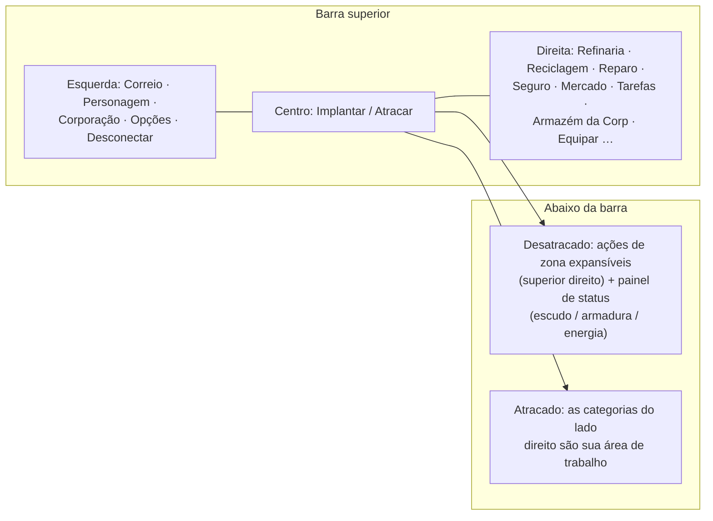

# Visão geral da interface do cliente

O cliente possui uma interface em estilo **EVE Online**: uma visualização do espaço/zona em tela inteira com
**janelas flutuantes, redimensionáveis e móveis** que podem ser **fechadas e reabertas** à vontade.
A integração é feita por sistema — consulte as páginas vinculadas abaixo.

> Este layout é um modelo de trabalho fornecido pelo projeto, utilizado para descrever onde as ações
> se localizam. Os nomes exatos das telas podem diferir ligeiramente; a estrutura serve como referência.

## A barra superior

Uma barra persistente na parte superior da tela.

| Área | Conteúdo |
|---|---|
| **Esquerda** | Botões principais: **Correio**, **Personagem**, **Corporação**, outras **Opções** e **Desconectar** |
| **Centro** | O botão **Implantar / Atracar** — seu alternador principal atracado⇄desatracado (veja [movimento](/pt/features/movement/)) |
| **Direita** | Categorias de ação em forma de botões: **Refinaria**, **Reciclagem**, **Reparo**, **Seguro**, **Mercado**, **Tarefas** (transportes), **Armazém da Corp**, **Equipar**, … |

As categorias do lado direito abrem suas respectivas janelas do sistema:

| Botão | Abre / faz | Página da wiki |
|---|---|---|
| Refinaria | Processa recursos brutos em componentes | [produção](/pt/features/production/) |
| Reciclagem | Desmonta itens em materiais básicos | [produção](/pt/features/production/) |
| Reparo | Repara robôs/módulos danificados | [produção](/pt/features/production/) |
| Seguro | Apólices de seguro de robôs/produção | [produção](/pt/features/production/) |
| Mercado | Ordens de mercado e compras diretas | [mercado](/pt/features/market/) |
| Tarefas | Tarefas de transporte (remessas) | [transporte](/pt/features/transport/) |
| Armazém da Corp | Armazenamento/hangar corporativo | [grupos](/pt/features/groups/) |
| Equipar | Equipa módulos e munição no seu robô ativo | [robôs](/pt/features/robots/) |

## Estado atracado

Enquanto estiver **atracado**, as categorias de ação do lado direito formam sua área de trabalho principal: você processa materiais,
negocia, equipa robôs e gerencia inventários sem sair da base. O botão Implantar desatraca seu robô
para a zona (veja [movimento](/pt/features/movement/) para os pré-requisitos de desatracação).

## Estado desatracado

Enquanto estiver **desatracado** (pilotando seu robô ativo em uma zona):

- A área **superior direita** ganha um **botão de ações expansível**: clique nele e uma lista de
  ações de zona adicionais se expandirá para baixo (escaneamento, colheita/interação, ferramentas de zona —
  ações documentadas em [coleta](/pt/features/gathering/) e [combate](/pt/features/combat/)).
- O **painel de status principal** exibe as condições do seu robô: **escudo, armadura/chassi, energia**
  e status de combate associados — os mesmos dados aos quais a página de [combate](/pt/features/combat/) se refere
  (ex.: a verificação de "sistema de energia intacto" para desatracar).
- Categorias exclusivas da base (refinaria, mercado, …) permanecem indisponíveis até que você atraque novamente.

## Janelas comuns

A maioria dos sistemas se abre em uma janela flutuante padrão: barra de título, botão fechar, bordas
redimensionáveis, guias ou conteúdo em lista. Sistemas com múltiplas instâncias (inventário/contêineres, mercado,
linhas de produção) podem ter várias janelas abertas simultaneamente.

- **Inventário / contêineres** — listar um contêiner, mover/empilhar/empacotar itens, renomear, descartar —
  veja [itens](/pt/features/items/).
- **Janela de personagem** (botão superior esquerdo) — perfil, extensões (pesquisa), configurações,
  créditos — veja [primeiros passos](/pt/features/getting-started/) e [pesquisa](/pt/features/research/).
- **Janela da corporação** (botão superior esquerdo) — informações da corporação, hangar, documentos, votos,
  quadro de avisos — veja [grupos](/pt/features/groups/).
- **Janela de correio** (botão superior esquerdo) — correio pessoal e mensagens em massa — veja [social](/pt/features/social/).

## Convenções usadas nesta wiki

- **"Barra superior → X"** = o botão chamado X na barra superior.
- **"Ações desatracadas"** = a lista expansível no canto superior direito quando estiver na zona.
- **Botão Implantar/Atracar** = o alternador no centro da barra superior.

<!-- Note: this page is the agreed UI model (project-provided). If the real client
     differs in button names or placement, update this page first — every other
     features/ page references the conventions defined here. -->
