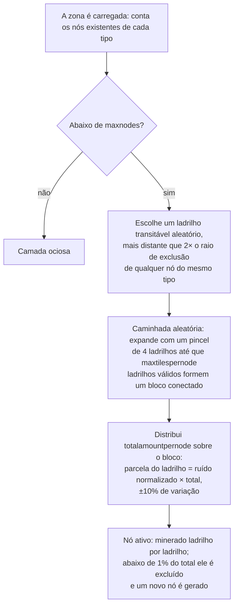

# Geração de recursos da zona

Esta página explica como o servidor mantém abastecidos os recursos de uma zona. Ambos os sistemas operam
continuamente em segundo plano enquanto a zona está carregada; nenhuma ação do jogador é
necessária para que eles avancem seus ciclos.

## A configuração de recursos da zona

Cada zona é configurada no banco de dados com duas listas independentes:

- **Configuração de minério** (`mineralconfigs`) — uma linha por tipo de minério presente na zona,
  com quatro parâmetros por tipo:
  | Coluna | Significado |
  |---|---|
  | `maxnodes` | Quantos nós deste tipo a zona mantém |
  | `maxtilespernode` | Número máximo de ladrilhos que um único nó pode cobrir |
  | `totalamountpernode` | Material total em um nó recém-criado, distribuído por seus ladrilhos |
  | `minthreshold` | Taxa mínima de preenchimento por ladrilho (0–1); ladrilhos abaixo disso após a mineração são descartados |
- **Configuração de plantas** (`zones.fertility` + um conjunto de regras de plantas) — a meta de
  cobertura vegetal da zona (uma porcentagem) e a lista de espécies de plantas autorizadas a crescer lá
  (o comportamento de cada espécie é um arquivo de regras documentado em
  [Plantas](/pt/content/plants/)).

Zonas sem uma configuração de minério (arenas, zonas de treinamento, fortalezas, algumas zonas
gama) não possuem camadas de minério.

## Jazidas de minério

### Como um nó é posicionado

Quando uma zona carrega, a camada de cada tipo de minério conta seus nós existentes (persistidos na
tabela `mineralnodes`) e gera novos nós até que `maxnodes` seja atingido. Um novo nó é
posicionado por meio de uma **caminhada aleatória**:

1. Escolhe um ladrilho transitável aleatório.
2. Ele deve estar distante do nó existente mais próximo do mesmo tipo — o raio de exclusão
   é derivado de `maxtilespernode` (`√(maxtilespernode/π) × 2`, e então o ponto inicial
   deve estar pelo menos ao dobro dessa distância), para que os nós nunca se fundam em um único depósito gigante.
3. A partir do ladrilho inicial, uma caminhada expande-se aleatoriamente (um pincel de 4 ladrilhos por vez),
   agrupando até `maxtilespernode` ladrilhos válidos em um único bloco conectado.
4. O material de `totalamountpernode` do nó é distribuído sobre o bloco: a parcela de cada ladrilho
   é seu valor de ruído (normalizado) multiplicado pelo total, com uma variação aleatória de ±10%, para que nenhum
   dois nós do mesmo tipo sejam idênticos.

Um ladrilho só é válido para um nó se estiver dentro da zona, não for uma ilha, não estiver
protegido por terraformação de PBS e for transitável. Dois tipos raros recebem **zonas de exclusão** ao redor
de bases de atracação e teleportes: o **epriton** mantém uma distância mínima, e o **minério flux**
mantém o dobro dessa distância — portanto, o minério flux nunca é encontrado logo ao lado de uma base.

### Como um nó é consumido

- A mineração remove material ladrilho por ladrilho.
- Um nó que cai abaixo de **1% do seu total configurado** é excluído, e um novo nó
  é gerado (retornando à etapa 1) para manter a zona em `maxnodes`.
- Os nós de minério flux acionam adicionalmente a **geração de NPCs** — nós sendo minerados (ou removidos)
  publicam eventos escutados pelo sistema de NPCs, razão pela qual locais com minério flux atraem
  atenção.

## Plantas

### A varredura de plantas

A zona é dividida em blocos de **32×32 ladrilhos**. Um manipulador de plantas percorre esses blocos em ordem,
processando um por ciclo (tick), em um ritmo ajustado para que uma **passagem completa pela zona leve cerca de 8 horas**
(personalizável por zona). Cada "cubo" de 32×32 é processado por uma rotina fixa:

1. **Validar** — remove plantas inválidas (solo incorreto, mortas, fora do lugar).
2. **Crescer** — avança cada planta por seus estágios de crescimento (consulte
   [coleta](/pt/features/gathering/) para detalhes sobre `growRate` e frutificação).
3. **Gerar** — adiciona novas plantas onde o cubo está abaixo de sua meta de fertilidade.
4. **Danificar paredes** — a altura de bloqueio das plantas decai com o tempo.
5. **Eliminar por distância** — impõe o espaçamento entre o mesmo tipo (`killDistance`).
6. **Renovar material** — uma pequena quantidade de material frutífero se regenera.

### Como uma nova planta é escolhida

Um ladrilho só pode brotar se o arquivo da zona lhe conceder **potencial de surgimento** (um byte por ladrilho
embutido na camada de plantas da zona — 0 significa que o ladrilho nunca brota). A cada ciclo, para
cada ladrilho elegível:

- **Verificação de fertilidade da zona primeiro**: se a cobertura de plantas bloqueadoras do cubo já atinge
  `fertility%` de seus ladrilhos de solo, nada de novo surge lá.
- **Probabilidade por ladrilho**: um sorteio aleatório precisa superar o potencial de surgimento do ladrilho.
- **Seleção de espécie**:
  - Se o ladrilho **não tiver vizinhos com plantas**, a espécie é selecionada por um sorteio ponderado
    onde o peso de cada espécie permitida é sua `fertility` (espécies semeadas por jogadores são
    excluídas do surgimento natural).
  - Se ele **tiver vizinhos**, é um cara ou coroa: 50% de chance para a espécie vizinha atualmente *dominante*
    (a mais comum nas proximidades), 50% de chance para um sorteio de **disseminação** ponderado por
    `(contagem de vizinhos × spreading)` para cada espécie — é isso que faz os grupos
    se expandirem com sua própria espécie.
- **Limites e espaçamento**: uma espécie com limite `maxAmount` é ignorada assim que a zona tiver
  a quantidade suficiente dela, e um ladrilho dentro de `killDistance` de outra planta do mesmo tipo é
  ignorado.

### O que isso significa para os jogadores

- A densidade de plantas é limitada pela fertilidade da zona — você nunca verá uma zona com
  100% de cobertura de plantas se sua fertilidade for 20.
- Agrupamentos são a regra: a disseminação faz com que cada espécie expanda suas próprias manchas, de modo que uma
  zona tende a territórios de espécies em vez de uma mistura homogênea.
- Espécies com `killDistance` (por exemplo, certas plantas de alto valor) ficam espaçadas uniformemente, o que
  torna suas localizações previsíveis assim que você encontra uma.
- Novos nós aparecem onde a caminhada aleatória terminar — não há um "ponto de minério" fixo em uma
  zona; o escaneamento é obrigatório (consulte [coleta](/pt/features/gathering/)).

<!-- Notas do desenvolvedor: TerrainsModule.cs (construção de camadas por zona: OreLayer para
     Solid, LiquidLayer para Liquid, GravelLayer para TrainingZone; reabastecimento em LoadMineralNodes);
     MineralLayer.cs (LoadMineralNodes: exclui nós <1%, gera até maxnodes;
     FluxOre -> OreNpcSpawnMessage na redução/expiração);
     Generators/MineralNodeGeneratorBase.cs (FindStartPosition zonas de exclusão + espaçamento,
     NormalizeNoise, CreateMineralNode variação); RandomWalkMineralNodeGenerator.cs
     (pincel de preenchimento 4, limite de 50k passos); MineralNodeRepository.cs (tabela mineralnodes,
     valores compactados por ladrilho); PlantHandler.cs (áreas 32x32, passagem completa de 8h,
     PlantsGrowthTimerOverrideMin, modos de escaneamento); NatureCube.cs (pipeline ProcessAll,
     lógica de fertilidade/spawn/killDistance em SpawnPlants, GetNewPlantRule 50/50 dominante vs
     disseminação); PlantRuleExtensions.cs (sorteios ponderados por fertilidade + disseminação);
     PlantInfo.cs (byte de surgimento por ladrilho vem do arquivo de camada de plantas da zona,
     nunca atribuído pelo código do servidor). -->
