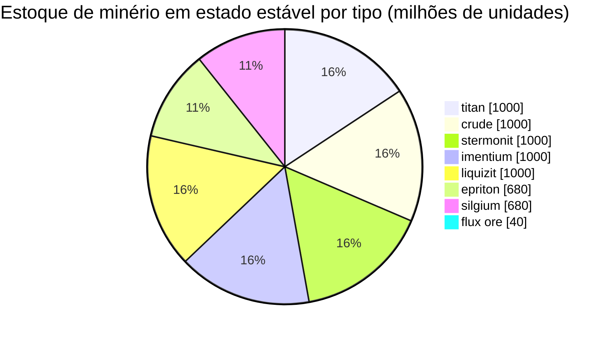

# Daoden (zone_ASI) — exemplo prático

  <a href="/pt/zones/map/">
    
    <strong>Mapa mundial</strong> — onde esta zona se localiza entre todas as outras, com as conexões de teleporte. Abrir o mapa completo.
  </a>

Onde se encontram as colunas de teleporte desta zona (pontos, rotulados com o destino — esmaecidos onde
a coluna está desativada no momento), os pontos de aterrissagem de teleportes vindos de outras
zonas (círculos tracejados) e os portões de saída (losangos) onde existirem. As posições são as
coordenadas de ladrilho registradas pelo servidor.
As linhas tracejadas conectam os pares de colunas de teleporte locais (internas à zona).

Uma zona **PvP aberta** do nível alfa — a configuração de minério mais rica do jogo e
o local onde vivem os tipos raros. Tudo o que New Virginia tem, mais epriton, silgium e
os locais de minério flux que atraem ataques de NPCs.

| Fato | Valor |
|---|---|
| ID da zona | 2 |
| Tipo | PvP (aberta) |
| Proteção | [Beta](/pt/zones/protection/) — PvP aberto, terreno padrão |
| Tamanho | 2048 × 2048 ladrilhos |
| Fertilidade | 20 |
| Conjunto de regras de plantas | 2 — 19 espécies (incl. colhíveis de alto nível) |
| Tipos de minério | 8 (titan, crude, stermonit, imentium, liquizit, epriton, silgium, flux ore) |
| Total de nós de minério | 64 (8 por tipo) |

## Configuração de minério

| Material | Nós | Máx. ladrilhos/nó | Total por nó | Limiar mínimo |
|---|---|---|---|---|
| [titan](/pt/content/ores/titan/) | 8 | 500 | 125,000,000 | 0.5 |
| [crude](/pt/content/ores/crude/) | 8 | 1257 | 125,000,000 | 0.5 |
| [stermonit](/pt/content/ores/stermonit/) | 8 | 500 | 125,000,000 | 0.5 |
| [imentium](/pt/content/ores/imentium/) | 8 | 500 | 125,000,000 | 0.5 |
| [liquizit](/pt/content/ores/liquizit/) | 8 | 500 | 125,000,000 | 0.5 |
| [epriton](/pt/content/ores/epriton/) | 8 | 500 | 85,000,000 | 0.5 |
| [silgium](/pt/content/ores/silgium/) | 8 | 500 | 85,000,000 | 0.5 |
| [fluxore](/pt/content/ores/fluxore/) | 8 | 300 | 5,000,000 | 0.5 |

Aspectos que se destacam:

- **8× mais nós do que New Virginia**, mas cada nó é menor (500 ladrilhos vs 1.000): o
  raio de caminhada cai de 34 para 24 ladrilhos para os minérios padrão. O escaneamento é mais importante
  aqui — os depósitos são mais dispersos e mais numerosos.
- **Epriton e silgium** possuem totais reduzidos (85 M vs 125 M) — valor mais alto, estoque
  mais raro. O epriton adicionalmente mantém uma **distância mínima de bases e teleportes**, de modo que
  seus nós nunca surgem em um ponto de entrada.
- **Minério flux é o caso extremo**: apenas 5 M por nó distribuídos por 300 ladrilhos (~16.600 por
  ladrilho — uma gota, não um depósito), 8 nós e uma zona de exclusão de **o dobro** da
  distância do epriton em relação às bases. Minerar um nó de flux publica eventos de geração para o sistema
  de NPCs — áreas de flux são disputadas por concepção de projeto (consulte [Sistemas de Intrusão & NPC](/pt/features/intrusion/)).
- Estoque em estado estável: aproximadamente 6,4 bilhões de unidades de material no total.

## Mistura de plantas

O conjunto de regras 2 permite 19 espécies — a mistura alfa completa: o básico, mais **devrinol**,
**wall**, **titanplant** e os **colhíveis de alto nível** (electroplant superior,
árvore de ferro superior, rustbush superior, slimeroot superior). A fertilidade ainda é 20, portanto a densidade é a
mesma de New Virginia — o que muda é *quais* espécies podem vencer o sorteio de fertilidade. Os
pesos de `fertility` próprios dos itens colhíveis de alto nível decidem com que frequência eles superam
as gramas.

As regras por espécie encontram-se em [Plantas](/pt/content/plants/); os rendimentos por minério em
[Minérios](/pt/content/ores/).

## O que isso significa para o jogador

- Toda a cadeia de minérios está disponível, incluindo a economia de minério flux — mas é PvP
  aberto, portanto tudo o que você minerar pode ser tomado (consulte
  [transporte](/pt/features/transport/) para transferir mercadorias com segurança entre bases).
- Espere pressão de NPCs perto de nós de minério flux; o gerador monitora eventos de mineração
  nesses nós.
- A colheita de plantas aqui foca nas variantes de alto nível, que possuem frutos melhores do que
  as espécies de baixo nível das zonas iniciais.

<!-- Notas do desenvolvedor: linha da tabela zones com id 2 (zonetype 2 = PvP, protected 0, fertility 20,
     plantruleset 2); 8 linhas em mineralconfigs (7 padrão + fluxore 8/300/5M);
     MineralNodeGeneratorBase.KeepOutDist: Epriton = MINERAL_DISTANCE_FROM_BASE_MIN,
     FluxOre = 2x; MineralLayer.OnNodeDecrease/OnNodeExpired -> OreNpcSpawnMessage para
     FluxOre; plantrules rulesetid 2 = 19 arquivos (4 colhíveis, incl. devrinol e
     wall). -->
