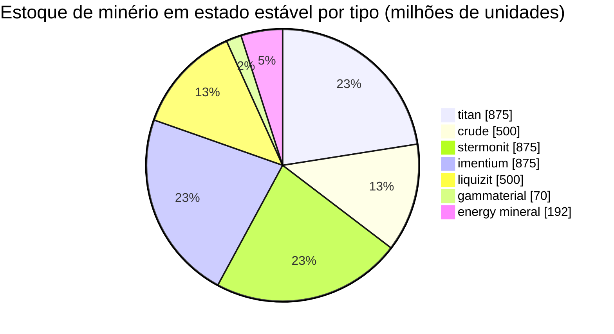

# zone_gamma_z106 — exemplo prático

  <a href="/pt/zones/map/">
    
    <strong>Mapa mundial</strong> — onde esta zona se localiza entre todas as outras, com as conexões de teleporte. Abrir o mapa completo.
  </a>

Onde se encontram as colunas de teleporte desta zona (pontos, rotulados com o destino — esmaecidos onde
a coluna está desativada no momento), os pontos de aterrissagem de teleportes vindos de outras
zonas (círculos tracejados) e os portões de saída (losangos) onde existirem. As posições são as
coordenadas de ladrilho registradas pelo servidor.

Uma zona **PvP aberta** de nível alto: terraformável, baixa fertilidade, variantes de plantas tier-2 e
uma economia de minério mais restrita. Esta é a configuração típica de "fim de jogo" de uma zona — menos recursos,
mais disputados.

| Fato | Valor |
|---|---|
| ID da zona | 106 |
| Tipo | PvP (aberta) |
| Proteção | [Gama](/pt/zones/protection/) — PvP aberto, terraformável |
| Tamanho | 2048 × 2048 ladrilhos |
| Fertilidade | 15 |
| Terraformável | sim (limite tecnológico PBS 2) |
| Conjunto de regras de plantas | 22 — 17 espécies ("Regras de Plantas Gama", mistura tier-2) |
| Tipos de minério | 7 (titan, crude, stermonit, imentium, liquizit, gammaterial, mineral de energia) |
| Total de nós de minério | 44 |

## Configuração de minério

| Material | Nós | Máx. ladrilhos/nó | Total por nó | Limiar mínimo |
|---|---|---|---|---|
| [titan](/pt/content/ores/titan/) | 7 | 600 | 125,000,000 | 0.5 |
| [crude](/pt/content/ores/crude/) | 4 | 600 | 125,000,000 | 0.5 |
| [stermonit](/pt/content/ores/stermonit/) | 7 | 600 | 125,000,000 | 0.5 |
| [imentium](/pt/content/ores/imentium/) | 7 | 600 | 125,000,000 | 0.5 |
| [liquizit](/pt/content/ores/liquizit/) | 4 | 600 | 125,000,000 | 0.5 |
| [gammaterial](/pt/content/ores/gammaterial/) | 7 | 100 | 10,000,000 | 0.5 |
| [energymineral](/pt/content/ores/energymineral/) | 8 | 300 | 24,000,000 | 0.5 |

Aspectos que se destacam:

- **Menos nós do que zonas alfa** (44 vs 64 em Daoden): crude e liquizit caem para
  apenas 4 nós cada. Mesmos totais por nó que os minérios padrão de alfa, de modo que o estado
  estável (~3,9 bilhões de unidades no total) é mais enxuto e mais lento para se recuperar.
- **Dois tipos exóticos**: **gammaterial** em nós minúsculos de 100 ladrilhos (raio de caminhada de 10 ladrilhos —
  pequenos, fáceis de localizar, ~1,4 M por nó) e **mineral de energia** a 24 M por nó.
- Sem epriton, sem minério flux — os minérios raros/econômicos permanecem no nível alfa.

## Mistura de plantas

O conjunto de regras 22 permite 17 espécies: o básico, mais as **variantes tier-2** — árvore de ferro superior t2
e rustbush superior t2 como colhíveis selvagens, e as **plantas semeadas tier-2**
(electroplant superior t2, slimeroot superior t2). As semeadas têm o atributo `playerSeeded` — elas
**nunca** surgem naturalmente; existem apenas em plantações de jogadores (consulte
[coleta → plantas](/pt/features/gathering/)).

A fertilidade é **15**, e não 20: um cubo de 32×32 pode conter no máximo ~15% de plantas bloqueadoras, portanto
a cobertura vegetal é visivelmente mais esparsa do que nas zonas alfa, e o sorteio de fertilidade tem
ligeiramente menos espaço para preencher antes que o cubo "sature".

As regras por espécie (incluindo as quantidades de frutos t2) encontram-se em
[Plantas](/pt/content/plants/); os rendimentos por minério em [Minérios](/pt/content/ores/).

## O que isso significa para o jogador

- Economia mais enxuta e lenta: menos nós dos minérios comuns significa que a pressão de mineração se
  manifesta mais rapidamente — um nó de crude esgotado leva mais tempo para ser reposto pela zona.
- Vegetação mais esparsa: com 15% de fertilidade, o solo descoberto é a regra e manchas de vegetação
  são a exceção.
- A coleta de alto valor aqui foca nas plantas selvagens árvore de ferro / rustbush tier-2, além da
  manutenção de plantações de jogadores com as semeadas t2 electroplant e slimeroot.
- Terraformação (limite tecnológico PBS 2) significa que o próprio terreno pode ser remodelado pelos jogadores
  (consulte [Estações base de energia (PBS)](/pt/features/pbs/)).

<!-- Notas do desenvolvedor: linha da tabela zones com id 106 (zonetype 2 = PvP, protected 0, fertility 15,
     terraformable 1, pbsTechLimit 2, plantruleset 22); mineralconfigs 7 linhas (crude
     e liquizit 4 nós cada); plantrules rulesetid 22 = 17 arquivos, nota "Gamma
     Plant Rules"; electroplant_seeded_t2.txt / slimeroot_seeded_t2.txt definem
     playerSeeded=n1 (herdado via source= de electroplant_hi.txt /
     slimeroot_hi.txt) -> excluídos dos surgimentos naturais em
     PlantRuleExtensions.GetWinnerPlantTypeBasedOnFertility. -->
