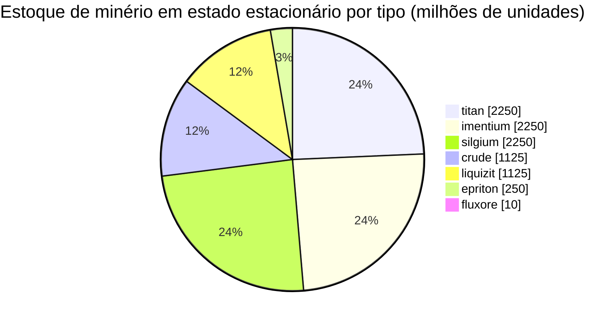

<!-- Generated by tools/generate from the live database (source: zones, mineralconfigs, plantrules, teleportdescriptions, strongholdexitconfig).
     Do not edit by hand; regenerate instead. -->
# zone_gamma_z114

  <a href="/pt/zones/map/">
    
    <strong>Mapa mundi</strong> — onde esta zona fica entre todas as outras, com as conexões de teletransporte. Abrir o mapa completo.
  </a>

Onde ficam as colunas de teletransporte desta zona (pontos rotulados com o destino — esmaecidos se a coluna estiver desativada), locais de aterrissagem de teletransportes vindos de outras zonas (círculos tracejados) e portões de saída (losangos) onde existirem. As posições são as coordenadas de blocos registradas pelo servidor.

Uma ilha de PvP aberto (beta) de frontier belt — jogadores podem atacar livremente e bloqueios se aplicam. Ela mantém 7 tipos de minério.

| Fato | Valor |
|---|---|
| ID da zona | 114 |
| Tipo | PvP |
| Proteção | [Beta](/pt/zones/protection/) — PvP aberto, terreno padrão |
| Tamanho | 2048×2048 blocos |
| Nível (Tier) | T0 (registrado no servidor) |
| Fertilidade | 15 |
| Espécies de plantas | 15 (conjunto de regras 10) |
| Tipos de minério | 7 |
| Total de nós de minério | 47 |
| Limite tecnológico da PBS | 0 |
| Bases de atracação máx. | nenhuma |

## Configuração de minério

A geração de nós que esta zona mantém. Os rendimentos por minério e as fórmulas de geração estão em [Minérios](/pt/content/ores/) (a seção desta zona está linkada abaixo).

| Material | Nós | Blocos máx./nó | Total por nó | Limiar mín. |
|---|---|---|---|---|
| [titan](/pt/content/ores/titan/) | 10 | 600 | 225M | 0.5 |
| [crude](/pt/content/ores/crude/) | 5 | 600 | 225M | 0.5 |
| [imentium](/pt/content/ores/imentium/) | 10 | 600 | 225M | 0.5 |
| [liquizit](/pt/content/ores/liquizit/) | 5 | 600 | 225M | 0.5 |
| [epriton](/pt/content/ores/epriton/) | 5 | 300 | 50M | 0.5 |
| [silgium](/pt/content/ores/silgium/) | 10 | 600 | 225M | 0.5 |
| [fluxore](/pt/content/ores/fluxore/) | 2 | 200 | 5M | 0.5 |

[Índice de zonas](/pt/zones/zone-index/) · [Mapa mundi](/pt/zones/map/#t1) · [Níveis de proteção](/pt/zones/protection/)
