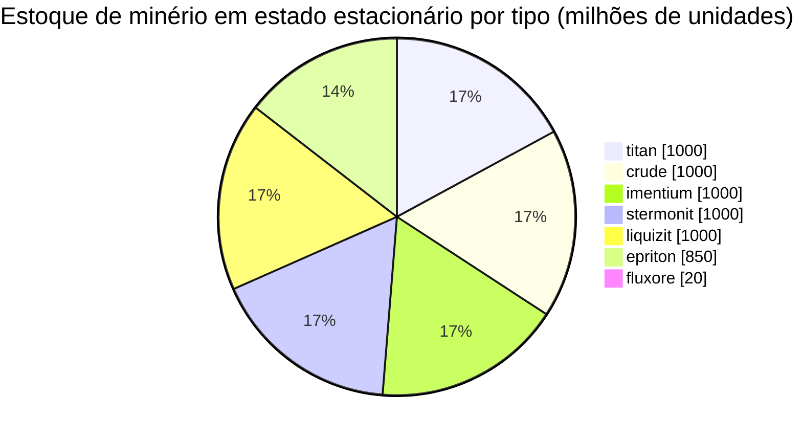

<!-- Generated by tools/generate from the live database (source: zones, mineralconfigs, plantrules, teleportdescriptions, strongholdexitconfig).
     Do not edit by hand; regenerate instead. -->
# Domhalarn (zone_ICS_A_real)

  <a href="/pt/zones/map/">
    
    <strong>Mapa mundi</strong> — onde esta zona fica entre todas as outras, com as conexões de teletransporte. Abrir o mapa completo.
  </a>

Onde ficam as colunas de teletransporte desta zona (pontos rotulados com o destino — esmaecidos se a coluna estiver desativada), locais de aterrissagem de teletransportes vindos de outras zonas (círculos tracejados) e portões de saída (losangos) onde existirem. As posições são as coordenadas de blocos registradas pelo servidor. As linhas tracejadas conectam os pares de colunas de teletransporte locais (dentro da zona).

Uma ilha de PvP aberto (beta) de Attalica (ICS) — jogadores podem atacar livremente e bloqueios se aplicam. Ela mantém 7 tipos de minério.

| Fato | Valor |
|---|---|
| ID da zona | 3 |
| Tipo | PvP |
| Proteção | [Beta](/pt/zones/protection/) — PvP aberto, terreno padrão |
| Tamanho | 2048×2048 blocos |
| Fertilidade | 20 |
| Espécies de plantas | 17 (conjunto de regras 3) |
| Tipos de minério | 7 |
| Total de nós de minério | 54 |
| Bases de atracação máx. | nenhuma |

## Configuração de minério

A geração de nós que esta zona mantém. Os rendimentos por minério e as fórmulas de geração estão em [Minérios](/pt/content/ores/) (a seção desta zona está linkada abaixo).

| Material | Nós | Blocos máx./nó | Total por nó | Limiar mín. |
|---|---|---|---|---|
| [titan](/pt/content/ores/titan/) | 8 | 500 | 125M | 0.5 |
| [crude](/pt/content/ores/crude/) | 8 | 1.257k | 125M | 0.5 |
| [stermonit](/pt/content/ores/stermonit/) | 8 | 500 | 125M | 0.5 |
| [imentium](/pt/content/ores/imentium/) | 8 | 500 | 125M | 0.5 |
| [liquizit](/pt/content/ores/liquizit/) | 8 | 500 | 125M | 0.5 |
| [epriton](/pt/content/ores/epriton/) | 10 | 350 | 85M | 0.5 |
| [fluxore](/pt/content/ores/fluxore/) | 4 | 300 | 5M | 0.5 |

[Índice de zonas](/pt/zones/zone-index/) · [Mapa mundi](/pt/zones/map/#beta) · [Níveis de proteção](/pt/zones/protection/)
