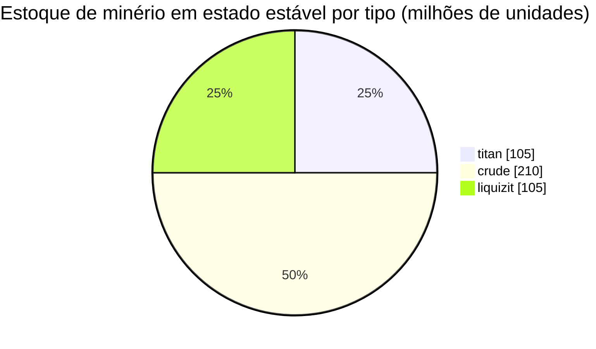

# New Virginia (zone_TM) — exemplo prático

  <a href="/pt/zones/map/">
    
    <strong>Mapa mundial</strong> — onde esta zona se localiza entre todas as outras, com as conexões de teleporte. Abrir o mapa completo.
  </a>

Onde se encontram as colunas de teleporte desta zona (pontos, rotulados com o destino — esmaecidos onde
a coluna está desativada no momento), os pontos de aterrissagem de teleportes vindos de outras
zonas (círculos tracejados) e os portões de saída (losangos) onde existirem. As posições são as
coordenadas de ladrilho registradas pelo servidor.
As linhas tracejadas conectam os pares de colunas de teleporte locais (internas à zona).

Uma zona **PvE protegida** de nível baixo — um local seguro onde novos personagens realizam coletas. Sua
configuração representa o extremo mais simples do espectro: poucos tipos de minério, nós grandes e
a mistura básica de plantas.

| Fato | Valor |
|---|---|
| ID da zona | 0 |
| Tipo | PvE (protegida) |
| Proteção | [Alfa](/pt/zones/protection/) — protegida, PvP desativado |
| Tamanho | 2048 × 2048 ladrilhos |
| Fertilidade | 20 |
| Conjunto de regras de plantas | 0 — 15 espécies (mistura básica "tm pve") |
| Tipos de minério | 3 (titan, crude, liquizit) |
| Total de nós de minério | 21 (7 por tipo) |

## Configuração de minério

| Material | Nós | Máx. ladrilhos/nó | Total por nó | Limiar mínimo |
|---|---|---|---|---|
| [titan](/pt/content/ores/titan/) | 7 | 1000 | 15,000,000 | 0.5 |
| [crude](/pt/content/ores/crude/) | 7 | 1257 | 30,000,000 | 0.5 |
| [liquizit](/pt/content/ores/liquizit/) | 7 | 1000 | 15,000,000 | 0.5 |

Aspectos que se destacam:

- **Nós grandes e esparsos** — 1.000 a 1.257 ladrilhos cada (raio da caminhada
  `(int)√(tiles/π)×2` = 34–40 ladrilhos), de modo que cada nó é um grande bloco, e existem apenas 7
  de cada tipo por zona. O estoque em estado estável é de aproximadamente 420 milhões de unidades de material no total
  (105 M de titan + 210 M de crude + 105 M de liquizit).
- **Sem tipos raros** — sem epriton, sem minério flux, portanto não há zonas de exclusão ao redor
  de bases nem áreas de minério que geram NPCs.
- `minthreshold` de 0.5 significa que um ladrilho só é utilizável se o preenchimento de ruído do nó naquele ponto for de
  pelo menos metade do seu valor máximo — as bordas de cada bloco são ralas.

Os rendimentos por tipo (o que uma unidade de cada minério gera após a refinação e as fórmulas
de geração de nós por trás dos números acima) encontram-se em [Minérios](/pt/content/ores/).

## Mistura de plantas

O conjunto de regras 0 permite 15 espécies — o conjunto inicial básico: grama (a/b), pinheiro, arbustos (a/b),
rango, árvore de cobre, junco, nanotrigo, rustbush/slimeroot/electroplant de nível baixo, bonsai
e árvore de ferro de nível baixo. Sem paredes, sem devrinol, sem itens de colheita de alto nível.

Com fertilidade 20, um cubo de 32×32 pode conter no máximo ~20% de plantas bloqueadoras; em todo o
mapa de 2048×2048 isso representa um limite superior de aproximadamente 838.000 ladrilhos de plantas (menos na prática —
água e ilhas não contam como solo). A seleção de espécies é ponderada pela `fertility` de cada regra,
de modo que as gramas e arbustos básicos predominam, enquanto os itens colhíveis de baixo nível
permanecem raros.

As regras completas por espécie (growRate, frutos, vida) encontram-se em [Plantas](/pt/content/plants/).

## O que isso significa para o jogador

- Economia inicial segura: três minérios comuns em blocos grandes e fáceis de escanear.
- Os itens colhíveis aqui são as variantes de baixo nível — plantas de alto valor (variantes
  superiores de electroplant/árvore de ferro/rustbush/slimeroot) aparecem em zonas posteriores.
- Como a zona é protegida, o risco de PvP é a única coisa ausente do ciclo
  de coleta (consulte [movimento](/pt/features/movement/) para entrada na zona).

<!-- Notas do desenvolvedor: linha da tabela zones com id 0 (zonetype 1 = PvE, protected 1, fertility 20,
     plantruleset 0); 3 linhas em mineralconfigs (titan/crude/liquizit, 7 nós cada);
     plantrules rulesetid 0 = 15 arquivos, nota "tm pve". Fórmula de raio do nó e
     semântica de limiar: consulte generation.md. -->
