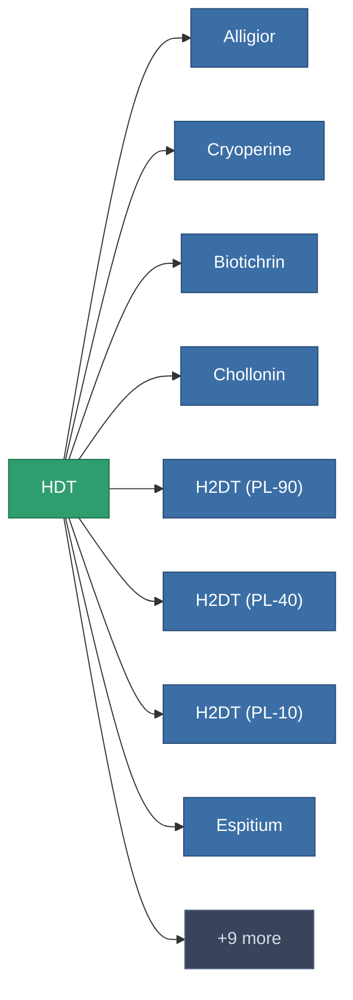

<!-- Generated by tools/generate from the live database (source: entitydefaults definition 170, aggregatevalues via aggregatefields).
     Do not edit by hand; regenerate instead. -->

# HDT

|  |  |
|---|---|
| Определение | `def_crude` |
| Тир | – |
| Прочность | 100 |
| Объём | 0 |
| Масса | 0.02 |
| Категория | Materials |

_Нет статистики — этот предмет не имеет агрегированных значений._

<!-- production:generated -->
## Используется в производстве

**Компонент 17 предметов** — пример того, что можно произвести с ним (полный список в [Рецепты](/ru/content/recipes/)).

