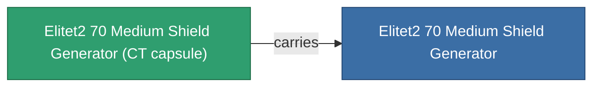

<!-- Generated by tools/generate from the live database (source: entitydefaults definition 5941, aggregatevalues via aggregatefields).
     Do not edit by hand; regenerate instead. -->

# Elitet2 70 Medium Shield Generator

|  |  |
|---|---|
| Определение | `def_elitet2_70_medium_shield_generator` |
| Тир | T2 (special) |
| Прочность | 100 |
| Объём | 0.5 |
| Масса | 270 |
| Категория | Modules / Shield |
| Примечание | elite module |

## Статистика

| Поле | Значение |
|---|---|
| core_recharge_time_modifier | 0.975 |
| core_usage | 12.5 |
| cpu_usage | 57 |
| cycle_time | 7k |
| powergrid_usage | 214 |
| shield_absorbtion | 2.1277 |
| shield_radius | 12 |

## Транспортная капсула

A transport capsule (CT) exists for this item — it is how the item moves between players and zones.

## Где купить

Fixed-price vendors that sell this item (see the [Item shop](/ru/content/shop/) for the full catalog).

| Vendor | Qty | TM Coin | Credits |
|---|---|---|---|
| Daoden outpost | ∞ | 2.5k | 375M |

<!-- production:generated -->
## Производство

**Производится из 2 компонентах** — соберите компоненты для изготовления (полный список в [Рецепты](/ru/content/recipes/)):

**Чертёж:** [Elitet2 70 Medium Shield Generator Cprg](/content/items/elitet2-70-medium-shield-generator-cprg/)

<svg class="prod-card-icon" aria-hidden="true"><use href="#mi-grid"/></svg><a class="prod-card-name" href="/ru/content/items/material-boss-z70/">Material Boss Z70</a>

нужно: <b>300</b>

<svg class="prod-card-icon" aria-hidden="true"><use href="#mi-tree"/></svg><a class="prod-card-name" href="/ru/content/items/named1-medium-shield-generator/">Parsvaal-IIX medium shield generator</a>

нужно: <b>1</b>

