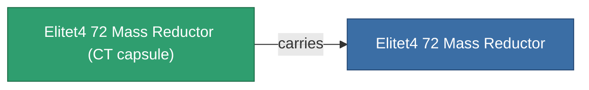

<!-- Generated by tools/generate from the live database (source: entitydefaults definition 6055, aggregatevalues via aggregatefields).
     Do not edit by hand; regenerate instead. -->

# Elitet4 72 Mass Reductor

|  |  |
|---|---|
| Определение | `def_elitet4_72_mass_reductor` |
| Тир | T4 (special) |
| Прочность | 100 |
| Объём | 0.5 |
| Масса | 1.5 |
| Категория | Modules / Enhancements |
| Примечание | elite module |

## Статистика

| Поле | Значение |
|---|---|
| armor_max_modifier | 0.745 |
| cpu_usage | 7 |
| massiveness | -0.25 |
| powergrid_usage | 3 |
| signature_radius | -0.3 |
| speed_max_modifier | 1.25 |

## Транспортная капсула

A transport capsule (CT) exists for this item — it is how the item moves between players and zones.

## Где купить

Fixed-price vendors that sell this item (see the [Item shop](/ru/content/shop/) for the full catalog).

| Vendor | Qty | Credits | UniCoin |
|---|---|---|---|
| Daoden outpost | ∞ | 500M | 25k |

<!-- production:generated -->
## Производство

**Производится из 2 компонентах** — соберите компоненты для изготовления (полный список в [Рецепты](/ru/content/recipes/)):

**Чертёж:** [Elitet4 72 Mass Reductor Cprg](/content/items/elitet4-72-mass-reductor-cprg/)

<svg class="prod-card-icon" aria-hidden="true"><use href="#mi-grid"/></svg><a class="prod-card-name" href="/ru/content/items/material-boss-z72/">Material Boss Z72</a>

нужно: <b>400</b>

<svg class="prod-card-icon" aria-hidden="true"><use href="#mi-grid"/></svg><a class="prod-card-name" href="/ru/content/items/named3-mass-reductor/">MRE 3000 lightweight frame</a>

нужно: <b>1</b>

