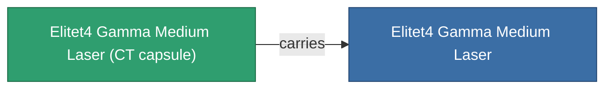

<!-- Generated by tools/generate from the live database (source: entitydefaults definition 6208, aggregatevalues via aggregatefields).
     Do not edit by hand; regenerate instead. -->

# Elitet4 Gamma Medium Laser

|  |  |
|---|---|
| Определение | `def_elitet4_gamma_medium_laser` |
| Тир | T4 (special) |
| Прочность | 100 |
| Объём | 1 |
| Масса | 550 |
| Категория | Modules / Weapons |
| Примечание | elite module |

## Статистика

| Поле | Значение |
|---|---|
| accuracy | 11.5 |
| core_usage | 17.6 |
| cpu_usage | 29 |
| cycle_time | 5k |
| damage_modifier | 1.7 |
| falloff | 10 |
| least_optimal | 6 |
| optimal_range | 19 |
| powergrid_usage | 238 |

## Транспортная капсула

A transport capsule (CT) exists for this item — it is how the item moves between players and zones.

## Где купить

Fixed-price vendors that sell this item (see the [Item shop](/ru/content/shop/) for the full catalog).

| Vendor | Qty | ASI Coin | Credits |
|---|---|---|---|
| Daoden outpost | ∞ | 5k | 750M |

<!-- production:generated -->
## Производство

**Производится из 2 компонентах** — соберите компоненты для изготовления (полный список в [Рецепты](/ru/content/recipes/)):

**Чертёж:** [Elitet4 Gamma Medium Laser Cprg](/ru/content/items/elitet4-gamma-medium-laser-cprg/)

<svg class="prod-card-icon" aria-hidden="true"><use href="#mi-grid"/></svg><a class="prod-card-name" href="/ru/content/items/material-boss-gamma-thelodica/">Material Boss Gamma Thelodica</a>

нужно: <b>400</b>

<svg class="prod-card-icon" aria-hidden="true"><use href="#mi-robots"/></svg><a class="prod-card-name" href="/ru/content/items/named3-medium-laser/">Thermodissector medium LCL laser</a>

нужно: <b>1</b>

