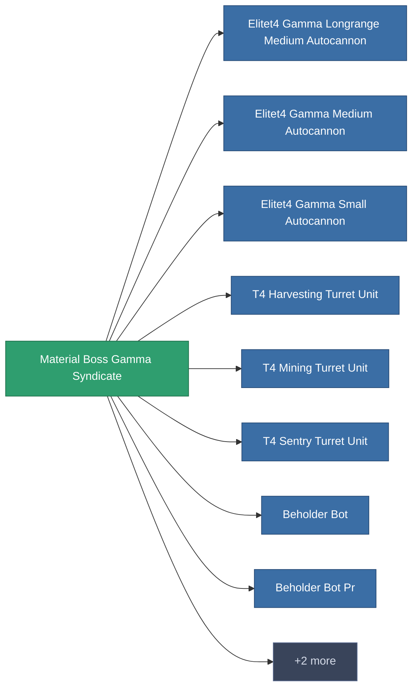

<!-- Generated by tools/generate from the live database (source: entitydefaults definition 6203, aggregatevalues via aggregatefields).
     Do not edit by hand; regenerate instead. -->

# Material Boss Gamma Syndicate

|  |  |
|---|---|
| Определение | `def_material_boss_gamma_syndicate` |
| Тир | – |
| Прочность | 100 |
| Объём | 0 |
| Масса | 0.25 |
| Категория | Materials |
| Примечание | elite module material |

_Нет статистики — этот предмет не имеет агрегированных значений._

<!-- production:generated -->
## Используется в производстве

**Компонент 10 предметов** — пример того, что можно произвести с ним (полный список в [Рецепты](/ru/content/recipes/)).

