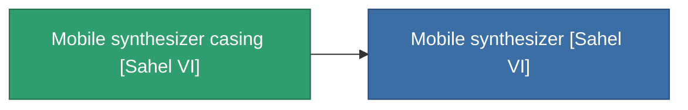

<!-- Generated by tools/generate from the live database (source: entitydefaults definition 4349, aggregatevalues via aggregatefields).
     Do not edit by hand; regenerate instead. -->

# Mobile synthesizer casing [Sahel VI]

|  |  |
|---|---|
| Определение | `def_missionitem_asi_ii_level03_exp3_06_t04` |
| Тир | – |
| Прочность | 100 |
| Объём | 0.01 |
| Масса | 50 |
| Категория | Mission items |

_Нет статистики — этот предмет не имеет агрегированных значений._

<!-- production:generated -->
## Используется в производстве

**Компонент 1 предметов** — всё, что использует его в производстве:

