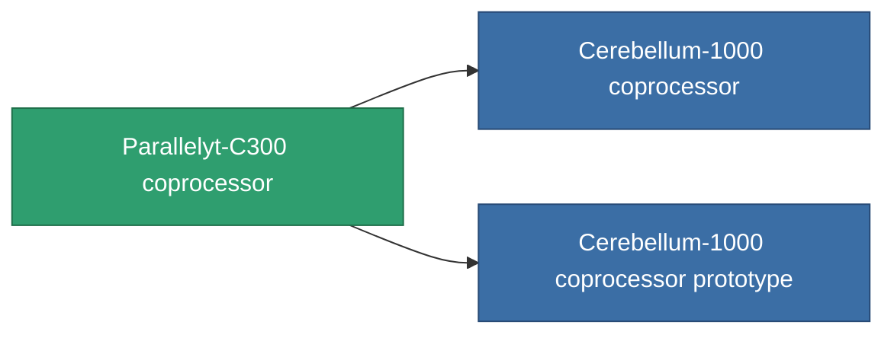

<!-- Generated by tools/generate from the live database (source: entitydefaults definition 783, aggregatevalues via aggregatefields).
     Do not edit by hand; regenerate instead. -->

# Parallelyt-C300 coprocessor

|  |  |
|---|---|
| Определение | `def_named1_cpu_upgrade` |
| Тир | T2 |
| Прочность | 100 |
| Объём | 0.01 |
| Масса | 0.2 |
| Категория | Modules / Enhancements |
| Tier line | [Standard coprocessor](/ru/content/items/standard-cpu-upgrade/) (T1) → **Parallelyt-C300 coprocessor** (T2) → [Cerebellum-1000 coprocessor](/ru/content/items/named2-cpu-upgrade/) (T3) → [Processyt-C1000 coprocessor](/ru/content/items/named3-cpu-upgrade/) (T4) |

## Статистика

| Поле | Значение |
|---|---|
| cpu_max_modifier | 1.1 |
| cpu_usage | 0 |
| powergrid_usage | 2 |

<!-- production:generated -->
## Производство

**Производится из 4 компонентах, уровень исследований 4** — соберите компоненты для изготовления (полный список в [Рецепты](/ru/content/recipes/)):

**Чертёж:** [Parallelyt-C300 coprocessor CT](/content/items/named1-cpu-upgrade-cprg/)

<svg class="prod-card-icon" aria-hidden="true"><use href="#mi-grid"/></svg><a class="prod-card-name" href="/ru/content/items/axicol/">Cryoperine</a>

нужно: <b>350</b>

<svg class="prod-card-icon" aria-hidden="true"><use href="#mi-crystal"/></svg><a class="prod-card-name" href="/ru/content/items/robotshard-common-basic/">Damaged common fragment</a>

нужно: <b>30</b>

<svg class="prod-card-icon" aria-hidden="true"><use href="#mi-grid"/></svg><a class="prod-card-name" href="/ru/content/items/standard-cpu-upgrade/">Standard coprocessor</a>

нужно: <b>1</b>

<svg class="prod-card-icon" aria-hidden="true"><use href="#mi-grid"/></svg><a class="prod-card-name" href="/ru/content/items/titanium/">Titanium</a>

нужно: <b>50</b>

## Используется в производстве

**Компонент 2 предметов** — всё, что использует его в производстве:

