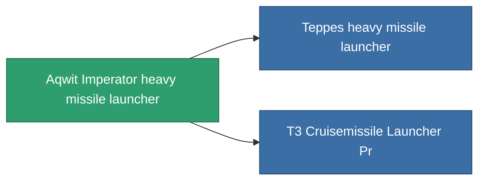

<!-- Generated by tools/generate from the live database (source: entitydefaults definition 855, aggregatevalues via aggregatefields).
     Do not edit by hand; regenerate instead. -->

# Aqwit Imperator heavy missile launcher

|  |  |
|---|---|
| Определение | `def_named1_cruisemissile_launcher` |
| Тир | T2 |
| Прочность | 100 |
| Объём | 1.5 |
| Масса | 900 |
| Категория | Modules / Weapons |
| Tier line | [Standard heavy missile launcher](/ru/content/items/standard-cruisemissile-launcher/) (T1) → **Aqwit Imperator heavy missile launcher** (T2) → [Teppes heavy missile launcher](/ru/content/items/named2-cruisemissile-launcher/) (T3) → [Pelistec-TR500 heavy missile launcher](/ru/content/items/named3-cruisemissile-launcher/) (T4) |

## Статистика

| Поле | Значение |
|---|---|
| accuracy | 1 |
| core_usage | 15 |
| cpu_usage | 90 |
| cycle_time | 14k |
| damage_modifier | 1.3 |
| powergrid_usage | 202.5 |

<!-- production:generated -->
## Производство

**Производится из 7 компонентах** — соберите компоненты для изготовления (полный список в [Рецепты](/ru/content/recipes/)):

**Чертёж:** [T2 Cruisemissile Launcher Cprg](/content/items/named1-cruisemissile-launcher-cprg/)

<svg class="prod-card-icon" aria-hidden="true"><use href="#mi-grid"/></svg><a class="prod-card-name" href="/ru/content/items/axicoline/">Axicoline</a>

нужно: <b>150</b>

<svg class="prod-card-icon" aria-hidden="true"><use href="#mi-grid"/></svg><a class="prod-card-name" href="/ru/content/items/phlobotil/">Phlobotil</a>

нужно: <b>150</b>

<svg class="prod-card-icon" aria-hidden="true"><use href="#mi-crystal"/></svg><a class="prod-card-name" href="/ru/content/items/robotshard-common-basic/">Damaged common fragment</a>

нужно: <b>45</b>

<svg class="prod-card-icon" aria-hidden="true"><use href="#mi-crystal"/></svg><a class="prod-card-name" href="/ru/content/items/robotshard-pelistal-basic/">Damaged pelistal fragment</a>

нужно: <b>45</b>

<svg class="prod-card-icon" aria-hidden="true"><use href="#mi-grid"/></svg><a class="prod-card-name" href="/ru/content/items/specimen-sap-item-flux/">Specimen Sap Item Flux</a>

нужно: <b>10</b>

<svg class="prod-card-icon" aria-hidden="true"><use href="#mi-star"/></svg><a class="prod-card-name" href="/ru/content/items/standard-cruisemissile-launcher/">Standard heavy missile launcher</a>

нужно: <b>1</b>

<svg class="prod-card-icon" aria-hidden="true"><use href="#mi-grid"/></svg><a class="prod-card-name" href="/ru/content/items/titanium/">Titanium</a>

нужно: <b>150</b>

## Используется в производстве

**Компонент 2 предметов** — всё, что использует его в производстве:

