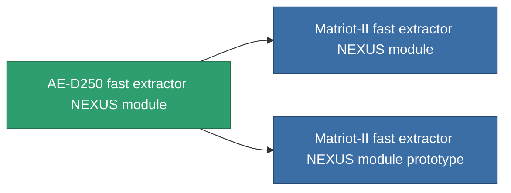

<!-- Generated by tools/generate from the live database (source: entitydefaults definition 2604, aggregatevalues via aggregatefields).
     Do not edit by hand; regenerate instead. -->

# AE-D250 fast extractor NEXUS module

|  |  |
|---|---|
| Определение | `def_named1_gang_assist_fast_extraction_module` |
| Тир | T2 |
| Прочность | 100 |
| Объём | 0.2 |
| Масса | 50 |
| Категория | Modules / Enhancements |
| Tier line | [Standard fast extractor NEXUS module](/ru/content/items/standard-gang-assist-fast-extraction-module/) (T1) → **AE-D250 fast extractor NEXUS module** (T2) → [Matriot-II fast extractor NEXUS module](/ru/content/items/named2-gang-assist-fast-extraction-module/) (T3) → [Matriot-IV fast extractor NEXUS module](/ru/content/items/named3-gang-assist-fast-extraction-module/) (T4) |
| Примечание | gathering cycletimet csokkent |

## Статистика

| Поле | Значение |
|---|---|
| core_usage | 31 |
| cpu_usage | 78 |
| cycle_time | 10k |
| default_effect_range | 100 |
| effect_gathering_cycle_time_modifier | 0.98 |
| powergrid_usage | 31 |

<!-- production:generated -->
## Производство

**Производится из 5 компонентах, уровень исследований 5** — соберите компоненты для изготовления (полный список в [Рецепты](/ru/content/recipes/)):

**Чертёж:** [AE-D250 fast extractor NEXUS module CT](/ru/content/items/named1-gang-assist-fast-extraction-module-cprg/)

<svg class="prod-card-icon" aria-hidden="true"><use href="#mi-grid"/></svg><a class="prod-card-name" href="/ru/content/items/axicol/">Cryoperine</a>

нужно: <b>500</b>

<svg class="prod-card-icon" aria-hidden="true"><use href="#mi-grid"/></svg><a class="prod-card-name" href="/ru/content/items/plasteosine/">Plasteosine</a>

нужно: <b>50</b>

<svg class="prod-card-icon" aria-hidden="true"><use href="#mi-crystal"/></svg><a class="prod-card-name" href="/ru/content/items/robotshard-common-basic/">Damaged common fragment</a>

нужно: <b>30</b>

<svg class="prod-card-icon" aria-hidden="true"><use href="#mi-panel"/></svg><a class="prod-card-name" href="/ru/content/items/standard-gang-assist-fast-extraction-module/">Standard fast extractor NEXUS module</a>

нужно: <b>1</b>

<svg class="prod-card-icon" aria-hidden="true"><use href="#mi-grid"/></svg><a class="prod-card-name" href="/ru/content/items/titanium/">Titanium</a>

нужно: <b>50</b>

## Используется в производстве

**Компонент 2 предметов** — всё, что использует его в производстве:

