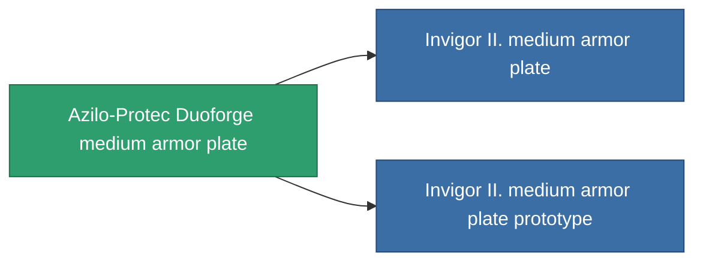

<!-- Generated by tools/generate from the live database (source: entitydefaults definition 687, aggregatevalues via aggregatefields).
     Do not edit by hand; regenerate instead. -->

# Azilo-Protec Duoforge medium armor plate

|  |  |
|---|---|
| Определение | `def_named1_medium_armor_plate` |
| Тир | T2 |
| Прочность | 100 |
| Объём | 2 |
| Масса | 2400 |
| Категория | Modules / Armor |
| Tier line | [Standard medium armor plate](/ru/content/items/standard-medium-armor-plate/) (T1) → **Azilo-Protec Duoforge medium armor plate** (T2) → [Invigor II. medium armor plate](/ru/content/items/named2-medium-armor-plate/) (T3) → [THL-Testudo medium armor plate](/ru/content/items/named3-medium-armor-plate/) (T4) |

## Статистика

| Поле | Значение |
|---|---|
| armor_max | 1.35k |
| cpu_usage | 2 |
| massiveness | 0.12 |
| powergrid_usage | 60 |
| signature_radius | 1 |

<!-- production:generated -->
## Производство

**Производится из 4 компонентах, уровень исследований 4** — соберите компоненты для изготовления (полный список в [Рецепты](/ru/content/recipes/)):

**Чертёж:** [Azilo-Protec Duoforge medium armor plate CT](/ru/content/items/named1-medium-armor-plate-cprg/)

<svg class="prod-card-icon" aria-hidden="true"><use href="#mi-grid"/></svg><a class="prod-card-name" href="/ru/content/items/plasteosine/">Plasteosine</a>

нужно: <b>700</b>

<svg class="prod-card-icon" aria-hidden="true"><use href="#mi-crystal"/></svg><a class="prod-card-name" href="/ru/content/items/robotshard-common-basic/">Damaged common fragment</a>

нужно: <b>60</b>

<svg class="prod-card-icon" aria-hidden="true"><use href="#mi-tree"/></svg><a class="prod-card-name" href="/ru/content/items/standard-medium-armor-plate/">Standard medium armor plate</a>

нужно: <b>1</b>

<svg class="prod-card-icon" aria-hidden="true"><use href="#mi-grid"/></svg><a class="prod-card-name" href="/ru/content/items/titanium/">Titanium</a>

нужно: <b>500</b>

## Используется в производстве

**Компонент 2 предметов** — всё, что использует его в производстве:

