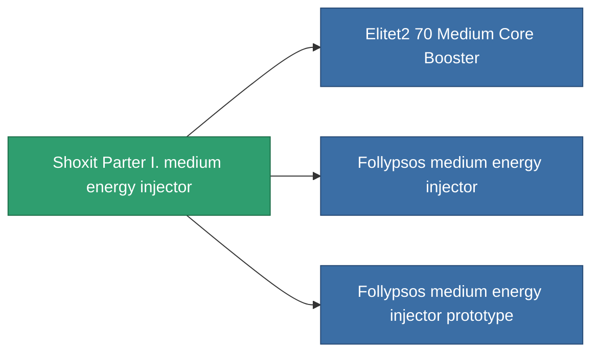

<!-- Generated by tools/generate from the live database (source: entitydefaults definition 825, aggregatevalues via aggregatefields).
     Do not edit by hand; regenerate instead. -->

# Shoxit Parter I. medium energy injector

|  |  |
|---|---|
| Определение | `def_named1_medium_core_booster` |
| Тир | T2 |
| Прочность | 100 |
| Объём | 1 |
| Масса | 180 |
| Категория | Modules / Enhancements |
| Tier line | [Standard medium energy injector](/ru/content/items/standard-medium-core-booster/) (T1) → **Shoxit Parter I. medium energy injector** (T2) → [Follypsos medium energy injector](/ru/content/items/named2-medium-core-booster/) (T3) → [Cerepter II. medium energy injector](/ru/content/items/named3-medium-core-booster/) (T4) |

## Статистика

| Поле | Значение |
|---|---|
| core_usage | 0 |
| cpu_usage | 23 |
| cycle_time | 11k |
| powergrid_usage | 225 |

<!-- production:generated -->
## Производство

**Производится из 4 компонентах, уровень исследований 5** — соберите компоненты для изготовления (полный список в [Рецепты](/ru/content/recipes/)):

**Чертёж:** [Shoxit Parter I. medium energy injector CT](/ru/content/items/named1-medium-core-booster-cprg/)

<svg class="prod-card-icon" aria-hidden="true"><use href="#mi-grid"/></svg><a class="prod-card-name" href="/ru/content/items/axicol/">Cryoperine</a>

нужно: <b>200</b>

<svg class="prod-card-icon" aria-hidden="true"><use href="#mi-crystal"/></svg><a class="prod-card-name" href="/ru/content/items/robotshard-common-basic/">Damaged common fragment</a>

нужно: <b>60</b>

<svg class="prod-card-icon" aria-hidden="true"><use href="#mi-grid"/></svg><a class="prod-card-name" href="/ru/content/items/standard-medium-core-booster/">Standard medium energy injector</a>

нужно: <b>1</b>

<svg class="prod-card-icon" aria-hidden="true"><use href="#mi-grid"/></svg><a class="prod-card-name" href="/ru/content/items/titanium/">Titanium</a>

нужно: <b>200</b>

## Используется в производстве

**Компонент 3 предметов** — всё, что использует его в производстве:

