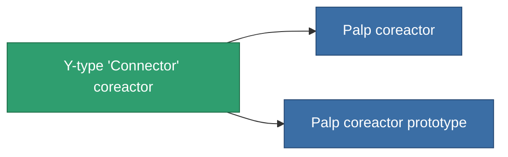

<!-- Generated by tools/generate from the live database (source: entitydefaults definition 765, aggregatevalues via aggregatefields).
     Do not edit by hand; regenerate instead. -->

# Y-type 'Connector' coreactor

|  |  |
|---|---|
| Определение | `def_named1_powergrid_upgrades` |
| Тир | T2 |
| Прочность | 100 |
| Объём | 0.5 |
| Масса | 90 |
| Категория | Modules / Power |
| Tier line | [Standard coreactor](/ru/content/items/standard-powergrid-upgrades/) (T1) → **Y-type 'Connector' coreactor** (T2) → [Palp coreactor](/ru/content/items/named2-powergrid-upgrades/) (T3) → [E-set 15VaW coreactor](/ru/content/items/named3-powergrid-upgrades/) (T4) |

## Статистика

| Поле | Значение |
|---|---|
| cpu_usage | 30 |
| powergrid_max_modifier | 1.1 |

<!-- production:generated -->
## Производство

**Производится из 4 компонентах, уровень исследований 4** — соберите компоненты для изготовления (полный список в [Рецепты](/ru/content/recipes/)):

**Чертёж:** [Y-type 'Connector' coreactor CT](/content/items/named1-powergrid-upgrades-cprg/)

<svg class="prod-card-icon" aria-hidden="true"><use href="#mi-grid"/></svg><a class="prod-card-name" href="/ru/content/items/axicol/">Cryoperine</a>

нужно: <b>300</b>

<svg class="prod-card-icon" aria-hidden="true"><use href="#mi-crystal"/></svg><a class="prod-card-name" href="/ru/content/items/robotshard-common-basic/">Damaged common fragment</a>

нужно: <b>30</b>

<svg class="prod-card-icon" aria-hidden="true"><use href="#mi-crystal"/></svg><a class="prod-card-name" href="/ru/content/items/standard-powergrid-upgrades/">Standard coreactor</a>

нужно: <b>1</b>

<svg class="prod-card-icon" aria-hidden="true"><use href="#mi-grid"/></svg><a class="prod-card-name" href="/ru/content/items/titanium/">Titanium</a>

нужно: <b>200</b>

## Используется в производстве

**Компонент 2 предметов** — всё, что использует его в производстве:

