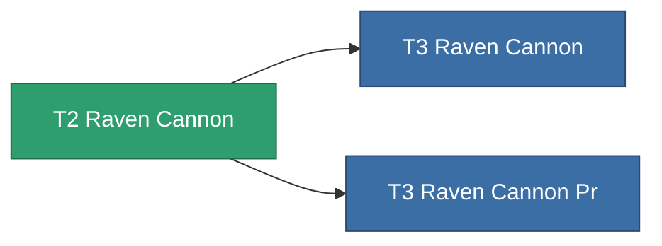

<!-- Generated by tools/generate from the live database (source: entitydefaults definition 1033, aggregatevalues via aggregatefields).
     Do not edit by hand; regenerate instead. -->

# T2 Raven Cannon

|  |  |
|---|---|
| Определение | `def_named1_raven_cannon` |
| Тир | T2 |
| Прочность | 100 |
| Объём | 1.8 |
| Масса | 1260 |
| Категория | Modules / Weapons |
| Tier line | [Standard Raven Cannon](/ru/content/items/standard-raven-cannon/) (T1) → **T2 Raven Cannon** (T2) → [T3 Raven Cannon](/ru/content/items/named2-raven-cannon/) (T3) → [T4 Raven Cannon](/ru/content/items/named3-raven-cannon/) (T4) |

## Статистика

| Поле | Значение |
|---|---|
| accuracy | 46 |
| core_usage | 2 |
| cpu_usage | 63 |
| cycle_time | 17k |
| damage_modifier | 1.65 |
| falloff | 40 |
| optimal_range | 38 |
| powergrid_usage | 270 |

<!-- production:generated -->
## Производство

**Производится из 8 компонентах** — соберите компоненты для изготовления (полный список в [Рецепты](/ru/content/recipes/)):

**Чертёж:** [T2 Raven Cannon Cprg](/ru/content/items/named1-raven-cannon-cprg/)

<svg class="prod-card-icon" aria-hidden="true"><use href="#mi-grid"/></svg><a class="prod-card-name" href="/ru/content/items/alligior/">Alligior</a>

нужно: <b>100</b>

<svg class="prod-card-icon" aria-hidden="true"><use href="#mi-grid"/></svg><a class="prod-card-name" href="/ru/content/items/axicol/">Cryoperine</a>

нужно: <b>200</b>

<svg class="prod-card-icon" aria-hidden="true"><use href="#mi-grid"/></svg><a class="prod-card-name" href="/ru/content/items/biotichrin/">Biotichrin</a>

нужно: <b>100</b>

<svg class="prod-card-icon" aria-hidden="true"><use href="#mi-grid"/></svg><a class="prod-card-name" href="/ru/content/items/espitium/">Espitium</a>

нужно: <b>50</b>

<svg class="prod-card-icon" aria-hidden="true"><use href="#mi-crystal"/></svg><a class="prod-card-name" href="/ru/content/items/robotshard-common-basic/">Damaged common fragment</a>

нужно: <b>90</b>

<svg class="prod-card-icon" aria-hidden="true"><use href="#mi-grid"/></svg><a class="prod-card-name" href="/ru/content/items/specimen-sap-item-flux/">Specimen Sap Item Flux</a>

нужно: <b>10</b>

<svg class="prod-card-icon" aria-hidden="true"><use href="#mi-robots"/></svg><a class="prod-card-name" href="/ru/content/items/standard-raven-cannon/">Standard Raven Cannon</a>

нужно: <b>1</b>

<svg class="prod-card-icon" aria-hidden="true"><use href="#mi-grid"/></svg><a class="prod-card-name" href="/ru/content/items/titanium/">Titanium</a>

нужно: <b>100</b>

## Используется в производстве

**Компонент 2 предметов** — всё, что использует его в производстве:

