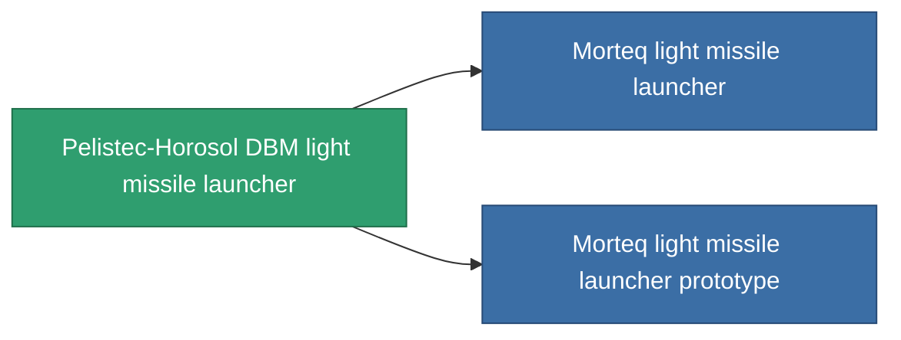

<!-- Generated by tools/generate from the live database (source: entitydefaults definition 849, aggregatevalues via aggregatefields).
     Do not edit by hand; regenerate instead. -->

# Pelistec-Horosol DBM light missile launcher

|  |  |
|---|---|
| Определение | `def_named1_rocket_launcher` |
| Тир | T2 |
| Прочность | 100 |
| Объём | 1 |
| Масса | 225 |
| Категория | Modules / Weapons |
| Tier line | [Standard light missile launcher](/ru/content/items/standard-rocket-launcher/) (T1) → **Pelistec-Horosol DBM light missile launcher** (T2) → [Morteq light missile launcher](/ru/content/items/named2-rocket-launcher/) (T3) → [Pelistec-TR110 light missile launcher](/ru/content/items/named3-rocket-launcher/) (T4) |

## Статистика

| Поле | Значение |
|---|---|
| accuracy | 1 |
| core_usage | 1 |
| cpu_usage | 28 |
| cycle_time | 7.5k |
| damage_modifier | 1 |
| powergrid_usage | 22 |

<!-- production:generated -->
## Производство

**Производится из 6 компонентах, уровень исследований 3** — соберите компоненты для изготовления (полный список в [Рецепты](/ru/content/recipes/)):

**Чертёж:** [Pelistec-Horosol DBM light missile launcher CT](/ru/content/items/named1-rocket-launcher-cprg/)

<svg class="prod-card-icon" aria-hidden="true"><use href="#mi-grid"/></svg><a class="prod-card-name" href="/ru/content/items/axicoline/">Axicoline</a>

нужно: <b>50</b>

<svg class="prod-card-icon" aria-hidden="true"><use href="#mi-grid"/></svg><a class="prod-card-name" href="/ru/content/items/phlobotil/">Phlobotil</a>

нужно: <b>50</b>

<svg class="prod-card-icon" aria-hidden="true"><use href="#mi-crystal"/></svg><a class="prod-card-name" href="/ru/content/items/robotshard-common-basic/">Damaged common fragment</a>

нужно: <b>15</b>

<svg class="prod-card-icon" aria-hidden="true"><use href="#mi-crystal"/></svg><a class="prod-card-name" href="/ru/content/items/robotshard-pelistal-basic/">Damaged pelistal fragment</a>

нужно: <b>15</b>

<svg class="prod-card-icon" aria-hidden="true"><use href="#mi-star"/></svg><a class="prod-card-name" href="/ru/content/items/standard-rocket-launcher/">Standard light missile launcher</a>

нужно: <b>1</b>

<svg class="prod-card-icon" aria-hidden="true"><use href="#mi-grid"/></svg><a class="prod-card-name" href="/ru/content/items/titanium/">Titanium</a>

нужно: <b>50</b>

## Используется в производстве

**Компонент 2 предметов** — всё, что использует его в производстве:

