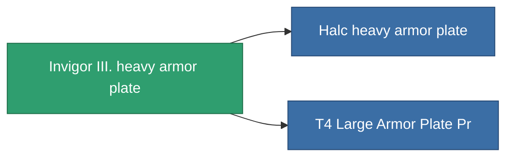

<!-- Generated by tools/generate from the live database (source: entitydefaults definition 691, aggregatevalues via aggregatefields).
     Do not edit by hand; regenerate instead. -->

# Invigor III. heavy armor plate

|  |  |
|---|---|
| Определение | `def_named2_large_armor_plate` |
| Тир | T3 |
| Прочность | 100 |
| Объём | 4 |
| Масса | 9000 |
| Категория | Modules / Armor |
| Tier line | [Standard large armor plate](/ru/content/items/standard-large-armor-plate/) (T1) → [Vorbol p113 heavy armor plate](/ru/content/items/named1-large-armor-plate/) (T2) → **Invigor III. heavy armor plate** (T3) → [Halc heavy armor plate](/ru/content/items/named3-large-armor-plate/) (T4) |

## Статистика

| Поле | Значение |
|---|---|
| armor_max | 4.35k |
| cpu_usage | 60 |
| massiveness | 0.156 |
| powergrid_usage | 1.05k |
| signature_radius | 3 |

<!-- production:generated -->
## Производство

**Производится из 7 компонентах** — соберите компоненты для изготовления (полный список в [Рецепты](/ru/content/recipes/)):

**Чертёж:** [T3 Large Armor Plate Cprg](/ru/content/items/named2-large-armor-plate-cprg/)

<svg class="prod-card-icon" aria-hidden="true"><use href="#mi-grid"/></svg><a class="prod-card-name" href="/ru/content/items/alligior/">Alligior</a>

нужно: <b>525</b>

<svg class="prod-card-icon" aria-hidden="true"><use href="#mi-tree"/></svg><a class="prod-card-name" href="/ru/content/items/named1-large-armor-plate/">Vorbol p113 heavy armor plate</a>

нужно: <b>1</b>

<svg class="prod-card-icon" aria-hidden="true"><use href="#mi-grid"/></svg><a class="prod-card-name" href="/ru/content/items/plasteosine/">Plasteosine</a>

нужно: <b>525</b>

<svg class="prod-card-icon" aria-hidden="true"><use href="#mi-crystal"/></svg><a class="prod-card-name" href="/ru/content/items/robotshard-common-advanced/">Functional common fragment</a>

нужно: <b>60</b>

<svg class="prod-card-icon" aria-hidden="true"><use href="#mi-crystal"/></svg><a class="prod-card-name" href="/ru/content/items/robotshard-common-basic/">Damaged common fragment</a>

нужно: <b>60</b>

<svg class="prod-card-icon" aria-hidden="true"><use href="#mi-grid"/></svg><a class="prod-card-name" href="/ru/content/items/specimen-sap-item-flux/">Specimen Sap Item Flux</a>

нужно: <b>50</b>

<svg class="prod-card-icon" aria-hidden="true"><use href="#mi-grid"/></svg><a class="prod-card-name" href="/ru/content/items/titanium/">Titanium</a>

нужно: <b>750</b>

## Используется в производстве

**Компонент 2 предметов** — всё, что использует его в производстве:

