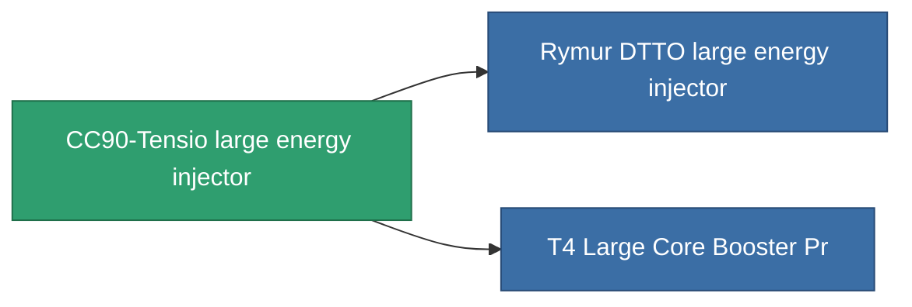

<!-- Generated by tools/generate from the live database (source: entitydefaults definition 829, aggregatevalues via aggregatefields).
     Do not edit by hand; regenerate instead. -->

# CC90-Tensio large energy injector

|  |  |
|---|---|
| Определение | `def_named2_large_core_booster` |
| Тир | T3 |
| Прочность | 100 |
| Объём | 2 |
| Масса | 1600 |
| Категория | Modules / Enhancements |
| Tier line | [Standard large energy injector](/ru/content/items/standard-large-core-booster/) (T1) → [Shoxit Parter II. large energy injector](/ru/content/items/named1-large-core-booster/) (T2) → **CC90-Tensio large energy injector** (T3) → [Rymur DTTO large energy injector](/ru/content/items/named3-large-core-booster/) (T4) |

## Статистика

| Поле | Значение |
|---|---|
| core_usage | 0 |
| cpu_usage | 375 |
| cycle_time | 5.5k |
| powergrid_usage | 1.375k |

<!-- production:generated -->
## Производство

**Производится из 7 компонентах** — соберите компоненты для изготовления (полный список в [Рецепты](/ru/content/recipes/)):

**Чертёж:** [T3 Large Core Booster Cprg](/content/items/named2-large-core-booster-cprg/)

<svg class="prod-card-icon" aria-hidden="true"><use href="#mi-grid"/></svg><a class="prod-card-name" href="/ru/content/items/axicol/">Cryoperine</a>

нужно: <b>150</b>

<svg class="prod-card-icon" aria-hidden="true"><use href="#mi-grid"/></svg><a class="prod-card-name" href="/ru/content/items/espitium/">Espitium</a>

нужно: <b>150</b>

<svg class="prod-card-icon" aria-hidden="true"><use href="#mi-grid"/></svg><a class="prod-card-name" href="/ru/content/items/named1-large-core-booster/">Shoxit Parter II. large energy injector</a>

нужно: <b>1</b>

<svg class="prod-card-icon" aria-hidden="true"><use href="#mi-crystal"/></svg><a class="prod-card-name" href="/ru/content/items/robotshard-common-advanced/">Functional common fragment</a>

нужно: <b>60</b>

<svg class="prod-card-icon" aria-hidden="true"><use href="#mi-crystal"/></svg><a class="prod-card-name" href="/ru/content/items/robotshard-common-basic/">Damaged common fragment</a>

нужно: <b>60</b>

<svg class="prod-card-icon" aria-hidden="true"><use href="#mi-grid"/></svg><a class="prod-card-name" href="/ru/content/items/specimen-sap-item-flux/">Specimen Sap Item Flux</a>

нужно: <b>15</b>

<svg class="prod-card-icon" aria-hidden="true"><use href="#mi-grid"/></svg><a class="prod-card-name" href="/ru/content/items/titanium/">Titanium</a>

нужно: <b>300</b>

## Используется в производстве

**Компонент 2 предметов** — всё, что использует его в производстве:

