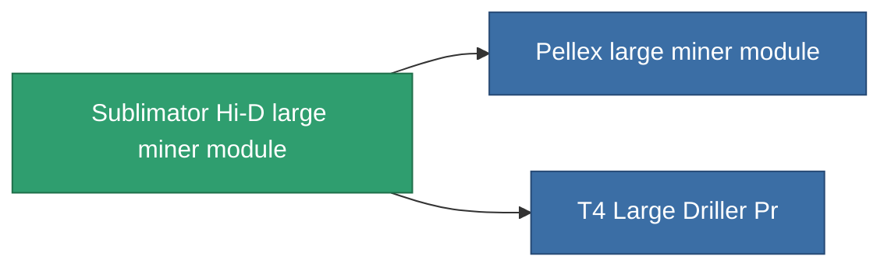

<!-- Generated by tools/generate from the live database (source: entitydefaults definition 8683, aggregatevalues via aggregatefields).
     Do not edit by hand; regenerate instead. -->

# Sublimator Hi-D large miner module

|  |  |
|---|---|
| Определение | `def_named2_large_driller` |
| Тир | T3 |
| Прочность | 100 |
| Объём | 2.5 |
| Масса | 1500 |
| Категория | Modules / Enhancements |
| Tier line | [Standard large miner module](/ru/content/items/standard-large-driller/) (T1) → [MMA v19-'Widge' large miner module](/ru/content/items/named1-large-driller/) (T2) → **Sublimator Hi-D large miner module** (T3) → [Pellex large miner module](/ru/content/items/named3-large-driller/) (T4) |

## Статистика

| Поле | Значение |
|---|---|
| core_usage | 180 |
| cpu_usage | 468 |
| cycle_time | 11k |
| powergrid_usage | 1.44k |

<!-- production:generated -->
## Производство

**Производится из 6 компонентах** — соберите компоненты для изготовления (полный список в [Рецепты](/ru/content/recipes/)):

**Чертёж:** [T3 Large Driller Cprg](/content/items/named2-large-driller-cprg/)

<svg class="prod-card-icon" aria-hidden="true"><use href="#mi-grid"/></svg><a class="prod-card-name" href="/ru/content/items/axicol/">Cryoperine</a>

нужно: <b>400</b>

<svg class="prod-card-icon" aria-hidden="true"><use href="#mi-grid"/></svg><a class="prod-card-name" href="/ru/content/items/espitium/">Espitium</a>

нужно: <b>400</b>

<svg class="prod-card-icon" aria-hidden="true"><use href="#mi-panel"/></svg><a class="prod-card-name" href="/ru/content/items/named1-large-driller/">MMA v19-'Widge' large miner module</a>

нужно: <b>1</b>

<svg class="prod-card-icon" aria-hidden="true"><use href="#mi-crystal"/></svg><a class="prod-card-name" href="/ru/content/items/robotshard-common-advanced/">Functional common fragment</a>

нужно: <b>80</b>

<svg class="prod-card-icon" aria-hidden="true"><use href="#mi-crystal"/></svg><a class="prod-card-name" href="/ru/content/items/robotshard-common-basic/">Damaged common fragment</a>

нужно: <b>80</b>

<svg class="prod-card-icon" aria-hidden="true"><use href="#mi-grid"/></svg><a class="prod-card-name" href="/ru/content/items/titanium/">Titanium</a>

нужно: <b>2.4k</b>

## Используется в производстве

**Компонент 2 предметов** — всё, что использует его в производстве:

