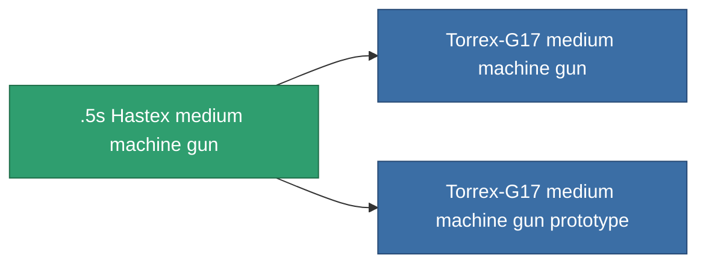

<!-- Generated by tools/generate from the live database (source: entitydefaults definition 844, aggregatevalues via aggregatefields).
     Do not edit by hand; regenerate instead. -->

# .5s Hastex medium machine gun

|  |  |
|---|---|
| Определение | `def_named2_medium_autocannon` |
| Тир | T3 |
| Прочность | 100 |
| Объём | 1.2 |
| Масса | 500 |
| Категория | Modules / Weapons |
| Tier line | [Standard medium machine gun](/ru/content/items/standard-medium-autocannon/) (T1) → [Grenber 28d medium machine gun](/ru/content/items/named1-medium-autocannon/) (T2) → **.5s Hastex medium machine gun** (T3) → [Torrex-G17 medium machine gun](/ru/content/items/named3-medium-autocannon/) (T4) |

## Статистика

| Поле | Значение |
|---|---|
| accuracy | 17 |
| core_usage | 2 |
| cpu_usage | 11 |
| cycle_time | 4k |
| damage_modifier | 1.7 |
| falloff | 21.5 |
| least_optimal | 3 |
| optimal_range | 14.5 |
| powergrid_usage | 125 |

<!-- production:generated -->
## Производство

**Производится из 4 компонентах, уровень исследований 5** — соберите компоненты для изготовления (полный список в [Рецепты](/ru/content/recipes/)):

**Чертёж:** [.5s Hastex medium machine gun CT](/content/items/named2-medium-autocannon-cprg/)

<svg class="prod-card-icon" aria-hidden="true"><use href="#mi-grid"/></svg><a class="prod-card-name" href="/ru/content/items/axicoline/">Axicoline</a>

нужно: <b>100</b>

<svg class="prod-card-icon" aria-hidden="true"><use href="#mi-grid"/></svg><a class="prod-card-name" href="/ru/content/items/hydrobenol/">Hydrobenol</a>

нужно: <b>100</b>

<svg class="prod-card-icon" aria-hidden="true"><use href="#mi-grid"/></svg><a class="prod-card-name" href="/ru/content/items/named1-medium-autocannon/">Grenber 28d medium machine gun</a>

нужно: <b>1</b>

<svg class="prod-card-icon" aria-hidden="true"><use href="#mi-grid"/></svg><a class="prod-card-name" href="/ru/content/items/titanium/">Titanium</a>

нужно: <b>100</b>

## Используется в производстве

**Компонент 2 предметов** — всё, что использует его в производстве:

