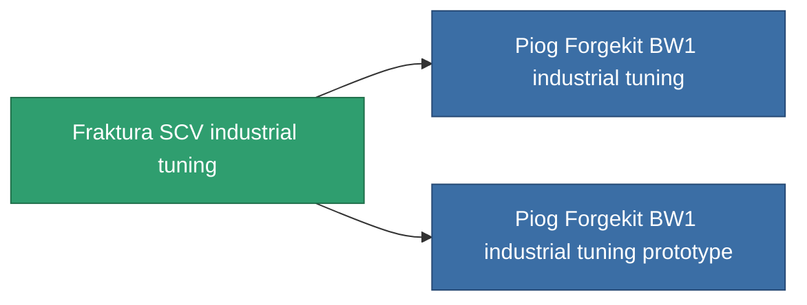

<!-- Generated by tools/generate from the live database (source: entitydefaults definition 805, aggregatevalues via aggregatefields).
     Do not edit by hand; regenerate instead. -->

# Fraktura SCV industrial tuning

|  |  |
|---|---|
| Определение | `def_named2_mining_upgrade` |
| Тир | T3 |
| Прочность | 100 |
| Объём | 0.1 |
| Масса | 60 |
| Категория | Modules / Enhancements |
| Tier line | [Standard industrial tuning](/ru/content/items/standard-mining-upgrade/) (T1) → [Piog Forgekit AI industrial tuning](/ru/content/items/named1-mining-upgrade/) (T2) → **Fraktura SCV industrial tuning** (T3) → [Piog Forgekit BW1 industrial tuning](/ru/content/items/named3-mining-upgrade/) (T4) |

## Статистика

| Поле | Значение |
|---|---|
| cpu_usage | 37 |
| harvesting_amount_modifier | 1.075 |
| mining_amount_modifier | 1.075 |
| powergrid_usage | 21 |

<!-- production:generated -->
## Производство

**Производится из 6 компонентах, уровень исследований 5** — соберите компоненты для изготовления (полный список в [Рецепты](/ru/content/recipes/)):

**Чертёж:** [Fraktura SCV industrial tuning CT](/content/items/named2-mining-upgrade-cprg/)

<svg class="prod-card-icon" aria-hidden="true"><use href="#mi-grid"/></svg><a class="prod-card-name" href="/ru/content/items/axicol/">Cryoperine</a>

нужно: <b>100</b>

<svg class="prod-card-icon" aria-hidden="true"><use href="#mi-grid"/></svg><a class="prod-card-name" href="/ru/content/items/espitium/">Espitium</a>

нужно: <b>100</b>

<svg class="prod-card-icon" aria-hidden="true"><use href="#mi-panel"/></svg><a class="prod-card-name" href="/ru/content/items/named1-mining-upgrade/">Piog Forgekit AI industrial tuning</a>

нужно: <b>1</b>

<svg class="prod-card-icon" aria-hidden="true"><use href="#mi-crystal"/></svg><a class="prod-card-name" href="/ru/content/items/robotshard-common-advanced/">Functional common fragment</a>

нужно: <b>20</b>

<svg class="prod-card-icon" aria-hidden="true"><use href="#mi-crystal"/></svg><a class="prod-card-name" href="/ru/content/items/robotshard-common-basic/">Damaged common fragment</a>

нужно: <b>20</b>

<svg class="prod-card-icon" aria-hidden="true"><use href="#mi-grid"/></svg><a class="prod-card-name" href="/ru/content/items/titanium/">Titanium</a>

нужно: <b>50</b>

## Используется в производстве

**Компонент 2 предметов** — всё, что использует его в производстве:

