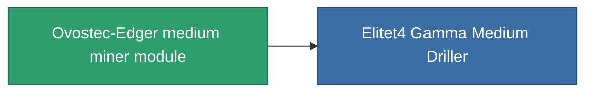

<!-- Generated by tools/generate from the live database (source: entitydefaults definition 803, aggregatevalues via aggregatefields).
     Do not edit by hand; regenerate instead. -->

# Ovostec-Edger medium miner module

|  |  |
|---|---|
| Определение | `def_named3_medium_driller` |
| Тир | T4 |
| Прочность | 100 |
| Объём | 1.5 |
| Масса | 1000 |
| Категория | Modules / Enhancements |
| Tier line | [Standard medium miner module](/ru/content/items/standard-medium-driller/) (T1) → [MMA v12-'Alkhemir' medium miner module](/ru/content/items/named1-medium-driller/) (T2) → [Sublimator Mid-D medium miner module](/ru/content/items/named2-medium-driller/) (T3) → **Ovostec-Edger medium miner module** (T4) |

## Статистика

| Поле | Значение |
|---|---|
| core_usage | 65 |
| cpu_usage | 55 |
| cycle_time | 10k |
| optimal_range | 3 |
| powergrid_usage | 170 |

<!-- production:generated -->
## Производство

**Производится из 8 компонентах, уровень исследований 6** — соберите компоненты для изготовления (полный список в [Рецепты](/ru/content/recipes/)):

**Чертёж:** [Ovostec-Edger medium miner module CT](/content/items/named3-medium-driller-cprg/)

<svg class="prod-card-icon" aria-hidden="true"><use href="#mi-grid"/></svg><a class="prod-card-name" href="/ru/content/items/axicol/">Cryoperine</a>

нужно: <b>100</b>

<svg class="prod-card-icon" aria-hidden="true"><use href="#mi-grid"/></svg><a class="prod-card-name" href="/ru/content/items/espitium/">Espitium</a>

нужно: <b>100</b>

<svg class="prod-card-icon" aria-hidden="true"><use href="#mi-panel"/></svg><a class="prod-card-name" href="/ru/content/items/named2-medium-driller/">Sublimator Mid-D medium miner module</a>

нужно: <b>1</b>

<svg class="prod-card-icon" aria-hidden="true"><use href="#mi-crystal"/></svg><a class="prod-card-name" href="/ru/content/items/robotshard-common-advanced/">Functional common fragment</a>

нужно: <b>60</b>

<svg class="prod-card-icon" aria-hidden="true"><use href="#mi-crystal"/></svg><a class="prod-card-name" href="/ru/content/items/robotshard-common-basic/">Damaged common fragment</a>

нужно: <b>30</b>

<svg class="prod-card-icon" aria-hidden="true"><use href="#mi-crystal"/></svg><a class="prod-card-name" href="/ru/content/items/robotshard-common-expert/">Perfect common fragment</a>

нужно: <b>90</b>

<svg class="prod-card-icon" aria-hidden="true"><use href="#mi-grid"/></svg><a class="prod-card-name" href="/ru/content/items/titanium/">Titanium</a>

нужно: <b>300</b>

<svg class="prod-card-icon" aria-hidden="true"><use href="#mi-grid"/></svg><a class="prod-card-name" href="/ru/content/items/unimetal/">Briochit</a>

нужно: <b>300</b>

## Используется в производстве

**Компонент 1 предметов** — всё, что использует его в производстве:

