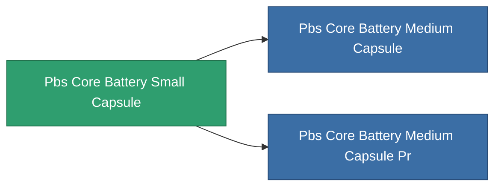

<!-- Generated by tools/generate from the live database (source: entitydefaults definition 5124, aggregatevalues via aggregatefields).
     Do not edit by hand; regenerate instead. -->

# Pbs Core Battery Small Capsule

|  |  |
|---|---|
| Определение | `def_pbs_core_battery_small_capsule` |
| Тир | T1 |
| Прочность | 100 |
| Объём | 125 |
| Масса | 125000 |
| Категория | Special & other / Miscellaneous |

## Статистика

| Поле | Значение |
|---|---|
| armor_max | 50k |
| core_max | 14.112M |
| resist_chemical | 30 |
| resist_explosive | 30 |
| resist_kinetic | 30 |
| resist_thermal | 30 |
| signature_radius | 40 |
| stealth_strength | 50 |

<!-- production:generated -->
## Производство

**Производится из 4 компонентах** — соберите компоненты для изготовления (полный список в [Рецепты](/ru/content/recipes/)):

**Чертёж:** [Standard energy battery foundation CT](/ru/content/items/pbs-core-battery-small-capsule-cprg/)

<svg class="prod-card-icon" aria-hidden="true"><use href="#mi-grid"/></svg><a class="prod-card-name" href="/ru/content/items/axicol/">Cryoperine</a>

нужно: <b>5.0k</b>

<svg class="prod-card-icon" aria-hidden="true"><use href="#mi-grid"/></svg><a class="prod-card-name" href="/ru/content/items/espitium/">Espitium</a>

нужно: <b>5.0k</b>

<svg class="prod-card-icon" aria-hidden="true"><use href="#mi-grid"/></svg><a class="prod-card-name" href="/ru/content/items/titanium/">Titanium</a>

нужно: <b>2.0k</b>

<svg class="prod-card-icon" aria-hidden="true"><use href="#mi-grid"/></svg><a class="prod-card-name" href="/ru/content/items/unimetal/">Briochit</a>

нужно: <b>2.0k</b>

## Используется в производстве

**Компонент 2 предметов** — всё, что использует его в производстве:

