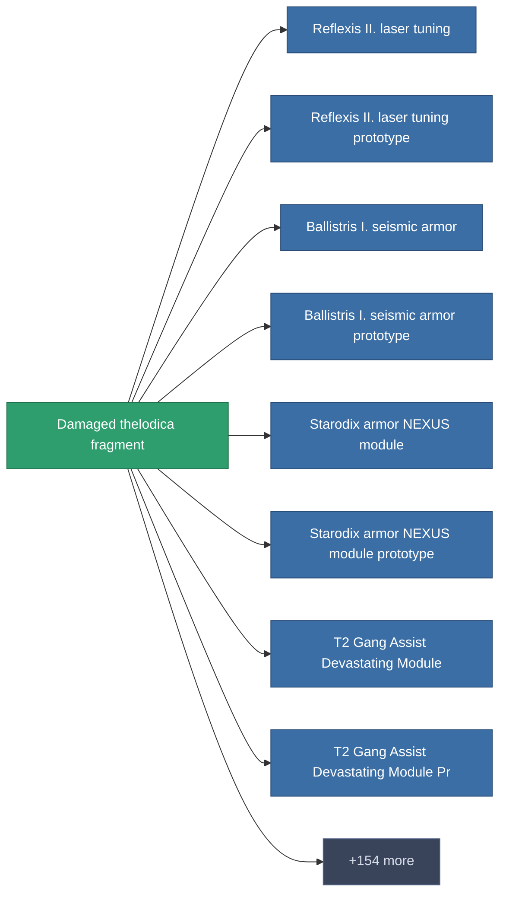

<!-- Generated by tools/generate from the live database (source: entitydefaults definition 1983, aggregatevalues via aggregatefields).
     Do not edit by hand; regenerate instead. -->

# Damaged thelodica fragment

|  |  |
|---|---|
| Определение | `def_robotshard_thelodica_basic` |
| Тир | – |
| Прочность | 100 |
| Объём | 0.01 |
| Масса | 1 |
| Категория | Materials |

_Нет статистики — этот предмет не имеет агрегированных значений._

<!-- production:generated -->
## Производство

**Производится из 3 компонентах** — соберите компоненты для изготовления (полный список в [Рецепты](/ru/content/recipes/)):

<svg class="prod-card-icon" aria-hidden="true"><use href="#mi-grid"/></svg><a class="prod-card-name" href="/ru/content/items/metachropin/">Metachropin</a>

нужно: <b>1</b>

<svg class="prod-card-icon" aria-hidden="true"><use href="#mi-grid"/></svg><a class="prod-card-name" href="/ru/content/items/polynucleit/">Polynucleit</a>

нужно: <b>1</b>

<svg class="prod-card-icon" aria-hidden="true"><use href="#mi-grid"/></svg><a class="prod-card-name" href="/ru/content/items/prilumium/">Prilumium</a>

нужно: <b>1</b>

## Используется в производстве

**Компонент 162 предметов** — пример того, что можно произвести с ним (полный список в [Рецепты](/ru/content/recipes/)).

