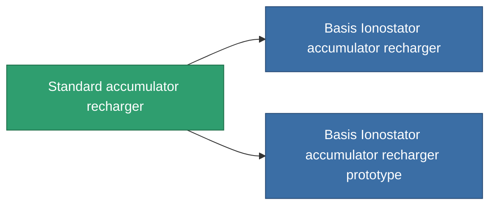

<!-- Generated by tools/generate from the live database (source: entitydefaults definition 41, aggregatevalues via aggregatefields).
     Do not edit by hand; regenerate instead. -->

# Standard accumulator recharger

|  |  |
|---|---|
| Определение | `def_standard_core_recharger` |
| Тир | T1 |
| Прочность | 100 |
| Объём | 0.5 |
| Масса | 100 |
| Категория | Modules / Power |
| Tier line | **Standard accumulator recharger** (T1) → [Basis Ionostator accumulator recharger](/ru/content/items/named1-core-recharger/) (T2) → [Duobar 300xs-'Othys' accumulator recharger](/ru/content/items/named2-core-recharger/) (T3) → [Nyhna Filler accumulator recharger](/ru/content/items/named3-core-recharger/) (T4) |

## Статистика

| Поле | Значение |
|---|---|
| core_recharge_time_modifier | 0.9 |
| cpu_usage | 25 |
| powergrid_usage | 2 |

<!-- production:generated -->
## Производство

**Производится из 2 компонентах, уровень исследований 3** — соберите компоненты для изготовления (полный список в [Рецепты](/ru/content/recipes/)):

**Чертёж:** [Standard accumulator recharger CT](/ru/content/items/standard-core-recharger-cprg/)

<svg class="prod-card-icon" aria-hidden="true"><use href="#mi-grid"/></svg><a class="prod-card-name" href="/ru/content/items/axicol/">Cryoperine</a>

нужно: <b>250</b>

<svg class="prod-card-icon" aria-hidden="true"><use href="#mi-grid"/></svg><a class="prod-card-name" href="/ru/content/items/titanium/">Titanium</a>

нужно: <b>150</b>

## Используется в производстве

**Компонент 2 предметов** — всё, что использует его в производстве:

