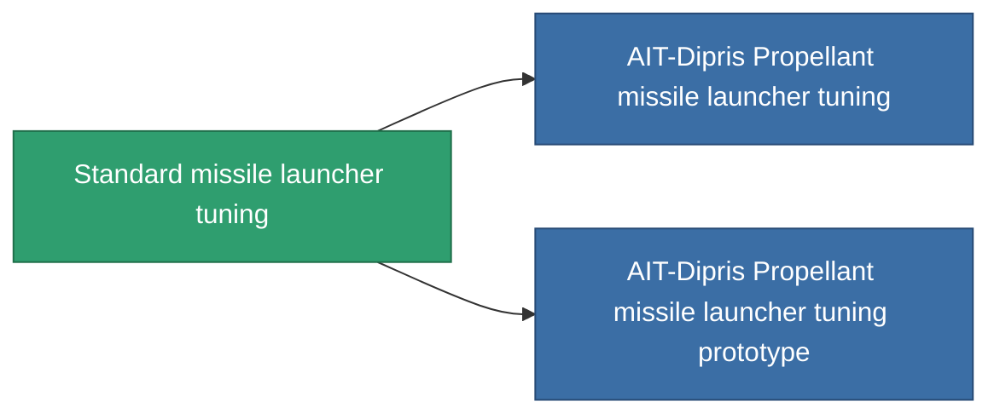

<!-- Generated by tools/generate from the live database (source: entitydefaults definition 910, aggregatevalues via aggregatefields).
     Do not edit by hand; regenerate instead. -->

# Standard missile launcher tuning

|  |  |
|---|---|
| Определение | `def_standard_damage_mod_missile` |
| Тир | T1 |
| Прочность | 100 |
| Объём | 0.5 |
| Масса | 100 |
| Категория | Modules / Enhancements |
| Tier line | **Standard missile launcher tuning** (T1) → [AIT-Dipris Propellant missile launcher tuning](/ru/content/items/named1-damage-mod-missile/) (T2) → [Pelistec-FBP-II. missile launcher tuning](/ru/content/items/named2-damage-mod-missile/) (T3) → [Dozer-IMT missile launcher tuning](/ru/content/items/named3-damage-mod-missile/) (T4) |

## Статистика

| Поле | Значение |
|---|---|
| cpu_usage | 25 |
| damage_missile_modifier | 0.15 |
| powergrid_usage | 5 |

<!-- production:generated -->
## Производство

**Производится из 5 компонентах, уровень исследований 3** — соберите компоненты для изготовления (полный список в [Рецепты](/ru/content/recipes/)):

**Чертёж:** [Standard missile launcher tuning CT](/ru/content/items/standard-damage-mod-missile-cprg/)

<svg class="prod-card-icon" aria-hidden="true"><use href="#mi-grid"/></svg><a class="prod-card-name" href="/ru/content/items/axicol/">Cryoperine</a>

нужно: <b>100</b>

<svg class="prod-card-icon" aria-hidden="true"><use href="#mi-grid"/></svg><a class="prod-card-name" href="/ru/content/items/axicoline/">Axicoline</a>

нужно: <b>50</b>

<svg class="prod-card-icon" aria-hidden="true"><use href="#mi-grid"/></svg><a class="prod-card-name" href="/ru/content/items/phlobotil/">Phlobotil</a>

нужно: <b>50</b>

<svg class="prod-card-icon" aria-hidden="true"><use href="#mi-grid"/></svg><a class="prod-card-name" href="/ru/content/items/titanium/">Titanium</a>

нужно: <b>50</b>

<svg class="prod-card-icon" aria-hidden="true"><use href="#mi-grid"/></svg><a class="prod-card-name" href="/ru/content/items/vitricyl/">Vitricyl</a>

нужно: <b>100</b>

## Используется в производстве

**Компонент 2 предметов** — всё, что использует его в производстве:

