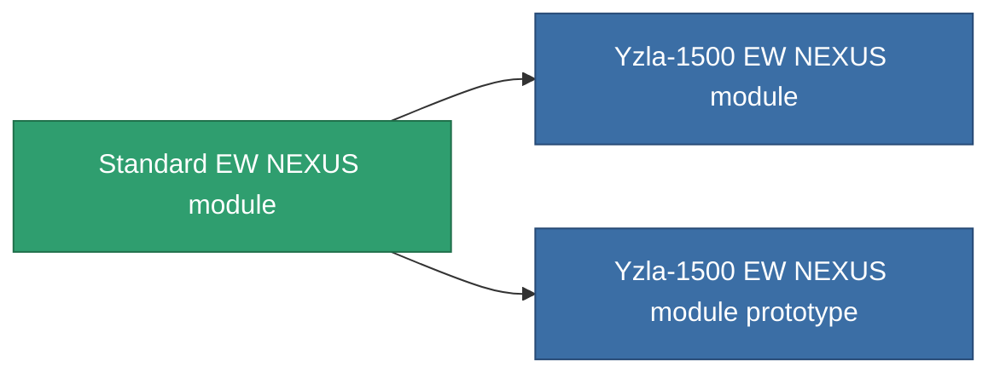

<!-- Generated by tools/generate from the live database (source: entitydefaults definition 2550, aggregatevalues via aggregatefields).
     Do not edit by hand; regenerate instead. -->

# Standard EW NEXUS module

|  |  |
|---|---|
| Определение | `def_standard_gang_assist_ewar_range_module` |
| Тир | T1 |
| Прочность | 100 |
| Объём | 0.2 |
| Масса | 50 |
| Категория | Modules / Enhancements |
| Tier line | **Standard EW NEXUS module** (T1) → [Yzla-1500 EW NEXUS module](/ru/content/items/named1-gang-assist-ewar-range-module/) (T2) → [Hidmuns EW NEXUS module](/ru/content/items/named2-gang-assist-ewar-range-module/) (T3) → [Yzla-2500 EW NEXUS module](/ru/content/items/named3-gang-assist-ewar-range-module/) (T4) |
| Примечание | ew_optimalt novel |

## Статистика

| Поле | Значение |
|---|---|
| core_usage | 35 |
| cpu_usage | 85 |
| cycle_time | 10k |
| default_effect_range | 100 |
| effect_ew_optimal_range_modifier | 1.02 |
| powergrid_usage | 35 |

<!-- production:generated -->
## Производство

**Производится из 3 компонентах, уровень исследований 4** — соберите компоненты для изготовления (полный список в [Рецепты](/ru/content/recipes/)):

**Чертёж:** [Standard EW NEXUS module CT](/ru/content/items/standard-gang-assist-ewar-range-module-cprg/)

<svg class="prod-card-icon" aria-hidden="true"><use href="#mi-grid"/></svg><a class="prod-card-name" href="/ru/content/items/axicol/">Cryoperine</a>

нужно: <b>500</b>

<svg class="prod-card-icon" aria-hidden="true"><use href="#mi-grid"/></svg><a class="prod-card-name" href="/ru/content/items/axicoline/">Axicoline</a>

нужно: <b>100</b>

<svg class="prod-card-icon" aria-hidden="true"><use href="#mi-grid"/></svg><a class="prod-card-name" href="/ru/content/items/titanium/">Titanium</a>

нужно: <b>50</b>

## Используется в производстве

**Компонент 2 предметов** — всё, что использует его в производстве:

