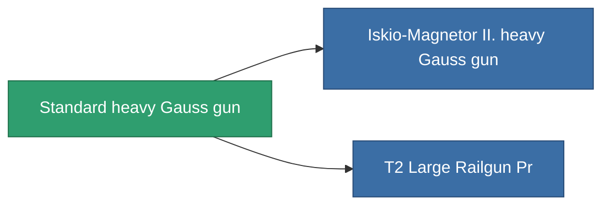

<!-- Generated by tools/generate from the live database (source: entitydefaults definition 68, aggregatevalues via aggregatefields).
     Do not edit by hand; regenerate instead. -->

# Standard heavy Gauss gun

|  |  |
|---|---|
| Определение | `def_standard_large_railgun` |
| Тир | T1 |
| Прочность | 100 |
| Объём | 1.5 |
| Масса | 1000 |
| Категория | Modules / Weapons |
| Tier line | **Standard heavy Gauss gun** (T1) → [Iskio-Magnetor II. heavy Gauss gun](/ru/content/items/named1-large-railgun/) (T2) → [Nuimtec-Gaule heavy Gauss gun](/ru/content/items/named2-large-railgun/) (T3) → [Pentack-Nailer dd550 heavy Gauss gun](/ru/content/items/named3-large-railgun/) (T4) |

## Статистика

| Поле | Значение |
|---|---|
| accuracy | 40.5 |
| core_usage | 10.5 |
| cpu_usage | 80 |
| cycle_time | 6k |
| damage_modifier | 2.55 |
| falloff | 7.5 |
| optimal_range | 20 |
| powergrid_usage | 225 |

<!-- production:generated -->
## Производство

**Производится из 4 компонентах** — соберите компоненты для изготовления (полный список в [Рецепты](/ru/content/recipes/)):

**Чертёж:** [Standard Large Railgun Cprg](/ru/content/items/standard-large-railgun-cprg/)

<svg class="prod-card-icon" aria-hidden="true"><use href="#mi-grid"/></svg><a class="prod-card-name" href="/ru/content/items/axicoline/">Axicoline</a>

нужно: <b>150</b>

<svg class="prod-card-icon" aria-hidden="true"><use href="#mi-grid"/></svg><a class="prod-card-name" href="/ru/content/items/polynitrocol/">Polynitrocol</a>

нужно: <b>150</b>

<svg class="prod-card-icon" aria-hidden="true"><use href="#mi-grid"/></svg><a class="prod-card-name" href="/ru/content/items/specimen-sap-item-flux/">Specimen Sap Item Flux</a>

нужно: <b>10</b>

<svg class="prod-card-icon" aria-hidden="true"><use href="#mi-grid"/></svg><a class="prod-card-name" href="/ru/content/items/titanium/">Titanium</a>

нужно: <b>150</b>

## Используется в производстве

**Компонент 2 предметов** — всё, что использует его в производстве:

