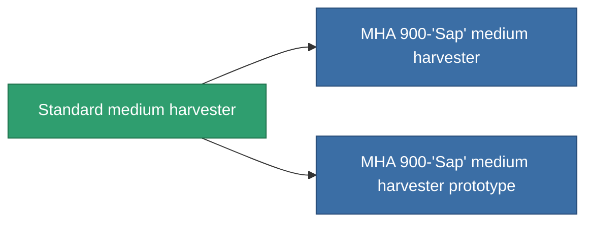

<!-- Generated by tools/generate from the live database (source: entitydefaults definition 640, aggregatevalues via aggregatefields).
     Do not edit by hand; regenerate instead. -->

# Standard medium harvester

|  |  |
|---|---|
| Определение | `def_standard_medium_harvester` |
| Тир | T1 |
| Прочность | 100 |
| Объём | 1.5 |
| Масса | 1000 |
| Категория | Modules / Harvesting |
| Tier line | **Standard medium harvester** (T1) → [MHA 900-'Sap' medium harvester](/ru/content/items/named1-medium-harvester/) (T2) → [Cultivator-XM medium harvester](/ru/content/items/named2-medium-harvester/) (T3) → [Protrim V-II medium harvester](/ru/content/items/named3-medium-harvester/) (T4) |

## Статистика

| Поле | Значение |
|---|---|
| core_usage | 55 |
| cpu_usage | 50 |
| cycle_time | 12k |
| optimal_range | 3 |
| powergrid_usage | 150 |

<!-- production:generated -->
## Производство

**Производится из 2 компонентах, уровень исследований 3** — соберите компоненты для изготовления (полный список в [Рецепты](/ru/content/recipes/)):

**Чертёж:** [Standard medium harvester CT](/content/items/standard-medium-harvester-cprg/)

<svg class="prod-card-icon" aria-hidden="true"><use href="#mi-grid"/></svg><a class="prod-card-name" href="/ru/content/items/axicol/">Cryoperine</a>

нужно: <b>100</b>

<svg class="prod-card-icon" aria-hidden="true"><use href="#mi-grid"/></svg><a class="prod-card-name" href="/ru/content/items/titanium/">Titanium</a>

нужно: <b>300</b>

## Используется в производстве

**Компонент 2 предметов** — всё, что использует его в производстве:

