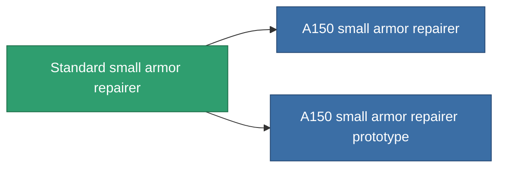

<!-- Generated by tools/generate from the live database (source: entitydefaults definition 18, aggregatevalues via aggregatefields).
     Do not edit by hand; regenerate instead. -->

# Standard small armor repairer

|  |  |
|---|---|
| Определение | `def_standard_small_armor_repairer` |
| Тир | T1 |
| Прочность | 100 |
| Объём | 1 |
| Масса | 250 |
| Категория | Modules / Repair |
| Tier line | **Standard small armor repairer** (T1) → [A150 small armor repairer](/ru/content/items/named1-small-armor-repairer/) (T2) → [Quissot's small armor repairer](/ru/content/items/named2-small-armor-repairer/) (T3) → [Microforge Aestolar small armor repairer](/ru/content/items/named3-small-armor-repairer/) (T4) |
| Примечание | armor_hp += repair_amount * armor_repair_amount_modifier  rof = cycle_time * armor_repair_cycle_time_modifier   |

## Статистика

| Поле | Значение |
|---|---|
| armor_repair_amount | 60 |
| core_usage | 65 |
| cpu_usage | 35 |
| cycle_time | 15k |
| powergrid_usage | 20 |

<!-- production:generated -->
## Производство

**Производится из 5 компонентах, уровень исследований 2** — соберите компоненты для изготовления (полный список в [Рецепты](/ru/content/recipes/)):

**Чертёж:** [Standard small armor repairer CT](/content/items/standard-small-armor-repairer-cprg/)

<svg class="prod-card-icon" aria-hidden="true"><use href="#mi-grid"/></svg><a class="prod-card-name" href="/ru/content/items/axicol/">Cryoperine</a>

нужно: <b>25</b>

<svg class="prod-card-icon" aria-hidden="true"><use href="#mi-grid"/></svg><a class="prod-card-name" href="/ru/content/items/chollonin/">Chollonin</a>

нужно: <b>25</b>

<svg class="prod-card-icon" aria-hidden="true"><use href="#mi-grid"/></svg><a class="prod-card-name" href="/ru/content/items/plasteosine/">Plasteosine</a>

нужно: <b>100</b>

<svg class="prod-card-icon" aria-hidden="true"><use href="#mi-grid"/></svg><a class="prod-card-name" href="/ru/content/items/statichnol/">Statichnol</a>

нужно: <b>100</b>

<svg class="prod-card-icon" aria-hidden="true"><use href="#mi-grid"/></svg><a class="prod-card-name" href="/ru/content/items/titanium/">Titanium</a>

нужно: <b>50</b>

## Используется в производстве

**Компонент 2 предметов** — всё, что использует его в производстве:

