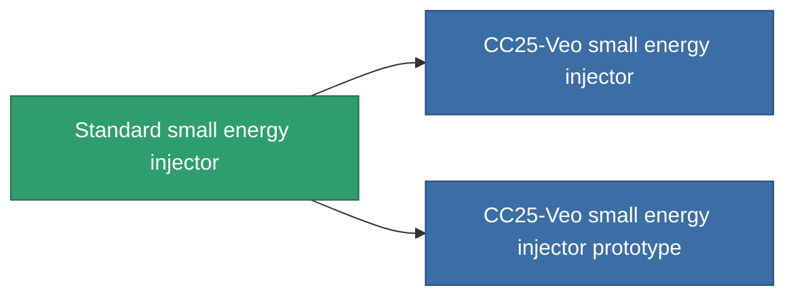

<!-- Generated by tools/generate from the live database (source: entitydefaults definition 648, aggregatevalues via aggregatefields).
     Do not edit by hand; regenerate instead. -->

# Standard small energy injector

|  |  |
|---|---|
| Определение | `def_standard_small_core_booster` |
| Тир | T1 |
| Прочность | 100 |
| Объём | 0.5 |
| Масса | 100 |
| Категория | Modules / Enhancements |
| Tier line | **Standard small energy injector** (T1) → [CC25-Veo small energy injector](/ru/content/items/named1-small-core-booster/) (T2) → [Joffret-Refiller small energy injector](/ru/content/items/named2-small-core-booster/) (T3) → [Cerepter I. small energy injector](/ru/content/items/named3-small-core-booster/) (T4) |

## Статистика

| Поле | Значение |
|---|---|
| core_usage | 0 |
| cpu_usage | 20 |
| cycle_time | 20k |
| powergrid_usage | 50 |

<!-- production:generated -->
## Производство

**Производится из 2 компонентах, уровень исследований 2** — соберите компоненты для изготовления (полный список в [Рецепты](/ru/content/recipes/)):

**Чертёж:** [Standard small energy injector CT](/ru/content/items/standard-small-core-booster-cprg/)

<svg class="prod-card-icon" aria-hidden="true"><use href="#mi-grid"/></svg><a class="prod-card-name" href="/ru/content/items/axicol/">Cryoperine</a>

нужно: <b>100</b>

<svg class="prod-card-icon" aria-hidden="true"><use href="#mi-grid"/></svg><a class="prod-card-name" href="/ru/content/items/titanium/">Titanium</a>

нужно: <b>100</b>

## Используется в производстве

**Компонент 2 предметов** — всё, что использует его в производстве:

