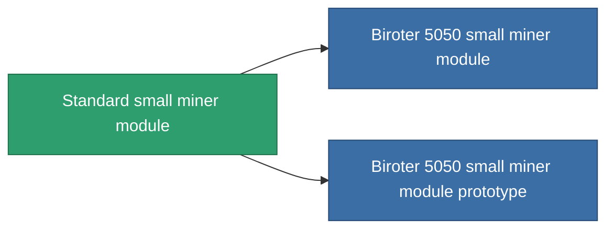

<!-- Generated by tools/generate from the live database (source: entitydefaults definition 53, aggregatevalues via aggregatefields).
     Do not edit by hand; regenerate instead. -->

# Standard small miner module

|  |  |
|---|---|
| Определение | `def_standard_small_driller` |
| Тир | T1 |
| Прочность | 100 |
| Объём | 1 |
| Масса | 400 |
| Категория | Modules / Enhancements |
| Tier line | **Standard small miner module** (T1) → [Biroter 5050 small miner module](/ru/content/items/named1-small-driller/) (T2) → [Sublimator Low-D small miner module](/ru/content/items/named2-small-driller/) (T3) → [Scraper-990 small miner module](/ru/content/items/named3-small-driller/) (T4) |

## Статистика

| Поле | Значение |
|---|---|
| core_usage | 17 |
| cpu_usage | 40 |
| cycle_time | 15.5k |
| optimal_range | 3 |
| powergrid_usage | 30 |

<!-- production:generated -->
## Производство

**Производится из 2 компонентах, уровень исследований 1** — соберите компоненты для изготовления (полный список в [Рецепты](/ru/content/recipes/)):

**Чертёж:** [Standard small miner module CT](/content/items/standard-small-driller-cprg/)

<svg class="prod-card-icon" aria-hidden="true"><use href="#mi-grid"/></svg><a class="prod-card-name" href="/ru/content/items/axicol/">Cryoperine</a>

нужно: <b>50</b>

<svg class="prod-card-icon" aria-hidden="true"><use href="#mi-grid"/></svg><a class="prod-card-name" href="/ru/content/items/titanium/">Titanium</a>

нужно: <b>150</b>

## Используется в производстве

**Компонент 2 предметов** — всё, что использует его в производстве:

