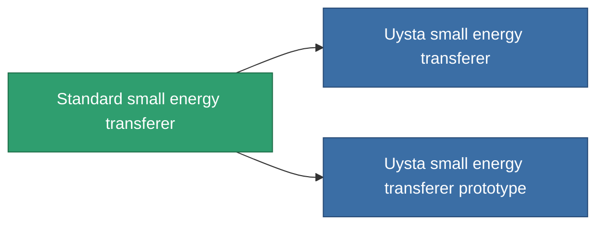

<!-- Generated by tools/generate from the live database (source: entitydefaults definition 32, aggregatevalues via aggregatefields).
     Do not edit by hand; regenerate instead. -->

# Standard small energy transferer

|  |  |
|---|---|
| Определение | `def_standard_small_energy_transfer` |
| Тир | T1 |
| Прочность | 100 |
| Объём | 0.5 |
| Масса | 100 |
| Категория | Modules / Enhancements |
| Tier line | **Standard small energy transferer** (T1) → [Uysta small energy transferer](/ru/content/items/named1-small-energy-transfer/) (T2) → [Bithom small energy transferer](/ru/content/items/named2-small-energy-transfer/) (T3) → [Livostid PT3 small energy transferer](/ru/content/items/named3-small-energy-transfer/) (T4) |
| Примечание | range = optimal_range * 	energy_transferers_optimal_range_modifier    cel core += energy_transfer_amount  sajat core -= energy_transfer_amount - 10% |

## Статистика

| Поле | Значение |
|---|---|
| core_usage | 10 |
| cpu_usage | 35 |
| cycle_time | 10k |
| energy_transfer_amount | 40 |
| falloff | 0 |
| optimal_range | 15 |
| powergrid_usage | 30 |

<!-- production:generated -->
## Производство

**Производится из 2 компонентах, уровень исследований 2** — соберите компоненты для изготовления (полный список в [Рецепты](/ru/content/recipes/)):

**Чертёж:** [Standard small energy transferer CT](/content/items/standard-small-energy-transfer-cprg/)

<svg class="prod-card-icon" aria-hidden="true"><use href="#mi-grid"/></svg><a class="prod-card-name" href="/ru/content/items/axicol/">Cryoperine</a>

нужно: <b>250</b>

<svg class="prod-card-icon" aria-hidden="true"><use href="#mi-grid"/></svg><a class="prod-card-name" href="/ru/content/items/titanium/">Titanium</a>

нужно: <b>100</b>

## Используется в производстве

**Компонент 2 предметов** — всё, что использует его в производстве:

