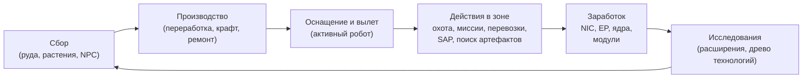

# Что можно делать в игре

Все действия игрока, структурированные по системам. Название команды представляет собой идентификатор на стороне сервера — клиент отображает эти действия в собственном интерфейсе. Подробное описание каждого действия приведено на страницах соответствующих систем.

Игровой процесс в рамках одного цикла: зарабатывайте и тратьте ресурсы, продвигаясь вверх по тирам развития.

## Системы

| Система | Страница | Что охватывает |
|---|---|---|
| Начало игры | [getting-started](/ru/features/getting-started/) | создание/выбор персонажей, первый робот, основы аккаунта |
| Перемещение | [movement](/ru/features/movement/) | зоны, стыковка, очередь, телепорты, искровые прыжки, врата |
| Сбор ресурсов | [gathering](/ru/features/gathering/) | сканирование, сбор урожая, добыча ресурсов |
| Бой | [combat](/ru/features/combat/) | сражения, типы урона, помехи, тревоги, боевые отчеты, SOS |
| NPC и PVE-охота | [npcs](/ru/features/npcs/) | ранги и фракции NPC, уязвимости, типы спавна, TAP, тактики |
| Исследование мира | [exploration](/ru/features/exploration/) | артефакты и реликвии |
| Роботы и оснащение | [robots](/ru/features/robots/) | выбор роботов, модулей, боеприпасов, пресетов, покраска |
| Модули и оснащение | [modules](/ru/features/modules/) | семейства модулей и практические правила фитинга |
| Искры (Sparks) | [sparks](/ru/features/sparks/) | авторизация искр, переключение, бонусы к способностям |
| Исследования | [research](/ru/features/research/) | расширения (древо навыков), EP, древо технологий |
| Персонаж | [character](/ru/features/character/) | окно персонажа: вкладка расширений (древо навыков) и искры |
| Производство | [production](/ru/features/production/) | производственные линии, переработка, ремонт, репроцессинг, прототипы, CPRG |
| Рынок и торговля | [market](/ru/features/market/) | рыночные ордера, прямая торговля, магазин предметов, кредиты |
| Группы | [groups](/ru/features/groups/) | корпорации, альянсы, банды (флоты) |
| Опорные базы (PBS) | [pbs](/ru/features/pbs/) | структуры PBS, территории, соединения |
| Миссии | [missions](/ru/features/missions/) | полевые миссии, агенты, терминалы |
| Транспорт | [transport](/ru/features/transport/) | доставка предметов между базами |
| Предметы и инвентарь | [items](/ru/features/items/) | контейнеры, объединение в стопки, названия предметов, погашаемые предметы, наборы подарков |
| Социальные функции | [social](/ru/features/social/) | почта, каналы, друзья, отношения (стендинги), «жёлтые страницы», новости, опросы |
| Вторжение (Intrusion) | [intrusion](/ru/features/intrusion/) | режим штурма баз NPC |
| Аванпосты и SAP | [outposts](/ru/features/outposts/) | владение аванпостами, стабильность, четыре типа SAP |
| Зонды слежения | [probes](/ru/features/probes/) | зонды наблюдения за зоной |
| Сервер и справка | [server](/ru/features/server/) | информация о сервере, рекорды, справочные данные, покупки |
| FAQ | [faq](/ru/features/faq/) | обучение, выбор фракции, первые шаги, игровой сленг |
| Лор | [lore](/ru/features/lore/) | сеттинг: Ния, нианцы, Синдикат |
| Настройка клиента и ПК | [client-setup](/ru/features/client-setup/) | запуск клиента, игра в несколько окон, масштабирование интерфейса |

### Справочные материалы

| Страница | Что охватывает |
|---|---|
| [Обзор интерфейса клиента](/ru/features/ui/) | Интерфейс в стиле EVE: верхняя панель, кнопка вылета/стыковки, категории действий, панель статуса вне базы и соглашения, принятые в этой вики |

Таблицы характеристик сущностей находятся в автоматически формируемом разделе [Content](/content/).

## Полный список действий

### Начало игры и аккаунт

| Действие | Команда |
|---|---|
| Создать персонажа | `characterCreate` |
| Выбрать персонажа (войти в игру) | `characterSelect` |
| Удалить персонажа | `characterDelete` |
| Переименовать персонажа | `characterRename` |
| Проверить доступность имени | `characterCheckNick` |
| Запросить стартового робота | `requestStarterRobot` |
| Запросить стартовый контейнер | `requestInfiniteBox` |
| Данные мастера создания нового персонажа | `characterWizardData` |
| Просмотреть свой профиль | `characterGetMyProfile` |
| Просмотреть профили других персонажей | `characterGetProfiles` |
| Поиск персонажей | `characterSearch` |
| Список персонажей | `characterList` |
| Получить/задать настройки персонажа | `characterSettingsGet`, `characterSettingsSet` |
| Установить аватар | `characterSetAvatar` |
| Установить статусное сообщение | `characterSetMoodmessage` |
| Оставить личную заметку о персонаже | `characterSetNote` / `characterGetNote` |
| Установить / сбросить домашнюю базу | `characterSetHomeBase`, `characterClearHomeBase` |
| Перевести кредиты между своими персонажами | `characterTransferCredit` |
| Заблокировать/разрешить торговлю для персонажа | `characterSetBlockTrades` |
| Изменить e-mail / пароль учетной записи | `changeSessionEmail`, `changeSessionPassword` |
| Просмотреть историю получения EP за активность | `accountEpForActivityHistory` |
| Просмотреть историю транзакций аккаунта | `accountGetTransactionHistory` |
| Выход из системы / обслуживание соединения | `signOut`, `connectionStart`, `connectionEnd`, `ping`, `quit`, `isOnline`, `transferData`, `welcome` |
| Кто онлайн | `getCharactersOnline`, `getAccountsWithCharacters` |
| Истории персонажа | `characterNickHistory`, `characterCorporationHistory`, `characterTransactionHistory`, `characterListNpcDeath` |

### Перемещение и зоны

| Действие | Команда |
|---|---|
| Состыковаться с базой / PBS | `dock` |
| Вылететь с базы (андок) | `undock` |
| Принудительная стыковка (экстренная) | `forceDock` |
| Проверить очередь на вход в зону | `zoneGetQueueInfo` |
| Задать предпочтительную длину очереди | `zoneSetQueueLength` |
| Отменить ожидание в очереди | `zoneCancelEnterQueue` |
| Получить информацию о зоне | `getZoneInfo` |
| Список секторов зоны | `zoneSectorList` |
| Список построек в зоне | `zoneGetBuildings` |
| Отправить сигнал SOS (запрос о помощи) | `zoneSOS` |
| Список доступных телепортов | `teleportList` |
| Использовать телепорт | `teleportUse` |
| Телепортироваться к объекту зоны | `teleportToZoneObject` |
| Список каналов телепортации | `teleportGetChannelList` |
| Запрос глобальных каналов телепортации | `teleportQueryWorldChannels` |
| Список зарядов искры | `sparkList` |
| Сменить активную искру | `sparkChange` |
| Удалить искру | `sparkRemove` |
| Разблокировать искру | `sparkUnlock` |
| Список / установка / использование / удаление телепортов искры | `sparkTeleportList`, `sparkTeleportSet`, `sparkTeleportUse`, `sparkTeleportDelete` |
| Переименовать врата | `gateSetName` |
| Информация о базе / владелец / услуги / мои предметы на базе | `baseGetInfo`, `baseGetOwnershipInfo`, `baseListFacilities`, `baseGetMyItems` |
| Настроить права на стыковку с базой | `baseSetDockingRights` |

### Сбор ресурсов и сканирование

| Действие | Команда |
|---|---|
| Сканировать зону (поиск руды/растений/развертываемых объектов) | `zoneUploadScanResult` |
| Список моих результатов сканирования минералов | `mineralScanResultList` |
| Создать предмет из результата сканирования | `mineralScanResultCreateItem` |
| Удалить результат сканирования | `mineralScanResultDelete` |
| Переместить результаты сканирования между контейнерами | `mineralScanResultMove` |
| Загрузить данные сканирования из предмета | `mineralScanResultUploadFromItem` |
| Подсчитать предметы в зоне (проверка видимости) | `itemCountOnZone`, `itemCount` |
| Киоск: просмотр / сдача предметов | `kioskInfo`, `kioskSubmitItem` |
| Использовать предмет (общее — включая собираемые ресурсы) | `useItem` |

### Бой

| Действие | Команда |
|---|---|
| Включить / снять боевую тревогу | `alarmStart` (окончание тревоги определяется сервером) |
| Просмотреть мои боевые отчеты (kill reports) | `getMyKillReports` |
| Просмотреть мои рекорды | `getMyHighScores` |
| Просмотреть таблицу рекордов сервера | `getHighScores` |

### Роботы и оснащение

| Действие | Команда |
|---|---|
| Выбрать активного робота | `selectActiveRobot` |
| Опустошить робота (снять всё) | `robotEmpty` |
| Получить информацию о роботе | `getRobotInfo` |
| Получить информацию об оснащении робота | `getRobotFittingInfo` |
| Установить модуль | `equipModule` |
| Снять модуль | `removeModule` |
| Заменить модуль | `changeModule` |
| Зарядить боеприпасы | `equipAmmo` |
| Сменить боеприпасы | `changeAmmo` |
| Разрядить боеприпасы | `unEquipAmmo` |
| Настроить цвет робота | `setRobotTint` |
| Сохранить / показать список / применить / удалить пресеты оснащения | `fittingPresetSave`, `fittingPresetList`, `fittingPresetApply`, `fittingPresetDelete` |

### Исследования (расширения и древо технологий)

| Действие | Команда |
|---|---|
| Список категорий расширений | `extensionCategoryList` |
| Получить все расширения | `extensionGetAll` |
| Список изученных расширений | `extensionLearntList` |
| Список предварительных требований | `extensionPrerequireList` |
| Купить расширение за очки | `extensionBuyForPoints` |
| Купить буст очков расширения (EP boost) | `extensionBuyEpBoost` |
| Получить доступные очки | `extensionGetAvailablePoints` |
| Получить параметры очков | `extensionGetPointParameters` |
| История расширений | `extensionHistory` |
| Сбросить один уровень расширения | `extensionRemoveLevel` |
| Полный сброс расширений персонажа | `extensionResetCharacter` |
| Разблокировать заблокированные EP | `extensionFreeLockedEp` |
| Просмотреть ежедневный журнал EP за активность | `epForActivityDailyLog` |
| Получить уровни исследований | `getResearchLevels` |
| Древо технологий: исследовать узел | `techTreeResearch` |
| Древо технологий: разблокировать узел | `techTreeUnlock` |
| Древо технологий: внести вклад (пожертвование) | `techTreeDonate` |
| Древо технологий: информация / журналы | `techTreeInfo`, `techTreeGetLogs` |

### Производство

| Действие | Команда |
|---|---|
| Список производственных линий | `productionLineList` |
| Запустить линию | `productionLineStart` |
| Калибровать линию | `productionLineCalibrate` |
| Задать количество циклов линии | `productionLineSetRounds` |
| Удалить линию | `productionLineDelete` |
| Запросить следующий цикл линии | `productionQueryLineNextRound` |
| Отменить производство | `productionCancel` |
| Переработка сырья (запрос + выполнение) | `productionRefine`, `productionRefineQuery` |
| Ремонт (запрос + выполнение) | `productionRepair`, `productionRepairQuery` |
| Репроцессинг (запрос + выполнение) | `productionReprocess`, `productionReprocessQuery` |
| Исследование компонентов (запрос + выполнение) | `productionResearch`, `productionResearchQuery` |
| Создание прототипа (запуск + запрос) | `productionPrototypeStart`, `productionPrototypeQuery` |
| Объединение исследовательских наборов (выполнение + запрос) | `productionMergeResearchKitsMulti`, `productionMergeResearchKitsMultiQuery` |
| Ковка CPRG (выполнение + запрос) | `productionCPRGForge`, `productionCPRGForgeQuery` |
| Информация о CPRG | `productionCPRGInfo` |
| Забрать CPRG с линии (получение + запрос) | `productionGetCPRGFromLine`, `productionGetCPRGFromLineQuery` |
| Страхование производства: покупка / список / запрос / удаление | `productionInsuranceBuy`, `productionInsuranceList`, `productionInsuranceQuery`, `productionInsuranceDelete` |
| Список производственных компонентов | `productionComponentsList` |
| Информация об объекте производства / описание | `productionFacilityInfo`, `productionFacilityDescription` |
| Текущие процессы (мои / корпорации) | `productionInProgress`, `productionInProgressCorporation` |
| История производства | `productionHistory` |
| Информация о производственном сервере | `productionServerInfo` |

### Рынок и торговля

| Действие | Команда |
|---|---|
| Создать ордер на продажу | `marketCreateSellOrder` |
| Создать ордер на покупку | `marketCreateBuyOrder` |
| Изменить ордер | `marketModifyOrder` |
| Отменить предмет / ордер | `marketCancelItem` |
| Купить предмет напрямую | `marketBuyItem` |
| Список товаров на рынке | `marketItemList` |
| Список доступных мне товаров | `marketAvailableItems` |
| Список товаров в заданном диапазоне | `marketItemsInRange` |
| Список моих товаров на рынке | `marketGetMyItems` |
| Информация о рынке | `marketGetInfo` |
| Средние цены (рыночная / по определению / глобальная) | `marketGetAveragePrices`, `marketGetDefinitionAveragePrice`, `marketGlobalAveragePrices` |
| Изменить налог рынка / просмотреть журнал налогов | `marketTaxChange`, `marketTaxLogList` |
| Начать торговлю | `tradeBegin` |
| Предложить / отозвать свое предложение | `tradeSetOffer`, `tradeRetractOffer` |
| Принять обмен | `tradeAccept` |
| Отменить торговлю | `tradeCancel` |
| Торговля завершена / статус сделки | `tradeFinished`, `tradeState` |
| Магазин предметов: список / покупка | `itemShopList`, `itemShopBuy` |
| Перевести кредиты другому персонажу | `characterTransferCredit` |

### Группы (корпорации, альянсы, банды)

| Действие | Команда |
|---|---|
| Создать корпорацию | `corporationCreate` |
| Подать заявку / пригласить в корпорацию | `corporationApply`, `corporationCharacterInvite` |
| Принять заявку / список заявок | `corporationAcceptApplication`, `corporationListApplications` |
| Мои заявки: список / удаление | `corporationListMyApplications`, `corporationDeleteMyApplication` |
| Удалить заявку (для офицеров) | `corporationDeleteApplication` |
| Ответить на приглашение | `corporationInviteReply` |
| Покинуть корпорацию / отменить выход | `corporationLeave`, `corporationCancelLeave` |
| Исключить участника / назначить роль участнику | `corporationRemoveMember`, `corporationSetMemberRole` |
| Снять с себя все роли | `corporationDropRoles` |
| Сделать участников нейтральными | `corporationSetMembersNeutral` |
| Информация о корпорации / мои данные / поиск | `corporationInfo`, `corporationGetMyInfo`, `corporationSearch` |
| Отношения корпорации / репутация | `corporationGetMyStandings`, `corporationGetReputation` |
| Внести пожертвование / выплатить средства из корпорации | `corporationDonate`, `corporationPayOut` |
| Перевести кредиты корпорации | `corporationTransfer` |
| Переименовать / задать цвет / изменить описание | `corporationRename`, `corporationSetColor`, `corporationSetInfo` |
| Получить список делегатов | `corporationGetDelegates` |
| Статус смены CEO / выдвинуть кандидатуру на пост CEO | `corporationCEOTakeOverStatus`, `corporationVolunteerForCEO` |
| Голосования корпорации: запустить / задать тему / список / проголосовать / удалить | `corporationVoteStart`, `corporationVoteSetTopic`, `corporationVoteList`, `corporationVoteCast`, `corporationVoteDelete` |
| Доска объявлений: инициализировать / список / новые записи / опубликовать / модерировать / удалить | `corporationBulletinStart`, `corporationBulletinList`, `corporationBulletinNewEntries`, `corporationBulletinEntry`, `corporationBulletinModerate`, `corporationBulletinDelete`, `corporationBulletinEntryDelete`, `corporationBulletinDetails` |
| Ангар: арендовать / оплатить аренду / стоимость аренды / закрыть | `corporationRentHangar`, `corporationHangarPayRent`, `corporationHangarRentPrice`, `corporationHangarClose` |
| Ангар: список (все / на базе) | `corporationHangarListAll`, `corporationHangarListOnBase` |
| Ангар: папки (создать / удалить) | `corporationHangarFolderCreate`, `corporationHangarFolderDelete` |
| Ангар: настроить доступ / задать имя | `corporationHangarSetAccess`, `corporationHangarSetName` |
| Журналы ангара: список / запись / очистка | `corporationHangarLogList`, `corporationHangarLogSet`, `corporationHangarLogClear` |
| Документы корпорации: настройка / создание / список / открытие / удаление / передача / аренда / отслеживание / отмена отслеживания / обновление текста / список реестра / установка реестра | `corporationDocumentConfig`, `corporationDocumentCreate`, `corporationDocumentList`, `corporationDocumentOpen`, `corporationDocumentDelete`, `corporationDocumentTransfer`, `corporationDocumentRent`, `corporationDocumentMonitor`, `corporationDocumentUnmonitor`, `corporationDocumentUpdateBody`, `corporationDocumentRegisterList`, `corporationDocumentRegisterSet` |
| Истории изменений: общий журнал / роли участников / роли корпорации / роли / смена названий / транзакции | `corporationLogHistory`, `corporationMemberRoleHistory`, `corporationRoleHistory`, `corporationNameHistory`, `corporationTransactionHistory` |
| Информация об альянсе / настройки по умолчанию / история ролей | `allianceGetMyInfo`, `allianceGetDefaults`, `allianceRoleHistory` |
| Банда (флот): создать / расформировать / информация | `gangCreate`, `gangDelete`, `gangInfo` |
| Банда: пригласить / ответить / выгнать / покинуть | `gangInvite`, `gangInviteReply`, `gangKick`, `gangLeave` |
| Банда: назначить лидера / задать роль | `gangSetLeader`, `gangSetRole` |

### Опорные базы (PBS) и территории

| Действие | Команда |
|---|---|
| Получить структуру сети PBS | `PBSGetNetwork` |
| Информация об узле PBS | `PBSNodeInfo` |
| Переименовать узел PBS | `PBSRenameNode` |
| Установить / разорвать соединение PBS | `PBSMakeConnection`, `PBSBreakConnection` |
| Задать вес соединения | `PBSSetConnectionWeight` |
| Перевести PBS в активный режим (онлайн) | `PBSSetOnline` |
| Настроить эффект PBS | `PBSSetEffect` |
| Проверить возможность развертывания (можно ли установить здесь?) | `PBSCheckDeployment` |
| Список моих территорий | `PBSGetTerritories` |
| Настроить видимость территории | `PBSSetTerritoryVisibility` |
| Установить лимит отношений (стендинга) | `PBSSetStandingLimit` |
| Задать смещение времени выхода из режима укрепления (reinforce) | `PBSSetReinforceOffset` |
| Получить / задать данные компенсации | `PBSGetReimburseInfo`, `PBSSetReimburseInfo` |
| Загрузить ресурсы в PBS | `PBSFeedableInfo`, `PBSFeedItems` |
| Запустить демонтаж базы | `PBSSetBaseDeconstruct` |
| Журналы PBS | `PBSGetLog` |

### Миссии

| Действие | Команда |
|---|---|
| Начать миссию | `missionStart` |
| Начать миссию из зоны | `missionStartFromZone` |
| Прервать миссию | `missionAbort` |
| Сдать миссию (доставка) | `missionDeliver` |
| Данные миссии / варианты / снабжение | `missionData`, `missionGetOptions`, `missionGetSupply` |
| Список агентов миссий | `missionListAgents` |
| Список моих активных миссий | `missionListRunning` |
| Журнал миссий | `missionLogList` |
| Добавить участника в миссию | `missionPlayerAddsParticipant` |
| Информация о полевом терминале | `fieldTerminalInfo` |

### Транспорт (доставка предметов)

| Действие | Команда |
|---|---|
| Создать контракт на перевозку | `transportAssignmentSubmit` |
| Взять контракт на перевозку (в роли курьера) | `transportAssignmentTake` |
| Список перевозок | `transportAssignmentList` |
| Просмотреть содержимое перевозки | `transportAssignmentListContent` |
| Информация о контейнере груза | `transportAssignmentContainerInfo` |
| Завершить доставку | `transportAssignmentDeliver` |
| Забрать свой доставленный груз | `transportAssignmentRetrieve` |
| Отменить перевозку / отказаться от контракта | `transportAssignmentCancel`, `transportAssignmentGiveUp` |
| Выполняется ли перевозка? | `transportAssignmentRunning` |
| Журнал перевозок | `transportAssignmentLog` |

### Предметы и инвентарь

| Действие | Команда |
|---|---|
| Просмотреть содержимое контейнера | `listContainer` |
| Упаковать предметы (в сумку/ящик) | `packItems` |
| Распаковать предметы | `unpackItems` |
| Объединить предметы в стопку | `stackItems`, `stackTo`, `stackSelection` |
| Разделить стопку на указанное количество | `unStackAmount` |
| Переместить предметы между контейнерами | `relocateItems` |
| Выбросить/уничтожить предметы | `trashItems` |
| Переименовать предмет | `setItemName` |
| Использовать предмет | `useItem` |
| Использовать лотерейный предмет | `useLotteryItem` |
| Погашаемые предметы: список / погасить / активировать | `redeemableItemList`, `redeemableItemRedeem`, `redeemableItemActivate` |
| Подарочные наборы: список / забрать | `goodiePackList`, `goodiePackRedeem` |
| Открыть подарок | `giftOpen` |
| Запросить компенсацию предмета | `ReimburseItem` |

### Социальные функции

| Действие | Команда |
|---|---|
| Почта: список / открыть / отправить / удалить / счетчик новых / используемые папки / переместить в папку / удалить папку | `mailList`, `mailOpen`, `mailSend`, `mailDelete`, `mailNewCount`, `mailUsedFolders`, `mailMoveToFolder`, `mailDeleteFolder` |
| Массовая рассылка (корпорация): отправить / список / открыть / удалить / счетчик новых | `massMailSend`, `massMailList`, `massMailOpen`, `massMailDelete`, `massMailNewCount` |
| Друзья: отправить запрос / ответить / подтвердить / удалить / заблокировать / список | `socialFriendRequest`, `socialFriendRequestReply`, `socialConfirmPendingFriendRequest`, `socialDeleteFriend`, `socialBlockFriend`, `socialGetMyList` |
| Каналы чата: создать / войти / покинуть / отправить сообщение | `channelCreate`, `channelJoin`, `channelLeave`, `channelTalk` |
| Каналы: список (все / мои) | `channelList`, `channelMyList`, `channelListAll` |
| Каналы: выгнать / забанить / разбанить / роли / заглушить / пароль / тема / оповещение | `channelKick`, `channelBan`, `channelRemoveBan`, `channelModifyMemberRole`, `channelGlobalMute`, `channelGetMutedCharacters`, `channelGetBannedMembers`, `channelSetPassword`, `channelSetTopic`, `channelNotification` |
| Личный чат | `chat` |
| Отношения (стендинги): список / история | `standingList`, `standingHistory` |
| Установить стендинг (где разрешено) | `setStanding` |
| Стандартные стендинги (альянсы / корпорации) | `getStandingForDefaultAlliances`, `getStandingForDefaultCorporations` |
| «Жёлтые страницы»: просмотр / добавить / удалить / поиск | `yellowPagesGet`, `yellowPagesSubmit`, `yellowPagesDelete`, `yellowPagesSearch` |
| Новости: категории / список / количество свежих | `newsCategory`, `getNews`, `freshNewsCount` |
| Опросы: просмотр / ответить | `pollGet`, `pollAnswer` |

### Вторжение (Intrusion)

| Действие | Команда |
|---|---|
| Сдать предмет SAP | `intrusionSAPSubmitItem` |
| Получить информацию о предмете SAP | `intrusionSAPGetItemInfo`, `intrusionSAPItemInfo` |
| Задать порог защиты | `intrusionSetDefenseThreshold` |
| Задать бонус эффекта комплекса | `intrusionSiteSetEffectBonus` |
| Улучшить сооружение | `intrusionUpgradeFacility` |
| Информация о комплексе | `getIntrusionSiteInfo` |
| Журналы: личные / публичные / моих комплексов / стабильности | `getIntrusionLog`, `getIntrusionPublicLog`, `getIntrusionMySitesLog`, `getIntrusionStabilityLog` |
| Пороговые значения бонуса стабильности | `getStabilityBonusThresholds` |
| Установить сообщение комплекса | `setIntrusionSiteMessage` |

### Зонды слежения

| Действие | Команда |
|---|---|
| Список моих зондов | `proximityProbeList` |
| Информация о регистрации зонда | `proximityProbeGetRegistrationInfo` |
| Настроить регистрацию зонда | `proximityProbeRegisterSet` |
| Удалить регистрацию зонда | `proximityProbeRemove` |
| Дать имя зонду | `proximityProbeSetName` |

### Сервер и справка

| Действие | Команда |
|---|---|
| Информация о сервере | `serverInfoGet`, `systemInfo` |
| Рекорды (сервера / личные) | `getHighScores`, `getMyHighScores` |
| Список рифтов | `getRifts` |
| Справочные данные: эффекты / перечисления / значения сущностей по умолчанию / агрегированные поля / настройки определений / расстояния | `getEffects`, `getEnums`, `getEntityDefaults`, `getAggregateFields`, `getDefinitionConfigUnits`, `getDistances` |
| Сводка предметов (справочные данные клиента) | `getItemSummary` |
| Список команд сервера (клиентский справочник) | `getCommands` |
| Магазин: список товаров / начать / завершить транзакцию | `steamGetProducts`, `steamStartTransaction`, `steamFinishTransaction` |