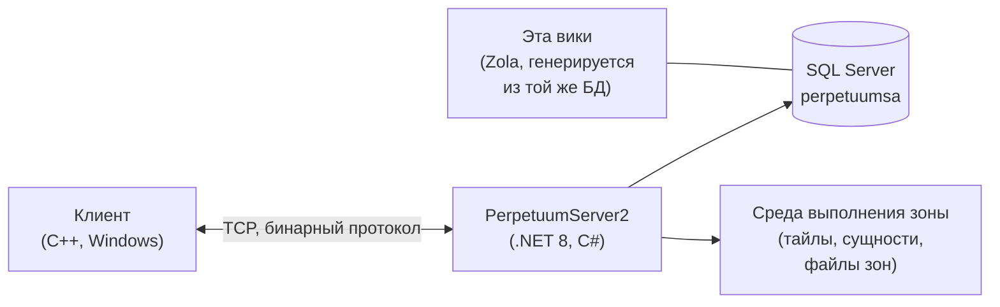

# Раздел разработчика

Высокоуровневая схема устройства игры с точки зрения разработчика и DevOps.
Подробные руководства находятся в разработке — пока здесь представлена вводная информация.

## Основные компоненты

- **Клиент** — игровой клиент Perpetuum (Windows; инструкции по запуску, включая Linux, см. в разделе [Установка клиента и настройка ПК](/ru/features/client-setup/)). Он взаимодействует с сервером по бинарному протоколу TCP; каждое действие игрока представляет собой именованную *команду* (эти же имена используются на вики в [списке действий](/ru/features/#complete-action-inventory)).
- **Сервер (PerpetuumServer2)** — кодовая база на C#/.NET 8. Один процесс выполняет всю работу сервера: уровень сетевых подключений, игровую логику (роботы, зоны, миссии, рынок, производство, исследования), а также среду выполнения зон, которая обновляет тайловый мир каждой зоны (ландшафт, сущности, телепорты).
- **База данных** — SQL Server, база данных `perpetuumsa`. Статический игровой контент (параметры сущностей по умолчанию, рецепты, модули/расширения, дерево технологий, магазин, описания телепортов) и всё динамическое состояние (персонажи, роботы, контейнеры, рынок, состояние зон).
- **Файлы зон** — зоны представляют собой сетки тайлов (слои высот и слои управления, 2 байта на тайл), упакованные в архивы `.gbf` и доступные для редактирования отдельно по зонам; см. [формат файлов зон](/ru/formats/zone-files/).
- **Справочные данные** — при запуске клиент загружает с сервера таблицы характеристик (см. раздел [Сервер и справочные данные](/ru/features/server/)).

## Запуск

- Сервер запускается в Docker Compose вместе с SQL Server (проект `perpetuumserver2`); генератор этой вики считывает данные именно из контейнера БД.
- Статический контент проверяется по файлам правил **plantrules**; C#-генератор вики (`make generate`) работает в той же экосистеме и читает ту же базу данных, поэтому каждая сгенерированная таблица на этом сайте отражает актуальные данные сервера.
- Карты телепортов зон на этой вики отрисовываются из тех же слоёв высот, которые использует сама игра.

## Что изучить дальше

- **[Форматы](/ru/formats/)** — справочник полей для разработчиков: как каждое поле характеристик хранится (колонка БД, ключ в файле правил, байт в бинарном слое) и используется, с практическими примерами.
- **[Сервер и справочные данные](/ru/features/server/)** — мета-системы: информация о сервере, рекорды, справочные данные, загружаемые клиентом, и внутриигровой магазин.

> Планируются дополнительные страницы для разработчиков (протокол, жизненный цикл зон, развертывание) — эта страница служит отправной точкой для них.
