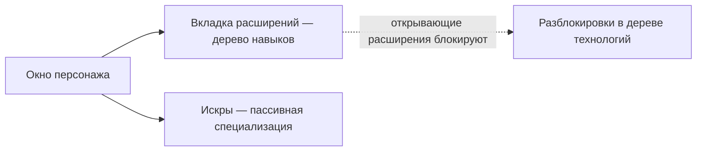

# Персонаж

**Окно персонажа** (верхняя панель → **Персонаж**, сверху слева) — это место, где сосредоточено развитие вашего персонажа: профиль, кредиты, **расширения** (навыки) и настройки. Всё на этой странице привязано к конкретному персонажу — на аккаунте может быть несколько персонажей, каждый со своим собственным деревом. Расположение элементов интерфейса описано в [обзоре интерфейса клиента](/ru/features/ui/).

## Расширения

**Вкладка расширений** — это дерево навыков персонажа: индивидуальные уровни навыков персонажа, которые открывают игровой процесс и настраивают характеристики, а главное — **открывающие расширения**, необходимые для пилотирования того или иного класса роботов. 1-й уровень стоит кредиты, каждый последующий уровень требует очков расширений (EP), а предварительные требования определяют доступный путь прокачки.

- [Основные категории](/content/extensions/#categories) — краткий обзор 15 категорий: какие категории открывают другие (нажмите на блок, чтобы перейти к его карточкам)
- [Расширения по категориям](/content/extensions/#table) — все расширения: ранг, цена, бонус, предварительные требования
- Как работают EP и дерево технологий: [Исследования](/ru/features/research/)

## Искры

Ваша **искра** — это специализация наноботов, установленная на персонажа. Пока она активна, её бонусы распространяются на каждого пилотируемого вами робота. Смена искр стоит ресурсов; для доступа к более высоким уровням требуется авторизация. Подробности в разделе [Искры](/ru/features/sparks/).