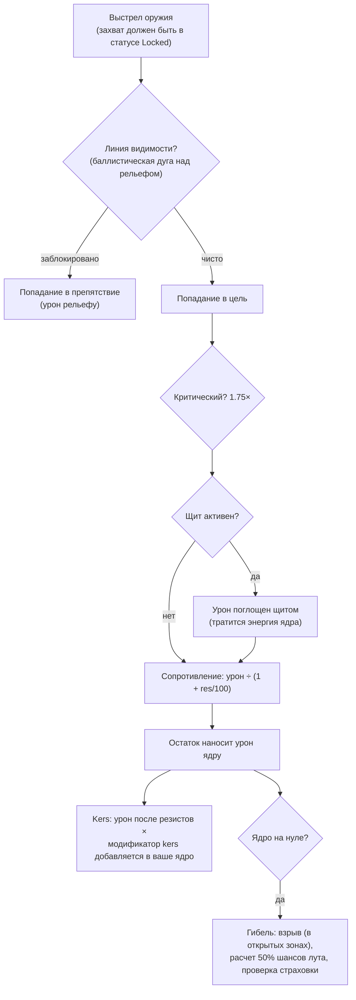

# Бой

Бои происходят **в зонах** с участием вашего активного робота. Вы сражаетесь с другими игроками (PvP),
NPC и враждебными структурами. На этой странице описаны механики, подтвержденные на
стороне сервера; подробное взаимодействие урона и оснащения (фиттинга) описано в разделе [роботы и оснащение](/ru/features/robots/).

> Элементы интерфейса соответствуют [обзору интерфейса клиента](/ru/features/ui/): **щит, броня, корпус и
> энергия** вашего робота отображаются на панели статуса вне дока. Захват целей в бою и управление
> оружием пока подробно не задокументированы.

## Вступление в бой

- Сражаться можно только **вне дока** — вы управляете своим активным роботом.
- Стрельба из атакующего оружия по другому игроку в открытой (PvP) зоне активирует
  **PvP-флаг** на атакующем. Ответный огонь или использование вспомогательного модуля на
  игроке с уже активным флагом также вешает флаг и на вас. Флаг длится **5 минут**
  (определение `effect_pvp`, 300 000 мс) и обновляется при каждом новом акте
  агрессии.
- Пока флаг активен:
  - вы **не можете использовать телепорты** (включая мобильные), и
  - вы **не можете состыковаться с базой обычным способом** — единственный путь спасения — **принудительный док (force dock)**, действие которого
    намеренно не блокируется флагом.

## Против кого можно сражаться

- **Роботы других игроков** (PvP).
- **NPC** — зональные NPC организованы в **стаи (flocks)** (группы с общим поведением).
- **Враждебные структуры / развертываемые объекты** в зоне.

## Уничтожение вашего робота

Ваш робот **уничтожается**, а на месте его гибели появляется **контейнер с добычей (лутом)**. Выпадение лута
рассчитывается для каждого предмета отдельно с шансом 50%:

| Что | Судьба |
|---|---|
| Каждый установленный **модуль** | Шанс 50% выпасть **поврежденным** (подлежит ремонту); иначе уничтожается |
| Заряженные **боеприпасы** каждого модуля | Шанс 50% выпасть (только если выпал сам модуль) |
| **Груз** (контейнеры/ящики) | Содержимое выпадает в виде лута, сам контейнер уничтожается |
| Другие **складируемые предметы** в трюме | Шанс 50% выпасть со случайно уменьшенным количеством (остаток уничтожается) |
| Ваша **покраска/оттенок** | Шанс 50% выпасть в виде предмета покраски |
| Сам **робот** | Уничтожается — если только на него не была оформлена активная **страховка**, в этом случае вам выплачивается компенсация в кредитах (робот все равно теряется) |

**Страховка** (приобретается в страховом отделе базы при стыковке — см.
[производство → страхование](/ru/features/production/)) покрывает робота на **15 дней** (плюс
бонусные дни от расширений). У каждого робота есть заданные контентом **взнос** и **выплата** (таблица
`insuranceprices` — 67 определений роботов); взнос может быть снижен бонусом расширения
и оплачен со счета корпорации. Начальные роботы не могут быть застрахованы. Вы можете одновременно
держать страховку на 1 + (бонус расширения) роботов.

После гибели вы остаетесь **без активного робота**. Чтобы вернуться в игру, вы можете:

- **выбрать другого робота** в вашем распоряжении, для которого у вас изучены требуемые разрешающие расширения, или
- **запросить начального робота** в доке — однако после гибели действует короткая блокировка:
  **3 минуты, если вас убил игрок, и 1 минута, если NPC**. Если вас уничтожил **NPC**,
  база также автоматически выдает вам **бесплатного начального робота** по возвращении.

## Отступление

Когда бой складывается неудачно:

- **Принудительный док (Force dock)** — аварийный выход. Мгновенно выводит вас из зоны и стыкует с
  главной базой (TMA) даже посреди боя.
- **SOS** — альтернативный выход: стыкует вас с текущей базой после стандартной
  задержки выхода из дока (7 секунд).

Оба варианта служат вашей страховкой; force dock — это кнопка «я сейчас погибну».

## Захват цели, дистанция и попадание

- **Сначала захват.** Оружие стреляет только по *захваченным* целям — и только после того, как процесс
  захвата завершился. Захват цели занимает время согласно параметру робота **время захвата (locking time)**
  (значение в мс); выстрел во время процесса захвата отклоняется. Вы можете удерживать несколько целей
  одновременно (ограничено параметром **максимум захваченных целей**), но только одна из них является *основной*,
  а некоторые виды оружия стреляют только по основной цели.
- **Оптимальная дальность + спад (falloff).** В пределах **оптимальной дальности** оружия вы наносите полный
  урон. За ее пределами урон плавно снижается на протяжении дистанции **спада (falloff)** —
  примерно половинный урон на середине зоны спада и нулевой на ее дальней границе. За пределами
  суммы оптимальной дальности и спада урон не наносится вовсе.
- **Размер поражения против размера цели.** Огнестрельные орудия не «промахиваются»: показатель **точности**
  орудия работает как радиус поражения, и цель, чья **сигнатура** меньше него,
  получает пропорционально меньше урона. Ракеты *могут* промахнуться полностью (шанс промаха
  зависит от показателя меткости ракет робота), но при попадании они взрываются
  с определенным **радиусом взрыва** — и, как и в случае с орудиями, небольшая цель получает меньшую
  долю взрывного урона.
- **Критические удары.** Для каждого выстрела рассчитывается ваш **шанс критического удара**; крит
  умножает весь урон на 1.75×, а также каждое попадание случайным образом варьируется в пределах ±10%.
- **Линия видимости.** Выстрелы летят по прямой, и рельеф местности, препятствия и
  растения блокируют их. Ракеты летят по дуге и могут огибать низкие укрытия — однако высота
  дуги ограничена, поэтому возвышенности по-прежнему служат преградой.
- **Собственный щит блокирует собственное оружие.** Пока ваш щит активен, ваше
  оружие не может стрелять.

### Типы урона

Боеприпасы определяют урон: у каждого типа боеприпасов есть значения для одного или нескольких типов урона —
как правило, один доминирующий тип плюс небольшой вторичный (ракетные боеприпасы — взрывной
плюс кинетический или химический; кристаллы лазеров — термический плюс химический; снаряды рельсотронов —
кинетический плюс термический). Типы:

| Тип | Примечания |
|---|---|
| **Chemical (Химический)** | Основной компонент огнестрельных и лазерных боеприпасов |
| **Kinetic (Кинетический)** | Боеприпасы рельсотронов, огнестрельного оружия и ракет |
| **Thermal (Термический)** | Лазеры, некоторые боеприпасы огнестрельного оружия |
| **Explosive (Взрывной)** | Ракеты |
| **Toxic (Токсичный)** | Некоторые боеприпасы огнестрельного оружия; наносит урон только растениям и рельефу |
| **Electric (Электрический)** | Специальные эффекты (например, скорчер) — **пробивает щиты** |

Входящий урон снижается по каждому типу за счет **сопротивления (резиста)** цели к этому типу:
сопротивление в 50% снижает урон на 50/(50+100) ≈ 33%. Сопротивления применяются только к тому, что
проходит *сквозь* щит — щит поглощает урон первым за счет энергии ядра:
чем сильнее попадание, тем больше энергии расходуется. Модули **Kers**
позволяют доле определенного типа урона напрямую подпитывать энергию щита даже после
учета сопротивлений. [Адаптивный сплав (Adaptive alloy)](/ru/features/modules/#semeistva-modulei)
перераспределяет ваши сопротивления в пользу того типа урона, который фактически по вам наносится.

## Обнаружение, маскировка и скорость

- **Обнаружение против маскировки.** Вы можете видеть цель на дистанции, которая увеличивается с ростом
  вашего параметра **обнаружения (detection)** и уменьшается с ростом параметра **маскировки (masking)** цели —
  примерно 100 м × обнаружение ÷ маскировка. Юнит, захвативший вас в прицел, всегда
  видим для вас независимо от его маскировки. Модули невидимости (стелс) временно повышают
  вашу маскировку (см. [модули](/ru/features/modules/)); мины вместо этого используют фиксированный
  радиус обнаружения.
- **Блоб (Blob).** Некоторые юниты и структуры излучают поле *блоба*. Пока вы находитесь внутри
  радиуса излучателя, уровень блоба на вашем юните растет; в диапазоне между двумя пороговыми параметрами блоба
  он **увеличивает ваше время захвата цели** (вплоть до 6× от базового значения)
  и **снижает дальность захвата и силу сенсоров** (вплоть до двукратного снижения).
- **Скорость.** Максимальная скорость падает с ростом массы: скорость = базовая × (расчетная масса ÷ фактическая
  масса) — каждая тонна дополнительных модулей, брони и груза делает вас медленнее.
- **Димобилизация («димоб»).** Эффект сетки (webber) снижает максимальную скорость цели.
  Сила воздействия масштабируется в зависимости от параметра **массивности (massiveness)** цели — более тяжелые
  юниты подвергаются димобилизации сильнее, поэтому крупные и медленные цели ощущают ее в наибольшей степени.

## Тревоги

**Тревога** активируется в зоне с помощью **переключателя тревоги (alarm switch)** (структура,
связанная с миссиями). После активации:

- Она длится в течение фиксированного **периода тревоги** (задается миссией; по умолчанию короткий).
- Вы должны **оставаться в пределах радиуса переключателя** на протяжении всего периода — присутствие
  проверяется каждые пару секунд, и отдаление приводит к отмене тревоги.
- Одновременно может быть активна только **одна тревога**.

Тревоги привязаны к контенту миссий — см. [миссии](/ru/features/missions/).

## Отчеты об уничтожении (Kill reports)

История ваших сражений доступна в виде **отчетов об уничтожении**:

- Фильтрация по **временному окну**.
- Фильтрация по **роли**: в качестве **жертвы**, **атакующего** или **убийцы**.

Используйте их для анализа того, как вы погибли или кого уничтожили.

## Таблицы рекордов

- **Рекорды сервера** — лучшие результаты по всему серверу.
- **Мои рекорды** — ваши личные достижения.

## Практические советы

- **Не погибайте по неосторожности** — уничтоженный робот означает простой, пока вы занимаетесь переоснащением или
  повторным запросом.
- **Force dock срабатывает мгновенно** — если силы неравны, немедленно уходите на TMA; переоснаститься можно и позже.
- **PvP блокирует телепорты** — планируйте пути отступления заранее: быстро телепортироваться из боя не выйдет.
- **Тревога — это сигнал** — активная тревога указывает на то, что в этой области в данный момент выполняется событие миссии.

<!--
Developer notes: rewritten 2026 from backend sources; no community-wiki text reused.
Verified against:
- Locking: Zones/Locking/LockHandler.cs (locking time in ms from
  AggregateField.locking_time; MaxLockedTargetsProperty; one primary lock;
  lock states Inprogress -> Locked), Zones/Locking/Locks/Lock.cs,
  Zones/Locking/LockValidator.cs (dead/not-lockable/out-of-range validation);
  ZoneSession.cs (weapons take an existing lock id; firing a weapon whose lock is
  not fully Locked raises LockIsInProgress — there is NO auto-lock on fire).
- Damage: Modules/Weapons/Damage.cs (CalculateDamages: crit = attacker.
  CriticalHitChance, CRITICALHIT_MOD 1.75, random 0.9-1.1; falloff =
  cos(x*PI)/2+0.5 with x=(distance-optimal)/falloff; zero beyond optimal+falloff;
  explosion modifier = target.SignatureRadius/explosionRadius clamped 0..1;
  toxic excluded from unit damage), Modules/Weapons/WeaponAmmo.cs (damage values
  per type live on the ammo: damage_chemical/thermal/kinetic/explosive/toxic;
  firearm adds damage_toxic to plants).
- Weapons: Modules/Weapons/FirearmWeaponModule.cs (CheckAccuracy always false —
  firearms never miss; WithExplosionRadius(Accuracy) — accuracy IS the blast
  radius), Modules/Weapons/MissileWeaponModule.cs (miss when rnd >
  robot.MissileHitChance; missile_miss property), WeaponModule.cs (shield active
  => ShieldIsActive error; LOS check before firing).
- Resistances: Units/Unit.cs GetResistByDamageType = resist/(resist+100);
  Zones/DamageProcessors/DamageProcessor.cs (shield absorbs first, paid from
  core: coreDamage = damage * AbsorbtionModifier; Electric damage penetrates as
  coreDamage; kers = damage * type kers modifier, scaled by
  (sin(core/coreMax*PI)/2)+0.5, added to target core);
  EffectModules/ShieldGeneratorModule.cs (AbsorbtionModifier =
  max(SigRadius/shieldRadius,1)/shieldAbsorbtion).
- Damage types: Modules/Weapons/DamageType.cs — Chemical, Kinetic, Thermal,
  Explosive, Toxic, Electric (no "seismic"; missile damage is Explosive).
  Electric is only produced by ScorcherModule.cs in this backend.
- Detection: Units/Unit.Visibility.cs (IsDetected: range = 100/max(1,
  target.StealthStrength)*max(1, DetectionStrength); locked-on-you always
  visible; mine detection range separate); stealth_strength property includes
  effect_stealth_strength_modifier (stealth modules raise masking).
- Speed: Units/UnitProperties/SpeedMaxProperty.cs (speed_max * Mass/ActualMass;
  dreadnought => 0.05; massiveness/drone/highway effect modifiers).
- Demob: Modules/EffectModules/WebberModule.cs (effect_demobilizer; effect
  property = module value + target.Massiveness, clamped at 1.0 — heavier targets
  get the full effect; longrange webbers additionally require LOS; accuracy
  check via optimal-range modifier).
- Blob: Zones/Blobs/BlobHandler.cs (emitters raise blob level inside
  BlobEmissionRadius; between blob_level_low/high the multiplier scales:
  locking_time modifier -5, i.e. lock time x(1+5*m) — up to 6x base at full blob, max_targeting_range *0.5,
  sensor_strength *0.5).
- LOS: Zones/LineOfSight.cs (raycast vs terrain blocks incl. Plant flag;
  ballistic arc for missiles: max amplitude 16 m over 40 m);
  Zones/Terrains/BlockingFlags.cs (Obstacle/Plant/Decor/Island block).
Corrections vs ingested page: "seismic" damage type does not exist (explosive
does); "firearms lose damage instead of missing" verified (accuracy = explosion
radius); auto-lock on fire NOT in backend (lock must be created and completed
first); "interference" (emission/minimum/peak, emitters, anomaly degradation)
has NO equivalent in this backend — only a comment in Services/RiftSystem/Rift.cs
— section removed; shield "absorbs" is core-energy based, and Electric damage
penetrates it.
Developer files: Zones/Locking/*; Zones/Locks via Zones/Locking/Locks/*;
Modules/Weapons/*.cs; Zones/DamageProcessors/*.cs; Units/Unit.Visibility.cs;
Units/Unit.cs; Units/UnitProperties/SpeedMaxProperty.cs;
Modules/EffectModules/ShieldGeneratorModule.cs, WebberModule.cs,
StealthModule.cs; Modules/ScorcherModule.cs; Zones/Blobs/*.cs;
Zones/LineOfSight.cs; Zones/ZoneSession.cs (lock/fire packet handling).
Previously verified (kept as-is): PvP flag = effect_pvp 300000 ms
(effect_pvp definition), raised by attack/aggro/support (Player.cs
ApplyPvPEffect); blocks teleport + normal dock (CantDockThisState), ForceDock.cs
has no PvP check; death loot 50% rolls (Player.cs OnUnitDeath,
Services/Looting/LootHelper.cs DROP_CHANCE 0.5); insurance (InsuraceFacility.cs,
InsuranceHelper.cs, insuranceprices 67 defs); starter-robot lock 3 min PvP /
1 min NPC; alarms (Zone/AlarmStart.cs, AlarmSwitch.cs); kill reports
(GetMyKillReports.cs); high scores (GetHighScores.cs / GetMyHighScores.cs).
-->